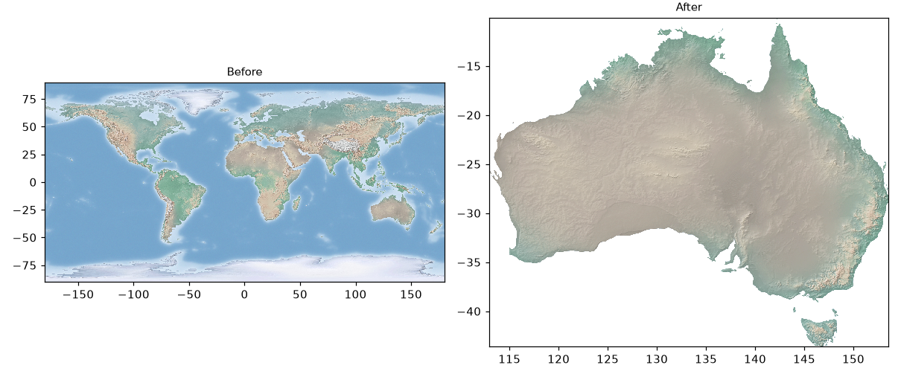
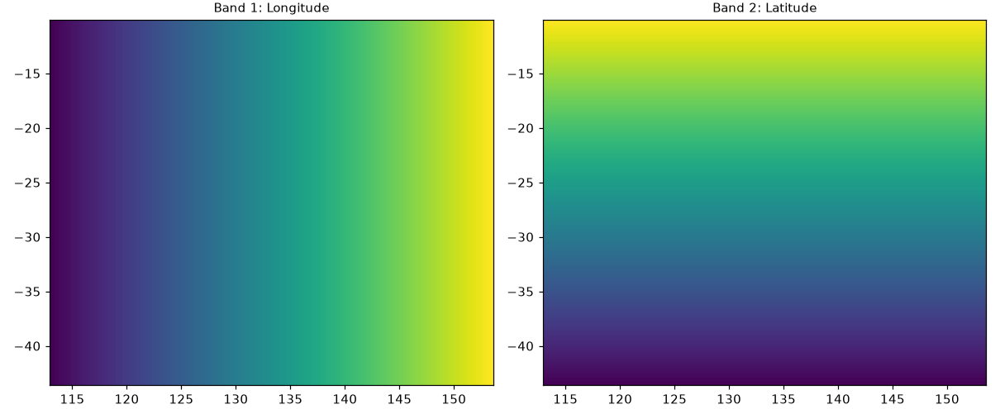
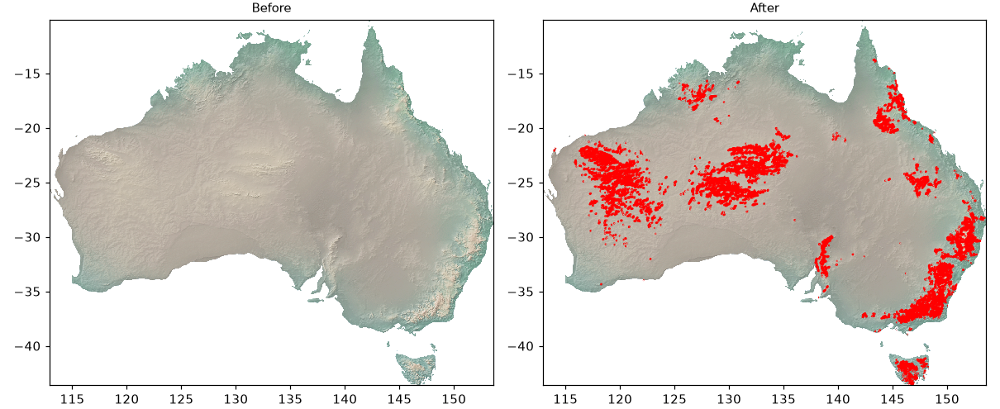
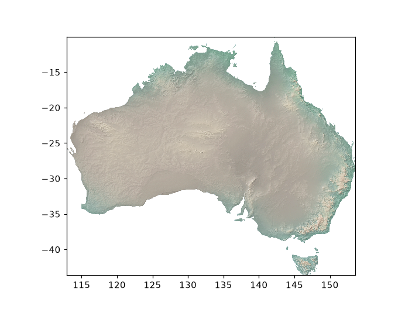
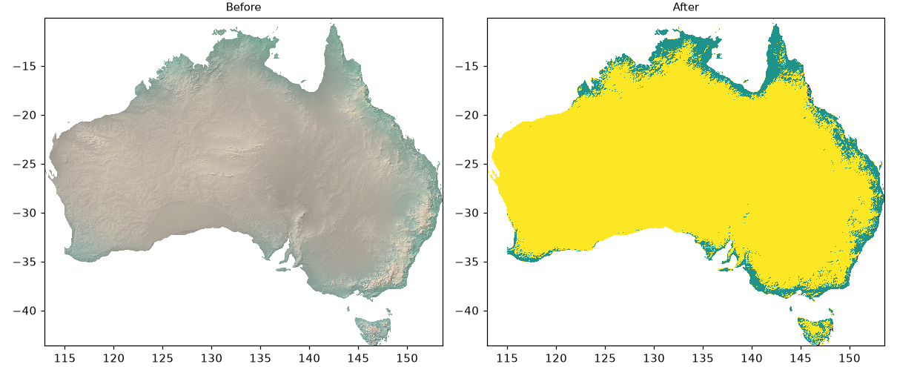
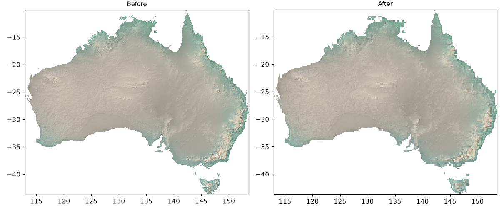
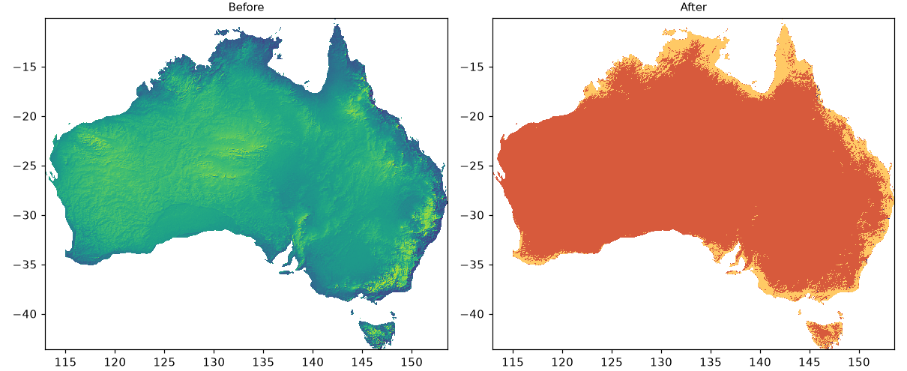
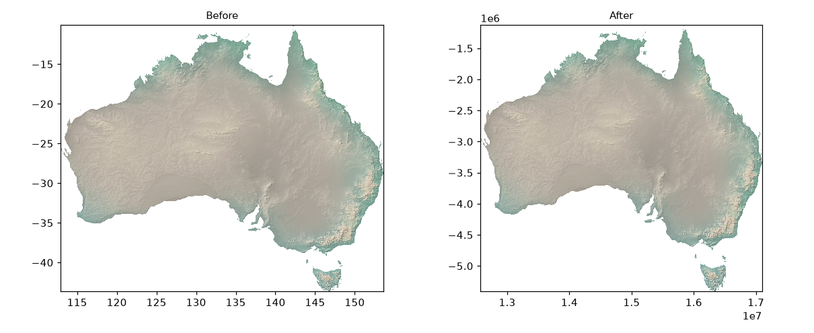
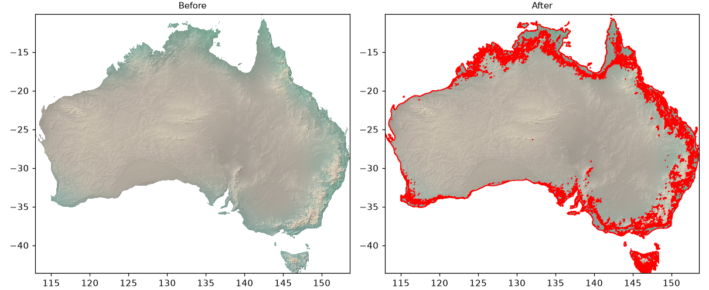

<p style="font-size: 120%;font-weight: bold;">gma.gio.Dataset</p><span style="background-color:#EFF0FC;display: block;line-height:1.6;border-radius: 0.3rem;"><span style="color: gray;font-size:90%;">[class] </span><span style="color: #616AE5; font-weight: bold;font-size: 150%;">Dataset</span><span style="font-style: italic; color: black;font-size: 130%;">(data = <span style="color:#48566B">None</span>, shape = <span style="color:#48566B">None</span>, crs = <span style="color:#48566B">None</span>, geo_transform = <span style="color:#48566B">None</span>, dtype = <span style="color:#48566B">None</span>, nodata = <span style="color:#48566B">None</span>, metadata = <span style="color:#48566B">{}</span>, **kwargs):</span></span>

<p>Create a Dataset object!</p>
<p style="font-size: 120%;color:#9298ED; font-weight: bold;">Optional:</p>
<p style="margin-left: 2em;"><b>data </b> = <code style="text-indent: 0em;">Dataset||ndarray||list||tuple||None</code>. <span style="color:#48566B;"> Default None</span>. </p>
<p style="margin-left: 4em;">Input data source. Can be a Dataset object, or a NumPy ndarray, list, tuple.</p>
<p style="margin-left: 4em;">If data is None, a new Dataset will be created according to the shape parameter.</p>
<p style="margin-left: 2em;"><b>shape </b> = <code style="text-indent: 0em;">tuple||None</code>. <span style="color:#48566B;"> Default None</span>. </p>
<p style="margin-left: 4em;">Shape of the new Dataset. If shape is a 2-tuple, it represents (rows, columns), and the number of bands is 1. If shape is a 3-tuple, it represents (bands, rows, columns).</p>
<p style="margin-left: 4em;">If shape is None, data must be set.</p>
<p style="margin-left: 2em;"><b>crs </b> = <code style="text-indent: 0em;">str||int||None</code>. <span style="color:#48566B;"> Default None</span>. </p>
<p style="margin-left: 4em;">The output coordinate system. Can be EPSG, WKT, Proj4, and other types of coordinate characters. Default(None) no coordinate system!</p>
<p style="margin-left: 2em;"><b>geo_transform </b> = <code style="text-indent: 0em;">tuple||None</code>. <span style="color:#48566B;"> Default None</span>. </p>
<p style="margin-left: 4em;">Geo transformation of the output raster. The affine transformation is not specified by default (None).</p>
<p style="margin-left: 2em;"><b>dtype </b> = <code style="text-indent: 0em;">str||None</code>. <span style="color:#48566B;"> Default None</span>. </p>
<p style="margin-left: 4em;">A code or string tag for the output raster data type.</p>
<p style="margin-left: 4em;">Supported data types include:</p>
<p style="margin-left: 6em;">'Unknown', 'Byte', 'UInt16', 'Int16', 'UInt32', 'Int32','Float32', 'Float64', 'CInt16', 'CInt32', 'CFloat32', 'CFloat64', ...</p>
<p style="margin-left: 4em;">For more, see const.RaDT_*.</p>
<p style="margin-left: 4em;">If dtype is None, the data type is determined by the data parameter.</p>
<p style="margin-left: 2em;"><b>nodata </b> = <code style="text-indent: 0em;">float||None</code>. <span style="color:#48566B;"> Default None</span>. </p>
<p style="margin-left: 4em;">Invalid value for output raster. The default is not specified (None).</p>
<p style="margin-left: 2em;"><b>metadata </b> = <code style="text-indent: 0em;">dict</code>. <span style="color:#48566B;"> Default {}</span>. </p>
<p style="margin-left: 4em;">Metadata to be added.</p>
<p style="margin-left: 2em;"><b>**kwargs</b>: </p>
<p style="margin-left: 4em;">Other parameters passed to _algos.geo.dataset.raster_translate.</p>

## Example

```python
import numpy as np
from gma import gio

# Open the Natural Earth shaded relief raster (sample data)
ds = gio.open_raster('HYP_50M_SR_W.tif')

# Clip it by Australia for the following examples
ly = gio.open_vector('Australia.shp')
ds = ds.clip(ly)

print(ds.shape)
print(ds.bounds)

# All following method examples are based on this dataset
```

```text
(3, 1006, 1220)
(112.93333333330409, -43.599999999986636, 153.59999999996668, -10.066666666656673)
```

## Method

### algebraic<span style="font-weight: normal;font-style: italic;color:#8a90a8;font-size: 88%;">(agg_fun, block = (None, 2048, 2048), sel_bands = None, scr_nodata = None, dst_nodata = None, **kwargs)</span>

<p>Perform algebraic operations on Dataset.</p>
<p style="font-size: 120%;color:#9298ED; font-weight: bold;">Parameters:</p>
<p style="margin-left: 2em;"><b>agg_fun</b>: <code style="text-indent: 0em;">def</code>. </p>
<p style="margin-left: 4em;">Calculate functions. For Example:</p>

```python
def func(in_ar):
    return in_ar[0] * 2.1
agg_fun = func
```

<p style="margin-left: 4em;">in_ar: Input NumPy arrays with block`s shape.</p>
<p style="font-size: 120%;color:#9298ED; font-weight: bold;">Optional:</p>
<p style="margin-left: 2em;"><b>block </b> = <code style="text-indent: 0em;">tuple</code>. <span style="color:#48566B;"> Default (None, 2048, 2048)</span>. </p>
<p style="margin-left: 4em;">Block sizes for bands, rows, and columns. Use None to represent all.</p>
<p style="margin-left: 2em;"><b>sel_bands </b> = <code style="text-indent: 0em;">list||None</code>. <span style="color:#48566B;"> Default None</span>. </p>
<p style="margin-left: 4em;">Extract band numbers. Selecting a subset of bands can reduce memory usage.</p>
<p style="margin-left: 4em;">The default (None) is all bands.</p>
<p style="margin-left: 2em;"><b>scr_nodata </b> = <code style="text-indent: 0em;">float</code>. <span style="color:#48566B;"> Default None</span>. </p>
<p style="margin-left: 4em;">Input nodata value. The default is not specified (None).</p>
<p style="margin-left: 2em;"><b>dst_nodata </b> = <code style="text-indent: 0em;">float</code>. <span style="color:#48566B;"> Default None</span>. </p>
<p style="margin-left: 4em;">Output nodata value. The default is scr_nodata (None).</p>
<p style="margin-left: 2em;"><b>**kwargs</b>: </p>
<p style="margin-left: 4em;">Other parameters passed to driver.RasterDriver.create.</p>

<p style="font-size: 120%;color:#9298ED; font-weight: bold;">Returns:</p>
<p style="margin-left: 2em;"><b>Type</b>: <code style="text-indent: 0em;">Dataset</code>. </p>
<p style="margin-left: 4em;">A new Dataset after the operation. The original dataset is unchanged.</p>

<p style="font-size: 120%;color:#9298ED; font-weight: bold;">Example:</p>

```python
# RGB values of a pixel before the operation
print(ds.to_numpy()[:, 500, 600])

# Convert to Float32 first to avoid uint8 overflow, then convert to grayscale
res = ds.to_dtype('float32').algebraic(lambda in_ar: (in_ar[0] + in_ar[1] + in_ar[2]) / 3)

# Grayscale value after the operation
print(res.to_numpy()[:, 500, 600])
```

```text
[196 188 173]
[185.66666667]
```


### clip<span style="font-weight: normal;font-style: italic;color:#8a90a8;font-size: 88%;">(layer, **kwargs)</span>

<p>Clip off areas that are not covered by the method layer.</p>
<p style="font-size: 120%;color:#9298ED; font-weight: bold;">Parameters:</p>
<p style="margin-left: 2em;"><b>layer</b>: <code style="text-indent: 0em;">Layer||Feature||Geometry||str</code>. </p>
<p style="margin-left: 4em;">A GMA item use for cliping!</p>
<p style="margin-left: 2em;"><b>**kwargs</b>: </p>
<p style="margin-left: 4em;">Other parameters passed to _algos.geo.dataset.raster_translate</p>

<p style="font-size: 120%;color:#9298ED; font-weight: bold;">Returns:</p>
<p style="margin-left: 2em;"><b>Type</b>: <code style="text-indent: 0em;">Dataset</code>. </p>
<p style="margin-left: 4em;">A new Dataset clipped by the layer. The original dataset is unchanged.</p>

<p style="font-size: 120%;color:#9298ED; font-weight: bold;">Example:</p>

```python
# The sample raster (global) and the clip layer
world = gio.open_raster('HYP_50M_SR_W.tif')
ly = gio.open_vector('Australia.shp')

res = world.clip(ly)

print(world.shape, '->', res.shape)
print(res.bounds)
```

```text
(3, 5400, 10800) -> (3, 1006, 1220)
(112.93333333330409, -43.599999999986636, 153.59999999996668, -10.066666666656673)
```




### extent<span style="font-weight: normal;font-style: italic;color:#8a90a8;font-size: 88%;">(**kwargs)</span>

<p>The extent of a geometry is the bounding rectangle.</p>
<p style="font-size: 120%;color:#9298ED; font-weight: bold;">Optional:</p>
<p style="margin-left: 2em;"><b>**kwargs</b>: </p>
<p style="margin-left: 4em;">Other parameters passed to _aio.Layer.Layer.</p>

<p style="font-size: 120%;color:#9298ED; font-weight: bold;">Returns:</p>
<p style="margin-left: 2em;"><b>Type</b>: <code style="text-indent: 0em;">Layer</code>. </p>
<p style="margin-left: 4em;">A new Layer of the dataset extent (bounding rectangle).</p>

<p style="font-size: 120%;color:#9298ED; font-weight: bold;">Example:</p>

```python
res = ds.extent()

print(res.gtype, res.bounds)
```

```text
Polygon (112.93333333330409, -43.599999999986636, 153.59999999996668, -10.066666666656673)
```


### gen_lonlat<span style="font-weight: normal;font-style: italic;color:#8a90a8;font-size: 88%;">(**kwargs)</span>

<p>Generate latitude and longitude raster.</p>

<p style="font-size: 120%;color:#9298ED; font-weight: bold;">Returns:</p>
<p style="margin-left: 2em;"><b>Type</b>: <code style="text-indent: 0em;">Dataset</code>. </p>
<p style="margin-left: 4em;">A new Dataset with two bands: Band 1 is longitude, Band 2 is latitude.</p>

<p style="font-size: 120%;color:#9298ED; font-weight: bold;">Example:</p>

```python
res = ds.gen_lonlat()

print(res.shape)
print(res.to_numpy()[0, 500, :3])  # Band 1: longitude
print(res.to_numpy()[1, 500, :3])  # Band 2: latitude
```

```text
(2, 1006, 1220)
[112.933334 112.96667  113.      ]
[-26.733334 -26.733334 -26.733334]
```




### get_palette<span style="font-weight: normal;font-style: italic;color:#8a90a8;font-size: 88%;">(bid = 1)</span>

<p>Get palette of the band.</p>
<p style="font-size: 120%;color:#9298ED; font-weight: bold;">Optional:</p>
<p style="margin-left: 2em;"><b>bid </b> = <code style="text-indent: 0em;">int</code>. <span style="color:#48566B;"> Default 1</span>. </p>
<p style="margin-left: 4em;">Number of the element calculation band. Start with 1.</p>

<p style="font-size: 120%;color:#9298ED; font-weight: bold;">Returns:</p>
<p style="margin-left: 2em;"><b>Type</b>: <code style="text-indent: 0em;">matplotlib</code>. <span style="color:#48566B;">colors.ListedColormap or None</span>. </p>
<p style="margin-left: 4em;">The palette (color table) of the band. None if the band has no palette.</p>

<p style="font-size: 120%;color:#9298ED; font-weight: bold;">Example:</p>

```python
# Palette is only supported for a single Byte/UInt16 band
ar = ds.to_numpy()[0]  # Band 1 of the dataset
ds_b = gio.Dataset(data=ar, crs=ds.crs, geo_transform=ds.geo_transform)
ds_b.set_nodata(255)

res = ds_b.reclassify({100: 20, 150: 128, 240: 230}, method='Range').to_dtype('Byte')
res.set_palette({20: (49, 54, 149, 255), 128: (255, 201, 101, 255), 230: (215, 90, 60, 255)})

print(type(res.get_palette()).__name__)
```

```text
ListedColormap
```


### isopleth<span style="font-weight: normal;font-style: italic;color:#8a90a8;font-size: 88%;">(interval = 50, base = 0, band = 1, **kwargs)</span>

<p>Generate a smooth curve formed by connecting points with equal quantity index values.</p>
<p style="font-size: 120%;color:#9298ED; font-weight: bold;">Optional:</p>
<p style="margin-left: 2em;"><b>interval </b> = <code style="text-indent: 0em;">float</code>. <span style="color:#48566B;"> Default 50.0</span>. </p>
<p style="margin-left: 4em;">Isopleth interval.</p>
<p style="margin-left: 2em;"><b>base </b> = <code style="text-indent: 0em;">float</code>. <span style="color:#48566B;"> Default 0.0</span>. </p>
<p style="margin-left: 4em;">The offset from the zero point of the start of the interval.</p>
<p style="margin-left: 2em;"><b>band </b> = <code style="text-indent: 0em;">int</code>. <span style="color:#48566B;"> Default 1</span>. </p>
<p style="margin-left: 4em;">The number of the band to be calculated starts from 1.</p>
<p style="margin-left: 2em;"><b>**kwargs</b>: </p>
<p style="margin-left: 4em;">Other parameters passed to _aio.layer.Layer.</p>

<p style="font-size: 120%;color:#9298ED; font-weight: bold;">Returns:</p>
<p style="margin-left: 2em;"><b>Type</b>: <code style="text-indent: 0em;">Layer</code>. </p>
<p style="margin-left: 4em;">A new Layer of isopleths (MultiLineString).</p>

<p style="font-size: 120%;color:#9298ED; font-weight: bold;">Example:</p>

```python
res = ds.isopleth(interval=100)

print(res.gtype, len(res))
```

```text
MultiLineString 2458
```




### plot<span style="font-weight: normal;font-style: italic;color:#8a90a8;font-size: 88%;">(ax = None, bands = None, **kwargs)</span>

<p>Make plots of Dataset.</p>
<p style="font-size: 120%;color:#9298ED; font-weight: bold;">Optional:</p>
<p style="margin-left: 2em;"><b>ax </b> = <code style="text-indent: 0em;">None||matplotlib</code>. <span style="color:#48566B;">~.AxesSubplot. Default None</span>. </p>
<p style="margin-left: 4em;">A matplotlib subplot. If None, a default axes will be created.</p>
<p style="margin-left: 2em;"><b>bands </b> = <code style="text-indent: 0em;">int||list||None</code>. <span style="color:#48566B;"> Default None</span>. </p>
<p style="margin-left: 4em;">The band ID to be plotted. For multi-band data, only 1, 3 (RGB), and 4 (RGBA) bands are supported for selection. Duplicate bands will only keep one. Default is the first four bands.</p>
<p style="margin-left: 2em;"><b>**kwargs</b>: </p>
<p style="margin-left: 4em;">Other parameters passed to matplotlib.image.AxesImage.</p>

<p style="font-size: 120%;color:#9298ED; font-weight: bold;">Returns:</p>
<p style="margin-left: 2em;"><b>Type</b>: <code style="text-indent: 0em;">matplotlib</code>. <span style="color:#48566B;">~.GeoAxes</span>. </p>
<p style="margin-left: 4em;">The axes with the plotted dataset. A new GeoAxes is created if ax is None; otherwise, the provided ax is returned.</p>

<p style="font-size: 120%;color:#9298ED; font-weight: bold;">Example:</p>

```python
import matplotlib.pyplot as plt

fig, ax = plt.subplots()

ax = ds.plot(ax=ax)

print(type(ax).__name__)
```

```text
Axes
```




### reclassify<span style="font-weight: normal;font-style: italic;color:#8a90a8;font-size: 88%;">(remap, method = "Range", **kwargs)</span>

<p>Reclassifies (or changes) the values in a raster.</p>
<p style="font-size: 120%;color:#9298ED; font-weight: bold;">Parameters:</p>
<p style="margin-left: 2em;"><b>remap</b>: <code style="text-indent: 0em;">dict</code>. </p>
<p style="margin-left: 4em;">Remap object. Used to remap an input value or range definition to a new value.</p>
<p style="margin-left: 4em;">The format is {mapping1: value1, mapping2: value2, ...}.</p>
<p style="margin-left: 4em;">Note: Items containing NAN will be rejected directly.</p>
<p style="font-size: 120%;color:#9298ED; font-weight: bold;">Optional:</p>
<p style="margin-left: 2em;"><b>method </b> = <code style="text-indent: 0em;">str</code>. <span style="color:#48566B;"> Default 'Range'</span>. </p>
<p style="margin-left: 4em;">Specifies how to reclassify the values of the input raster. May be: 'Range' or 'Unique'.</p>
<p style="margin-left: 4em;">'Range': The data in the range will be mapped.</p>
<p style="margin-left: 4em;">'Unique': Mapped strictly on a one-to-one basis.</p>
<p style="margin-left: 4em;">For example:</p>
<p style="margin-left: 6em;">Remap = {1000: 1, 2000: 2, 3000: 3} 1. ReClaMethod = 'Range'.</p>
<p style="margin-left: 2em;">Data <= 1000: --> <code style="text-indent: 0em;">1</code></p>
<p style="margin-left: 2em;">1000 < Data <= 1000: --> <code style="text-indent: 0em;">2</code></p>
<p style="margin-left: 2em;">2000 < Data <= 3000: --> <code style="text-indent: 0em;">3</code></p>
<p style="margin-left: 2em;">Data > 3000: --> <code style="text-indent: 0em;">NoData</code></p>
<p style="margin-left: 6em;">2. ReClaMethod = 'Unique'.</p>
<p style="margin-left: 2em;">Data == 1000: --> <code style="text-indent: 0em;">1</code></p>
<p style="margin-left: 2em;">Data == 2000: --> <code style="text-indent: 0em;">2</code></p>
<p style="margin-left: 2em;">Data == 3000: --> <code style="text-indent: 0em;">3</code></p>
<p style="margin-left: 2em;">Other values: --> <code style="text-indent: 0em;">NoData</code></p>
<p style="margin-left: 2em;"><b>**kwargs</b>: </p>
<p style="margin-left: 4em;">Other parameters passed to _algos.geo.dataset.raster_translate</p>

<p style="font-size: 120%;color:#9298ED; font-weight: bold;">Returns:</p>
<p style="margin-left: 2em;"><b>Type</b>: <code style="text-indent: 0em;">Dataset</code>. </p>
<p style="margin-left: 4em;">A new Dataset with remapped values (Float64). The original dataset is unchanged.</p>

<p style="font-size: 120%;color:#9298ED; font-weight: bold;">Example:</p>

```python
# Raw values of a pixel (RGB)
print(ds.to_numpy()[:, 500, 600])

res = ds.reclassify({100: 20, 150: 128, 240: 230}, method='Range')

print(ds.dtype, '->', res.dtype)
print(res.to_numpy()[:, 500, 600])
```

```text
[196 188 173]
Byte -> Float64
[230. 230. 230.]
```




### resample<span style="font-weight: normal;font-style: italic;color:#8a90a8;font-size: 88%;">(resolution, method = "Nearest", **kwargs)</span>

<p>Change the spatial resolution of the Dataset.</p>
<p style="font-size: 120%;color:#9298ED; font-weight: bold;">Parameters:</p>
<p style="margin-left: 2em;"><b>resolution</b>: <code style="text-indent: 0em;">float||list</code>. </p>
<p style="margin-left: 4em;">Resampling resolution(X, Y).</p>
<p style="font-size: 120%;color:#9298ED; font-weight: bold;">Optional:</p>
<p style="margin-left: 2em;"><b>method </b> = <code style="text-indent: 0em;">str</code>. <span style="color:#48566B;"> Default 'Nearest'</span>. </p>
<p style="margin-left: 4em;">Resampling method. Supported resampling methods include:</p>
<p style="margin-left: 4em;">'Nearest', 'Bilinear', 'Cubic', 'CubicSpline', 'Lanczos', 'Average', 'RMS', 'Mode'.</p>
<p style="margin-left: 2em;"><b>**kwargs</b>: </p>
<p style="margin-left: 4em;">Other parameters passed to _algos.geo.dataset.raster_translate</p>

<p style="font-size: 120%;color:#9298ED; font-weight: bold;">Returns:</p>
<p style="margin-left: 2em;"><b>Type</b>: <code style="text-indent: 0em;">Dataset</code>. </p>
<p style="margin-left: 4em;">A new Dataset with the target resolution. The original dataset is unchanged.</p>

<p style="font-size: 120%;color:#9298ED; font-weight: bold;">Example:</p>

```python
res = ds.resample(0.2)

print(ds.shape, '->', res.shape)
print(ds.resolution, '->', res.resolution)
```

```text
(3, 1006, 1220) -> (3, 168, 203)
(0.033333333333329995, 0.03333333333332998) -> (0.2, 0.2)
```




### set_crs<span style="font-weight: normal;font-style: italic;color:#8a90a8;font-size: 88%;">(crs)</span>

<p>Set dataset's crs!</p>
<p style="font-size: 120%;color:#9298ED; font-weight: bold;">Parameters:</p>
<p style="margin-left: 2em;"><b>crs</b>: <code style="text-indent: 0em;">str||int||None</code>. </p>
<p style="margin-left: 4em;">The output coordinate system. Can be EPSG, WKT, Proj4, and other types of coordinate characters.  Default(None) no coordinate system!</p>

<p style="font-size: 120%;color:#9298ED; font-weight: bold;">Returns:</p>
<p style="margin-left: 2em;"><b>Type</b>: <code style="text-indent: 0em;">None</code>. </p>
<p style="margin-left: 4em;">Modify in place.</p>

<p style="font-size: 120%;color:#9298ED; font-weight: bold;">Example:</p>

```python
ds.set_crs('EPSG:4326')

print(ds.crs)
```

```text
<CoordinateReferenceSystem:WGS 84>
```


### set_gcps<span style="font-weight: normal;font-style: italic;color:#8a90a8;font-size: 88%;">(gcps = [(0, 0, 0, 0, 0, '', '')], crs = None)</span>

<p>Set GCPs.</p>
<p style="font-size: 120%;color:#9298ED; font-weight: bold;">Optional:</p>
<p style="margin-left: 2em;"><b>gcps </b> = <code style="text-indent: 0em;">list[tuple]</code>. <span style="color:#48566B;"> Default [(0, 0, 0, 0, 0, '', '')]</span>. </p>
<p style="margin-left: 4em;">list(4 foloat + 2str) of gcps values.</p>
<p style="margin-left: 4em;">format:</p>
<p style="margin-left: 6em;">[(x(float), y(float), z(float), pixel(float), line(float), info(str, opt), id(str, opt)), ...]</p>
<p style="margin-left: 2em;"><b>crs </b> = <code style="text-indent: 0em;">str||int||None</code>. <span style="color:#48566B;"> Default None</span>. </p>
<p style="margin-left: 4em;">The gcps' coordinate system. Can be EPSG, WKT, Proj4, and other types of coordinate characters.  Default(None) no coordinate system!</p>

<p style="font-size: 120%;color:#9298ED; font-weight: bold;">Returns:</p>
<p style="margin-left: 2em;"><b>Type</b>: <code style="text-indent: 0em;">None</code>. </p>
<p style="margin-left: 4em;">Modify in place.</p>

<p style="font-size: 120%;color:#9298ED; font-weight: bold;">Example:</p>

```python
gcps = [(113.0, -12.0, 0.0, 0.0, 0.0, 'GCP1', '1'),
        (115.0, -14.0, 3.0, 3.0, 0.0, 'GCP2', '2')]

ds.set_gcps(gcps, crs='EPSG:4326')

print(ds.gcps)
```

```text
[(113.0, -12.0, 0.0, 0.0, 0.0, 'GCP1', '1'), (115.0, -14.0, 3.0, 3.0, 0.0, 'GCP2', '2')]
```


### set_geo_transform<span style="font-weight: normal;font-style: italic;color:#8a90a8;font-size: 88%;">(geo_transform)</span>

<p>Set dataset's geo transform!</p>
<p style="font-size: 120%;color:#9298ED; font-weight: bold;">Parameters:</p>
<p style="margin-left: 2em;"><b>geo_transform</b>: <code style="text-indent: 0em;">tuple</code>. </p>
<p style="margin-left: 4em;">Geo transformation of the output raster(6 float of tuple). format:</p>
<p style="margin-left: 6em;">[x min, x resolution, x rotation, y max, y rotation, y resolution]</p>

<p style="font-size: 120%;color:#9298ED; font-weight: bold;">Returns:</p>
<p style="margin-left: 2em;"><b>Type</b>: <code style="text-indent: 0em;">None</code>. </p>
<p style="margin-left: 4em;">Modify in place.</p>

<p style="font-size: 120%;color:#9298ED; font-weight: bold;">Example:</p>

```python
print('Before:', ds.bounds)

ds.set_geo_transform((112, 0.1, 0, -10, 0, -0.1))

print('After :', ds.bounds)
```

```text
Before: (112.93333333330409, -43.599999999986636, 153.59999999996668, -10.066666666656673)
After : (112.0, -110.60000000000001, 234.0, -10.0)
```


### set_metadata<span style="font-weight: normal;font-style: italic;color:#8a90a8;font-size: 88%;">(metadata)</span>

<p>Set dataset's metadata!</p>
<p style="font-size: 120%;color:#9298ED; font-weight: bold;">Parameters:</p>
<p style="margin-left: 2em;"><b>metadata</b>: <code style="text-indent: 0em;">dict</code>. </p>
<p style="margin-left: 4em;">Metadata to be added.</p>

<p style="font-size: 120%;color:#9298ED; font-weight: bold;">Returns:</p>
<p style="margin-left: 2em;"><b>Type</b>: <code style="text-indent: 0em;">None</code>. </p>
<p style="margin-left: 4em;">Modify in place.</p>

<p style="font-size: 120%;color:#9298ED; font-weight: bold;">Example:</p>

```python
ds.set_metadata({'': {'author': 'gma'}})

print(ds.metadata)
```

```text
{'': {'author': 'gma'}, 'IMAGE_STRUCTURE': {'INTERLEAVE': 'PIXEL'}}
```


### set_nodata<span style="font-weight: normal;font-style: italic;color:#8a90a8;font-size: 88%;">(nodata, bids = None)</span>

<p>Set dataset's nodata value of band!</p>
<p style="font-size: 120%;color:#9298ED; font-weight: bold;">Parameters:</p>
<p style="margin-left: 2em;"><b>nodata</b>: <code style="text-indent: 0em;">float</code>. </p>
<p style="margin-left: 4em;">Invalid value for output raster.</p>
<p style="font-size: 120%;color:#9298ED; font-weight: bold;">Optional:</p>
<p style="margin-left: 2em;"><b>bids </b> = <code style="text-indent: 0em;">int||lint of int||None</code>. <span style="color:#48566B;"> Default None</span>. </p>
<p style="margin-left: 4em;">Number of the element calculation band. Start with 1. None for all bands.</p>

<p style="font-size: 120%;color:#9298ED; font-weight: bold;">Returns:</p>
<p style="margin-left: 2em;"><b>Type</b>: <code style="text-indent: 0em;">None</code>. </p>
<p style="margin-left: 4em;">Modify in place.</p>

<p style="font-size: 120%;color:#9298ED; font-weight: bold;">Example:</p>

```python
print('Before:', ds.nodata)

ds.set_nodata(0)

print('After :', ds.nodata)
```

```text
Before: 255.0
After : 0.0
```


### set_palette<span style="font-weight: normal;font-style: italic;color:#8a90a8;font-size: 88%;">(palette)</span>

<p>Set dataset's palette of band!</p>
<p style="font-size: 120%;color:#9298ED; font-weight: bold;">Parameters:</p>
<p style="margin-left: 2em;"><b>palette</b>: <code style="text-indent: 0em;">dict||matplotlib</code>. <span style="color:#48566B;">~.cmap or a list of them</span>. </p>
<p style="margin-left: 4em;">Palette(color table) of raster bands.</p>
<p style="margin-left: 4em;">For example:</p>
<p style="margin-left: 6em;">1.dict({value: (R,G,B,A)}):</p>
<p style="margin-left: 8em;">palette = {10:(200,50,100,255), 20:(200,50,100,255)}.</p>
<p style="margin-left: 6em;">2.camp:</p>
<p style="margin-left: 8em;">import matplotlib.colors as cor palette = cor.ListedColormap(['r', 'g', 'b'], N = 256)</p>

<p style="font-size: 120%;color:#9298ED; font-weight: bold;">Returns:</p>
<p style="margin-left: 2em;"><b>Type</b>: <code style="text-indent: 0em;">None</code>. </p>
<p style="margin-left: 4em;">Modify in place.</p>

<p style="font-size: 120%;color:#9298ED; font-weight: bold;">Example:</p>

```python
# Palette is only supported for a single Byte/UInt16 band
ar = ds.to_numpy()[0]  # Band 1 of the dataset
ds_b = gio.Dataset(data=ar, crs=ds.crs, geo_transform=ds.geo_transform)
ds_b.set_nodata(255)

res = ds_b.reclassify({100: 20, 150: 128, 240: 230}, method='Range').to_dtype('Byte')
res.set_palette({20: (49, 54, 149, 255), 128: (255, 201, 101, 255), 230: (215, 90, 60, 255)})

print(type(res.get_palette()).__name__)
```

```text
ListedColormap
```




### set_statistics<span style="font-weight: normal;font-style: italic;color:#8a90a8;font-size: 88%;">(statistics, bids = None)</span>

<p>Set dataset's statistics of band!</p>
<p style="font-size: 120%;color:#9298ED; font-weight: bold;">Parameters:</p>
<p style="margin-left: 2em;"><b>statistics</b>: <code style="text-indent: 0em;">None||list of tuple(vmin||vmax||vmean||vstddev)</code>. </p>
<p style="margin-left: 4em;">Statistics values. None for automatically compute statistics.</p>
<p style="font-size: 120%;color:#9298ED; font-weight: bold;">Optional:</p>
<p style="margin-left: 2em;"><b>bids </b> = <code style="text-indent: 0em;">int||lint of int||None</code>. <span style="color:#48566B;"> Default None</span>. </p>
<p style="margin-left: 4em;">Number of the element calculation band. Start with 1. None for all bands.</p>

<p style="font-size: 120%;color:#9298ED; font-weight: bold;">Returns:</p>
<p style="margin-left: 2em;"><b>Type</b>: <code style="text-indent: 0em;">None</code>. </p>
<p style="margin-left: 4em;">Modify in place.</p>

<p style="font-size: 120%;color:#9298ED; font-weight: bold;">Example:</p>

```python
# Set band statistics as (vmin, vmax, vmean, vstddev) tuples
ds.set_statistics([(82, 233, 174, 19)])

# The stats property returns automatically computed statistics
print(ds.stats)
```

```text
{'Band1': {'min': 82.0, 'max': 233.0, 'mean': 173.98274225862008, 'std': 18.609418232702744}, 'Band2': {'min': 115.0, 'max': 226.0, 'mean': 173.3839232364416, 'std': 11.007481465773026}, 'Band3': {'min': 100.0, 'max': 228.0, 'mean': 161.13321148641523, 'std': 10.251896008952336}}
```


### shift<span style="font-weight: normal;font-style: italic;color:#8a90a8;font-size: 88%;">(distance = 1)</span>

<p>Shift a distance of the dataset. **Warining: This method will modify the original data.</p>
<p style="font-size: 120%;color:#9298ED; font-weight: bold;">Parameters:</p>
<p style="margin-left: 2em;"><b>distance </b> = <code style="text-indent: 0em;">float||list</code>. <span style="color:#48566B;"> Default 1</span>. </p>
<p style="margin-left: 4em;">X, Y shift distance. If a single value is provided, it is assumed that X = Y.</p>

<p style="font-size: 120%;color:#9298ED; font-weight: bold;">Returns:</p>
<p style="margin-left: 2em;"><b>Type</b>: <code style="text-indent: 0em;">Dataset</code>. </p>
<p style="margin-left: 4em;">The shifted dataset itself. Warning: this method modifies the original data in place.</p>

<p style="font-size: 120%;color:#9298ED; font-weight: bold;">Example:</p>

```python
print('Before:', ds.bounds)

ds.shift(0.5)

print('After :', ds.bounds)
```

```text
Before: (112.93333333330409, -43.599999999986636, 153.59999999996668, -10.066666666656673)
After : (113.43333333330409, -43.099999999986636, 154.09999999996668, -9.566666666656673)
```


### to_bytearray<span style="font-weight: normal;font-style: italic;color:#8a90a8;font-size: 88%;">(row_off = 0, column_off = 0, row_size = None, column_size = None, sel_bands = None)</span>

<p>Reads the raster dataset as a bytearray.</p>
<p style="font-size: 120%;color:#9298ED; font-weight: bold;">Optional:</p>
<p style="margin-left: 2em;"><b>row_off </b> = <code style="text-indent: 0em;">int</code>. <span style="color:#48566B;"> Default 0</span>. </p>
<p style="margin-left: 4em;">The starting row of the data to be read.</p>
<p style="margin-left: 2em;"><b>column_off </b> = <code style="text-indent: 0em;">int</code>. <span style="color:#48566B;"> Default 0</span>. </p>
<p style="margin-left: 4em;">The starting column of the data to be read.</p>
<p style="margin-left: 2em;"><b>row_size </b> = <code style="text-indent: 0em;">int</code>. <span style="color:#48566B;"> Default None</span>. </p>
<p style="margin-left: 4em;">The number of rows to read from the start row (the row width of the data window). The default (None) is all rows from the start row.</p>
<p style="margin-left: 2em;"><b>column_size </b> = <code style="text-indent: 0em;">int</code>. <span style="color:#48566B;"> Default None</span>. </p>
<p style="margin-left: 4em;">The number of columns to read from the start column (the column width of the data window). Default (None) All columns from the start column.</p>
<p style="margin-left: 2em;"><b>sel_bands </b> = <code style="text-indent: 0em;">int||list</code>. <span style="color:#48566B;"> Default None</span>. </p>
<p style="margin-left: 4em;">The band number or list of band numbers to be read. Default (None) All bands (numbering starts from 1).</p>

<p style="font-size: 120%;color:#9298ED; font-weight: bold;">Returns:</p>
<p style="margin-left: 2em;"><b>Type</b>: <code style="text-indent: 0em;">bytearray</code>. </p>
<p style="margin-left: 4em;">The raster data as a bytearray.</p>

<p style="font-size: 120%;color:#9298ED; font-weight: bold;">Example:</p>

```python
ba = ds.to_bytearray()

print(type(ba).__name__, len(ba))
```

```text
bytearray 3681960
```


### to_crs<span style="font-weight: normal;font-style: italic;color:#8a90a8;font-size: 88%;">(crs, **kwargs)</span>

<p>Reproject to another coordinate system.</p>
<p style="font-size: 120%;color:#9298ED; font-weight: bold;">Parameters:</p>
<p style="margin-left: 2em;"><b>crs</b>: <code style="text-indent: 0em;">str||int</code>. </p>
<p style="margin-left: 4em;">The output coordinate system. Can be EPSG, WKT, Proj4, and other types of coordinate characters.</p>
<p style="font-size: 120%;color:#9298ED; font-weight: bold;">Optional:</p>
<p style="margin-left: 2em;"><b>**kwargs</b>: </p>
<p style="margin-left: 4em;">Other parameters passed to _algos.geo.dataset.raster_translate</p>

<p style="font-size: 120%;color:#9298ED; font-weight: bold;">Returns:</p>
<p style="margin-left: 2em;"><b>Type</b>: <code style="text-indent: 0em;">Dataset</code>. </p>
<p style="margin-left: 4em;">A new Dataset reprojected to the target crs. The original dataset is unchanged.</p>

<p style="font-size: 120%;color:#9298ED; font-weight: bold;">Example:</p>

```python
res = ds.to_crs('EPSG:3857')

print(res.crs)
print(res.bounds)
```

```text
<CoordinateReferenceSystem:WGS 84 / Pseudo-Mercator>
(12571681.16025044, -5403798.8988850545, 17097188.38544975, -1126426.5345974586)
```




### to_dtype<span style="font-weight: normal;font-style: italic;color:#8a90a8;font-size: 88%;">(dtype, **kwargs)</span>

<p>Convert the data type of raster.</p>
<p style="font-size: 120%;color:#9298ED; font-weight: bold;">Parameters:</p>
<p style="margin-left: 2em;"><b>dtype</b>: <code style="text-indent: 0em;">str</code>. </p>
<p style="margin-left: 4em;">A code or string tag for the output raster data type.</p>
<p style="margin-left: 4em;">Supported data types include:</p>
<p style="margin-left: 4em;">'Unknown', 'Byte', 'UInt16', 'Int16', 'UInt32', 'Int32','Float32', 'Float64', 'CInt16', 'CInt32', 'CFloat32', 'CFloat64', ...</p>
<p style="margin-left: 4em;">for more, see const.RaDT_*.</p>
<p style="font-size: 120%;color:#9298ED; font-weight: bold;">Optional:</p>
<p style="margin-left: 2em;"><b>**kwargs</b>: </p>
<p style="margin-left: 4em;">Other parameters passed to _algos.geo.dataset.raster_translate</p>

<p style="font-size: 120%;color:#9298ED; font-weight: bold;">Returns:</p>
<p style="margin-left: 2em;"><b>Type</b>: <code style="text-indent: 0em;">Dataset</code>. </p>
<p style="margin-left: 4em;">A new Dataset converted to the target dtype. The original dataset is unchanged.</p>

<p style="font-size: 120%;color:#9298ED; font-weight: bold;">Example:</p>

```python
res = ds.to_dtype('float32')

print(ds.dtype, '->', res.dtype)
```

```text
Byte -> Float32
```


### to_file<span style="font-weight: normal;font-style: italic;color:#8a90a8;font-size: 88%;">(out_dst, driver = "GTiff", **kwargs)</span>

<p>Save Dataset as a raster file.</p>
<p style="font-size: 120%;color:#9298ED; font-weight: bold;">Parameters:</p>
<p style="margin-left: 2em;"><b>out_dst</b>: <code style="text-indent: 0em;">str</code>. </p>
<p style="margin-left: 4em;">The output raster file path.</p>
<p style="font-size: 120%;color:#9298ED; font-weight: bold;">Optional:</p>
<p style="margin-left: 2em;"><b>driver </b> = <code style="text-indent: 0em;">str</code>. <span style="color:#48566B;"> Default 'GTiff'</span>. </p>
<p style="margin-left: 4em;">Output file driver. For other drivers, see gft.RasterSummary().CreatableFormats.</p>
<p style="margin-left: 2em;"><b>**kwargs</b>: </p>
<p style="margin-left: 4em;">Other parameters passed to _algos.geo.dataset.raster_translate.</p>

<p style="font-size: 120%;color:#9298ED; font-weight: bold;">Returns:</p>
<p style="margin-left: 2em;"><b>Type</b>: <code style="text-indent: 0em;">None</code>. </p>
<p style="margin-left: 4em;">The dataset is saved to the output file.</p>

<p style="font-size: 120%;color:#9298ED; font-weight: bold;">Example:</p>

```python
ds.to_file('result.tif')

# Reopen the saved file to verify
ds2 = gio.open_raster('result.tif')

print(ds2.shape)
```

```text
(3, 1006, 1220)
```


### to_layer<span style="font-weight: normal;font-style: italic;color:#8a90a8;font-size: 88%;">(field = None, band = 1, gtype = "Polygon", mask = False, **kwargs)</span>

<p>Translate Dataset to Layer!</p>
<p style="font-size: 120%;color:#9298ED; font-weight: bold;">Optional:</p>
<p style="margin-left: 2em;"><b>field </b> = <code style="text-indent: 0em;">str</code>. <span style="color:#48566B;"> Default None</span>. </p>
<p style="margin-left: 4em;">The name of the output vector field. None for band.</p>
<p style="margin-left: 2em;"><b>band </b> = <code style="text-indent: 0em;">int</code>. <span style="color:#48566B;"> Default 1</span>. </p>
<p style="margin-left: 4em;">Number of the element calculation band. Start with 1.</p>
<p style="margin-left: 2em;"><b>gtype </b> = <code style="text-indent: 0em;">str</code>. <span style="color:#48566B;"> Default 'Polygon'</span>. </p>
<p style="margin-left: 4em;">Geometry type! Can be 'Point', 'MultiPoint', 'Line', 'MultiLine', 'MultiPolygon' or 'Polygon'. The default (None) is the automatic geometry type.</p>
<p style="margin-left: 2em;"><b>mask </b> = <code style="text-indent: 0em;">bool</code>. <span style="color:#48566B;"> Default False</span>. </p>
<p style="margin-left: 4em;">Whether to build mask layer(nodata:0, other:1).</p>
<p style="margin-left: 2em;"><b>**kwargs</b>: </p>
<p style="margin-left: 4em;">Other parameters passed to _algos.geo.layer.Layer.</p>

<p style="font-size: 120%;color:#9298ED; font-weight: bold;">Returns:</p>
<p style="margin-left: 2em;"><b>Type</b>: <code style="text-indent: 0em;">Layer</code>. </p>
<p style="margin-left: 4em;">A new Layer translated from the dataset.</p>

<p style="font-size: 120%;color:#9298ED; font-weight: bold;">Example:</p>

```python
res = ds.reclassify({100: 20, 150: 128, 240: 230}, method='Range')
lay = res.to_layer()

print(lay.gtype, len(lay))
```

```text
Polygon 4541
```




### to_numpy<span style="font-weight: normal;font-style: italic;color:#8a90a8;font-size: 88%;">(row_off = 0, column_off = 0, row_size = None, column_size = None, sel_bands = None, mask_nodata = False)</span>

<p>Reads the raster dataset as a 3-ndim Numpy array.</p>
<p style="font-size: 120%;color:#9298ED; font-weight: bold;">Optional:</p>
<p style="margin-left: 2em;"><b>row_off </b> = <code style="text-indent: 0em;">int</code>. <span style="color:#48566B;"> Default 0</span>. </p>
<p style="margin-left: 4em;">The starting row of the data to be read.</p>
<p style="margin-left: 2em;"><b>column_off </b> = <code style="text-indent: 0em;">int</code>. <span style="color:#48566B;"> Default 0</span>. </p>
<p style="margin-left: 4em;">The starting column of the data to be read.</p>
<p style="margin-left: 2em;"><b>row_size </b> = <code style="text-indent: 0em;">int</code>. <span style="color:#48566B;"> Default None</span>. </p>
<p style="margin-left: 4em;">The number of rows to read from the start row (the row width of the data window). The default (None) is all rows from the start row.</p>
<p style="margin-left: 2em;"><b>column_size </b> = <code style="text-indent: 0em;">int</code>. <span style="color:#48566B;"> Default None</span>. </p>
<p style="margin-left: 4em;">The number of columns to read from the start column (the column width of the data window). Default (None) All columns from the start column.</p>
<p style="margin-left: 2em;"><b>sel_bands </b> = <code style="text-indent: 0em;">int||list</code>. <span style="color:#48566B;"> Default None</span>. </p>
<p style="margin-left: 4em;">The band number or list of band numbers to be read. Default (None) All bands (numbering starts from 1).</p>
<p style="margin-left: 2em;"><b>mask_nodata </b> = <code style="text-indent: 0em;">bool</code>. <span style="color:#48566B;"> Default False</span>. </p>
<p style="margin-left: 4em;">Whether to mask array with nodata value.</p>

<p style="font-size: 120%;color:#9298ED; font-weight: bold;">Returns:</p>
<p style="margin-left: 2em;"><b>Type</b>: <code style="text-indent: 0em;">array</code>. </p>
<p style="margin-left: 4em;">The raster data as a 3-ndim NumPy array.</p>

<p style="font-size: 120%;color:#9298ED; font-weight: bold;">Example:</p>

```python
ar = ds.to_numpy()

print(ar.shape, ar.dtype)
print(ar[0, 500, :3])
```

```text
(3, 1006, 1220) uint8
[255 255 255]
```


### write_array<span style="font-weight: normal;font-style: italic;color:#8a90a8;font-size: 88%;">(ar, row_off = 0, column_off = 0, sel_bands = None)</span>

<p>Write array to dataset.</p>
<p style="font-size: 120%;color:#9298ED; font-weight: bold;">Parameters:</p>
<p style="margin-left: 2em;"><b>ar</b>: <code style="text-indent: 0em;">np</code>. <span style="color:#48566B;">ndarray</span>. </p>
<p style="margin-left: 4em;">The NumPy array that needs to be set.</p>
<p style="font-size: 120%;color:#9298ED; font-weight: bold;">Optional:</p>
<p style="margin-left: 2em;"><b>row_off </b> = <code style="text-indent: 0em;">int</code>. <span style="color:#48566B;"> Default 0</span>. </p>
<p style="margin-left: 4em;">The starting row of the data to be read.</p>
<p style="margin-left: 2em;"><b>column_off </b> = <code style="text-indent: 0em;">int</code>. <span style="color:#48566B;"> Default 0</span>. </p>
<p style="margin-left: 4em;">The starting column of the data to be read.</p>
<p style="margin-left: 2em;"><b>sel_bands </b> = <code style="text-indent: 0em;">int||list</code>. <span style="color:#48566B;"> Default None</span>. </p>
<p style="margin-left: 4em;">The band number or list of band numbers to be read. Default (None) All bands (numbering starts from 1).</p>

<p style="font-size: 120%;color:#9298ED; font-weight: bold;">Returns:</p>
<p style="margin-left: 2em;"><b>Type</b>: <code style="text-indent: 0em;">None</code>. </p>
<p style="margin-left: 4em;">Modify in place.</p>

<p style="font-size: 120%;color:#9298ED; font-weight: bold;">Example:</p>

```python
print('Before:', ds.to_numpy()[0, 500, 600])

ds.write_array(np.zeros(ds.shape, dtype='uint8'))

print('After :', ds.to_numpy()[0, 500, 600])
```

```text
Before: 196
After : 0
```


## Property

### blocks

<p style="margin-left: 2em;">Fetch the natural block size of this band. --> <code style="text-indent: 0em;">list(x and y dimensions of block)</code></p>

<p style="font-size: 120%;color:#9298ED; font-weight: bold;">Example:</p>

```python
print(ds.blocks)
```

```text
{'Band1': [1220, 2], 'Band2': [1220, 2], 'Band3': [1220, 2]}
```


### bounds

<p style="margin-left: 2em;">Bounds. --> <code style="text-indent: 0em;">tuple</code></p>

<p style="font-size: 120%;color:#9298ED; font-weight: bold;">Example:</p>

```python
print(ds.bounds)
```

```text
(112.93333333330409, -43.599999999986636, 153.59999999996668, -10.066666666656673)
```


### compression

<p style="margin-left: 2em;">Raster compression. --> <code style="text-indent: 0em;">str</code></p>

<p style="font-size: 120%;color:#9298ED; font-weight: bold;">Example:</p>

```python
# The clipped in-memory Dataset has no compression.
# Open the original file to get its compression
ds_f = gio.open_raster('HYP_50M_SR_W.tif')

print(ds_f.compression)
```

```text
DEFLATE
```


### crs

<p style="margin-left: 2em;">Raster coordinate reference system. --> <code style="text-indent: 0em;">CoordinateReferenceSystem</code></p>

<p style="font-size: 120%;color:#9298ED; font-weight: bold;">Example:</p>

```python
print(ds.crs)
```

```text
<CoordinateReferenceSystem:WGS 84>
```


### driver

<p style="margin-left: 2em;">Raster driver. --> <code style="text-indent: 0em;">RasterDriver</code></p>

<p style="font-size: 120%;color:#9298ED; font-weight: bold;">Example:</p>

```python
print(ds.driver)
```

```text
GTiff - Raster
```


### dtype

<p style="margin-left: 2em;">Raster data type. --> <code style="text-indent: 0em;">str</code></p>

<p style="font-size: 120%;color:#9298ED; font-weight: bold;">Example:</p>

```python
print(ds.dtype)
```

```text
Byte
```


### gcps

<p style="margin-left: 2em;">Raster GCPs. --> <code style="text-indent: 0em;">tuple</code></p>

<p style="font-size: 120%;color:#9298ED; font-weight: bold;">Example:</p>

```python
print(ds.gcps)
```

```text
[]
```


### geo_transform

<p style="margin-left: 2em;">Raster geo transform. --> <code style="text-indent: 0em;">tuple</code></p>

<p style="font-size: 120%;color:#9298ED; font-weight: bold;">Example:</p>

```python
print(ds.geo_transform)
```

```text
(112.93333333330409, 0.033333333333329995, 0.0, -10.066666666656673, 0.0, -0.03333333333332998)
```


### link

<p style="margin-left: 2em;">Layer path link. --> <code style="text-indent: 0em;">str</code></p>

<p style="font-size: 120%;color:#9298ED; font-weight: bold;">Example:</p>

```python
# In-memory Datasets get a random link.
# Open a file to get its real link (the path of the file)
ds_f = gio.open_raster('HYP_50M_SR_W.tif')

print(ds_f.link)
```

```text
HYP_50M_SR_W.tif
```


### metadata

<p style="margin-left: 2em;">metadata. --> <code style="text-indent: 0em;">dict</code></p>

<p style="font-size: 120%;color:#9298ED; font-weight: bold;">Example:</p>

```python
print(ds.metadata)
```

```text
{'': {'AREA_OR_POINT': 'Area', 'TIFFTAG_DATETIME': '2012:07:16 09:16:14', 'TIFFTAG_RESOLUTIONUNIT': '2 (pixels/inch)', 'TIFFTAG_SOFTWARE': 'Adobe Photoshop CS5 Macintosh', 'TIFFTAG_XRESOLUTION': '342.85699', 'TIFFTAG_YRESOLUTION': '342.85699'}, 'IMAGE_STRUCTURE': {'INTERLEAVE': 'PIXEL'}}
```


### name

<p style="margin-left: 2em;">Raster Name. --> <code style="text-indent: 0em;">str</code></p>

<p style="font-size: 120%;color:#9298ED; font-weight: bold;">Example:</p>

```python
# In-memory Datasets get a random name.
# Open a file to get its real name
ds_f = gio.open_raster('HYP_50M_SR_W.tif')

print(ds_f.name)
```

```text
HYP_50M_SR_W
```


### nodata

<p style="margin-left: 2em;">Raster nodata values. --> <code style="text-indent: 0em;">float</code></p>

<p style="font-size: 120%;color:#9298ED; font-weight: bold;">Example:</p>

```python
print(ds.nodata)
```

```text
255.0
```


### resolution

<p style="margin-left: 2em;">X, Y resolution. --> <code style="text-indent: 0em;">tuple</code></p>

<p style="font-size: 120%;color:#9298ED; font-weight: bold;">Example:</p>

```python
print(ds.resolution)
```

```text
(0.033333333333329995, 0.03333333333332998)
```


### shape

<p style="margin-left: 2em;">Raster shape. --> <code style="text-indent: 0em;">tuple(band, rows, columns)</code></p>

<p style="font-size: 120%;color:#9298ED; font-weight: bold;">Example:</p>

```python
print(ds.shape)
```

```text
(3, 1006, 1220)
```


### stats

<p style="margin-left: 2em;">Get stats of all bands. --> <code style="text-indent: 0em;">dict</code></p>

<p style="font-size: 120%;color:#9298ED; font-weight: bold;">Example:</p>

```python
for band, st in ds.stats.items():
    print(band, st)
```

```text
Band1 {'min': 82.0, 'max': 233.0, 'mean': 173.98274225862008, 'std': 18.609418232702744}
Band2 {'min': 115.0, 'max': 226.0, 'mean': 173.3839232364416, 'std': 11.007481465773026}
Band3 {'min': 100.0, 'max': 228.0, 'mean': 161.13321148641523, 'std': 10.251896008952336}
```
