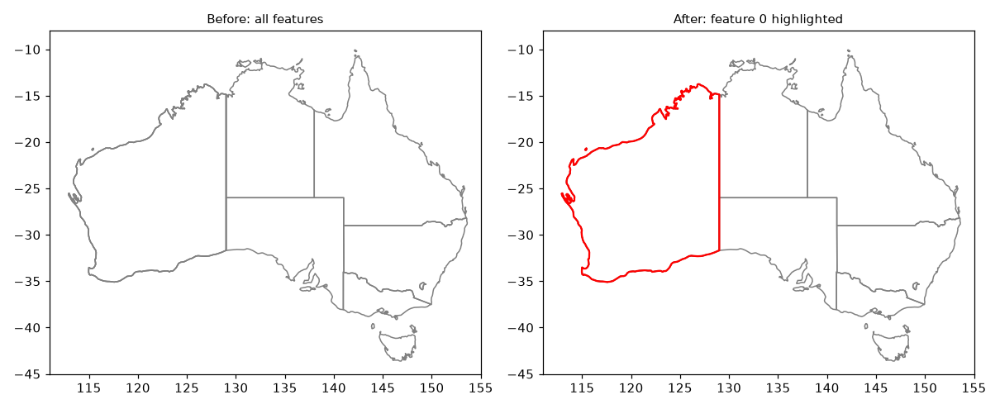
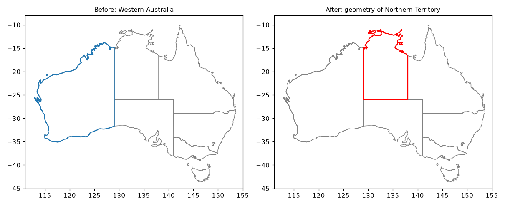
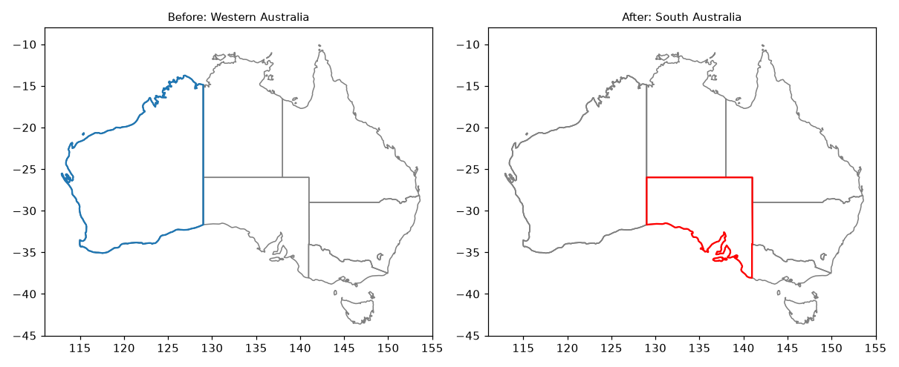

<p style="font-size: 120%;font-weight: bold;">gma.gio.Feature</p><span style="background-color:#EFF0FC;display: block;line-height:1.6;border-radius: 0.3rem;"><span style="color: gray;font-size:90%;">[class] </span><span style="color: #616AE5; font-weight: bold;font-size: 150%;">Feature</span><span style="font-style: italic; color: black;font-size: 130%;">(geom = <span style="color:#48566B">None</span>, values = <span style="color:#48566B">[]</span>, gtype = <span style="color:#48566B">None</span>, ftypes = <span style="color:#48566B">None</span>, crs = <span style="color:#48566B">None</span>):</span></span>

<p>Create a Feature object.</p>
<p style="font-size: 120%;color:#9298ED; font-weight: bold;">Optional:</p>
<p style="margin-left: 2em;"><b>geom </b> = <code style="text-indent: 0em;">None||Geometry</code>. <span style="color:#48566B;"> Default None</span>. </p>
<p style="margin-left: 4em;">The geometry of the feature. If None, create an empty geometry.</p>
<p style="margin-left: 2em;"><b>values </b> = <code style="text-indent: 0em;">list</code>. <span style="color:#48566B;"> Default []</span>. </p>
<p style="margin-left: 4em;">The field values of the feature.</p>
<p style="margin-left: 2em;"><b>gtype </b> = <code style="text-indent: 0em;">str||None</code>. <span style="color:#48566B;"> Default None</span>. </p>
<p style="margin-left: 4em;">The geometry type of the feature. See `dtypes.DefinedGeomTypes` for valid types. If None, use the geometry type of `geom`.</p>
<p style="margin-left: 2em;"><b>ftypes </b> = <code style="text-indent: 0em;">None||list of FieldType</code>. <span style="color:#48566B;"> Default None</span>. </p>
<p style="margin-left: 4em;">The FieldTypes of the feature. If None, create an empty FieldTypes.</p>
<p style="margin-left: 2em;"><b>crs </b> = <code style="text-indent: 0em;">str||int||None</code>. <span style="color:#48566B;"> Default None</span>. </p>
<p style="margin-left: 4em;">The projection of the geometry. If None, no projection is set.</p>

## Example

```python
from gma import gio

ly = gio.open_vector('Australia.shp')
ft = ly.get_feature(0)                          # Western Australia

print('fid     :', ft.fid)
print('name    :', ft.fields['name'])
print('geometry:', ft.geom.gtype)

# Build a new Feature from the geometry and fields of an existing one
new_ft = gio.Feature(geom=ft.geom, values=list(ft.fields.values()), ftypes=ft.ftypes)
print('new ft  :', new_ft.fid, new_ft.fields['name'], repr(new_ft.crs))
```

```text
fid     : 0
name    : Western Australia
geometry: MultiPolygon
new ft  : -1 Western Australia <CoordinateReferenceSystem:WGS 84>
```

## Method

### copy<span style="font-weight: normal;font-style: italic;color:#8a90a8;font-size: 88%;">()</span>

<p style="margin-left: 2em;">copy self. --> <code style="text-indent: 0em;">Feature</code></p>

<p style="font-size: 120%;color:#9298ED; font-weight: bold;">Returns:</p>
<p style="margin-left: 2em;"><b>Type</b>: <code style="text-indent: 0em;">Feature</code>. </p>
<p style="margin-left: 4em;">An independent copy of this feature.</p>

<p style="font-size: 120%;color:#9298ED; font-weight: bold;">Example:</p>

```python
from gma import gio

ft = gio.open_vector('Australia.shp').get_feature(0)
cp = ft.copy()
cp.set_fid(999)

print('original:', ft.fid, ft.fields['name'])
print('copy    :', cp.fid, cp.fields['name'])
print('same object:', cp is ft)
```

```text
original: 0 Western Australia
copy    : 999 Western Australia
same object: False
```


### plot<span style="font-weight: normal;font-style: italic;color:#8a90a8;font-size: 88%;">(ax = None, **kwargs)</span>

<p>Make plots of Geometry.</p>
<p style="font-size: 120%;color:#9298ED; font-weight: bold;">Optional:</p>
<p style="margin-left: 2em;"><b>ax </b> = <code style="text-indent: 0em;">None||matplotlib</code>. <span style="color:#48566B;">~.AxesSubplot. Default None</span>. </p>
<p style="margin-left: 4em;">A matplotlib subplot. If None, a default axes will be created.</p>
<p style="margin-left: 2em;"><b>**kwargs</b></p>
<p style="margin-left: 4em;">Other plotting parameters. For more, see:</p>
<p style="margin-left: 6em;">~.carto.utils.PolyCollection/LineCollection/PointCollection.</p>

<p style="font-size: 120%;color:#9298ED; font-weight: bold;">Returns:</p>
<p style="margin-left: 2em;"><b>Type</b>: <code style="text-indent: 0em;">Axes</code>. </p>
<p style="margin-left: 4em;">The matplotlib axes with the feature geometry plotted on it.</p>

<p style="font-size: 120%;color:#9298ED; font-weight: bold;">Example:</p>

```python
import matplotlib.pyplot as plt
from gma import gio

ly = gio.open_vector('Australia.shp')
ft = ly.get_feature(0)

fig, ax = plt.subplots(figsize=(6, 4.5))
ly.plot(ax=ax, facecolor='none', edgecolor='gray')                 # all features
ax = ft.plot(ax=ax, facecolor='none', edgecolor='red', linewidth=1.5)  # highlight one

print(type(ax).__name__)
```

```text
Axes
```




### set_fid<span style="font-weight: normal;font-style: italic;color:#8a90a8;font-size: 88%;">(fid)</span>

<p>Set the feature identifier.</p>
<p style="font-size: 120%;color:#9298ED; font-weight: bold;">Parameters:</p>
<p style="margin-left: 2em;"><b>fid</b>: <code style="text-indent: 0em;">int</code>. </p>
<p style="margin-left: 4em;">the new feature identifier value to assign.</p>

<p style="font-size: 120%;color:#9298ED; font-weight: bold;">Returns:</p>
<p style="margin-left: 2em;"><b>Type</b>: <code style="text-indent: 0em;">None</code>. </p>
<p style="margin-left: 4em;">Modify the feature identifier in place.</p>

<p style="font-size: 120%;color:#9298ED; font-weight: bold;">Example:</p>

```python
from gma import gio

ft = gio.open_vector('Australia.shp').get_feature(0)

print('Before:', ft.fid)
ft.set_fid(999)
print('After :', ft.fid)
```

```text
Before: 0
After : 999
```


### set_geom<span style="font-weight: normal;font-style: italic;color:#8a90a8;font-size: 88%;">(geom)</span>

<p>Set feature geometry. This function updates the features geometry, except that this function does not assume ownership of the passed geometry, but instead makes a copy of it.</p>
<p style="font-size: 120%;color:#9298ED; font-weight: bold;">Parameters:</p>
<p style="margin-left: 2em;"><b>geom</b>: <code style="text-indent: 0em;">Geometry</code>. </p>
<p style="margin-left: 4em;">new geometry to apply to feature.</p>

<p style="font-size: 120%;color:#9298ED; font-weight: bold;">Returns:</p>
<p style="margin-left: 2em;"><b>Type</b>: <code style="text-indent: 0em;">None</code>. </p>
<p style="margin-left: 4em;">Replace the geometry in place; field values are unchanged.</p>

<p style="font-size: 120%;color:#9298ED; font-weight: bold;">Example:</p>

```python
from gma import gio

ly = gio.open_vector('Australia.shp')
ft = ly.get_feature(0)                  # Western Australia
new_geom = ly.get_feature(1).geom       # Northern Territory

print('Before:', ft.fields['name'], tuple(round(v, 2) for v in ft.geom.bounds))
ft.set_geom(new_geom)
print('After :', ft.fields['name'], tuple(round(v, 2) for v in ft.geom.bounds))
```

```text
Before: Western Australia (112.91, -35.1, 129.0, -13.74)
After : Western Australia (129.0, -26.0, 138.0, -10.97)
```




### update<span style="font-weight: normal;font-style: italic;color:#8a90a8;font-size: 88%;">(other)</span>

<p>Set one feature from another. Overwrite the contents of this feature from the geometry and attributes of another.</p>
<p style="font-size: 120%;color:#9298ED; font-weight: bold;">Parameters:</p>
<p style="margin-left: 2em;"><b>other</b>: <code style="text-indent: 0em;">Feature</code>. </p>
<p style="margin-left: 4em;">feature from which geometry and field values will be copied.</p>

<p style="font-size: 120%;color:#9298ED; font-weight: bold;">Returns:</p>
<p style="margin-left: 2em;"><b>Type</b>: <code style="text-indent: 0em;">None</code>. </p>
<p style="margin-left: 4em;">Overwrite geometry and field values in place. The fid is not copied (-1).</p>

<p style="font-size: 120%;color:#9298ED; font-weight: bold;">Example:</p>

```python
from gma import gio

ly = gio.open_vector('Australia.shp')
ft = ly.get_feature(0)                  # Western Australia
other = ly.get_feature(2)               # South Australia

print('Before:', ft.fields['name'], tuple(round(v, 2) for v in ft.geom.bounds))
ft.update(other)
print('After :', ft.fields['name'], tuple(round(v, 2) for v in ft.geom.bounds))
print('fid   :', ft.fid)
```

```text
Before: Western Australia (112.91, -35.1, 129.0, -13.74)
After : South Australia (129.0, -38.07, 141.03, -26.0)
fid   : -1
```




## Property

### crs

<p style="margin-left: 2em;">Get coordinate reference system. --> <code style="text-indent: 0em;">CoordinateReferenceSystem</code></p>

<p style="font-size: 120%;color:#9298ED; font-weight: bold;">Example:</p>

```python
from gma import gio

ft = gio.open_vector('Australia.shp').get_feature(0)

print(ft.crs)
```

```text
<CoordinateReferenceSystem:WGS 84>
```


### fid

<p style="margin-left: 2em;">Get feature identifier. --> <code style="text-indent: 0em;">int</code></p>

<p style="font-size: 120%;color:#9298ED; font-weight: bold;">Example:</p>

```python
from gma import gio

ft = gio.open_vector('Australia.shp').get_feature(0)

print(ft.fid)
```

```text
0
```


### fields

<p style="margin-left: 2em;">Get fields for feature. --> <code style="text-indent: 0em;">dict</code></p>

<p style="font-size: 120%;color:#9298ED; font-weight: bold;">Example:</p>

```python
from gma import gio

ft = gio.open_vector('Australia.shp').get_feature(0)

print('number of fields:', len(ft.fields))
for key in ('name', 'iso_3166_2', 'type', 'scalerank'):
    print(key, ':', ft.fields[key])
```

```text
number of fields: 123
name : Western Australia
iso_3166_2 : AU-WA
type : State
scalerank : 2
```


### ftypes

<p style="margin-left: 2em;">Get field types for feature. --> <code style="text-indent: 0em;">FieldTypes</code></p>

<p style="font-size: 120%;color:#9298ED; font-weight: bold;">Example:</p>

```python
from gma import gio

ft = gio.open_vector('Australia.shp').get_feature(0)

print('number of field types:', len(ft.ftypes.names))
print('first five names     :', ft.ftypes.names[:5])
print('first field type     :', ft.ftypes[0])
```

```text
number of field types: 123
first five names     : ['featurecla', 'scalerank', 'adm1_code', 'diss_me', 'iso_3166_2']
first field type     : "featurecla" - Type:"String", Width:80, Precision:0
```


### geom

<p style="margin-left: 2em;">Get geometry for feature. --> <code style="text-indent: 0em;">Geometry</code></p>

<p style="font-size: 120%;color:#9298ED; font-weight: bold;">Example:</p>

```python
from gma import gio

ft = gio.open_vector('Australia.shp').get_feature(0)

print('type  :', ft.geom.gtype)
print('bounds:', tuple(round(v, 2) for v in ft.geom.bounds))
print('area  :', round(ft.geom.get_area(), 2))
```

```text
type  : MultiPolygon
bounds: (112.91, -35.1, 129.0, -13.74)
area  : 227.81
```
