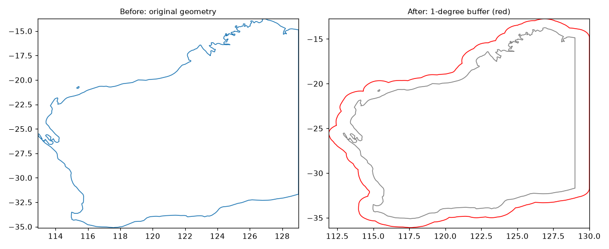
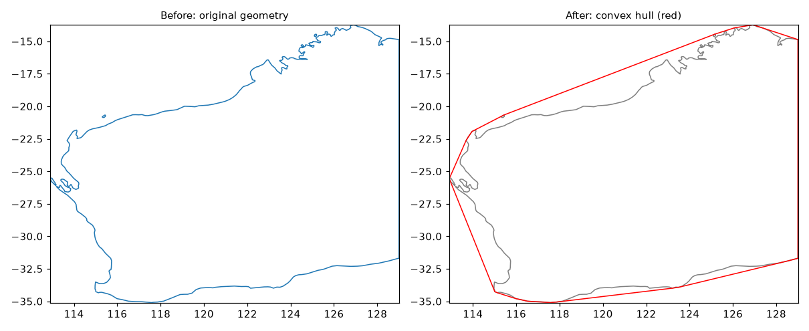
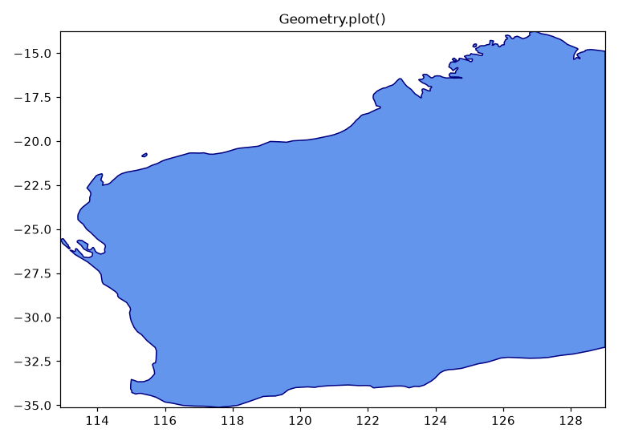
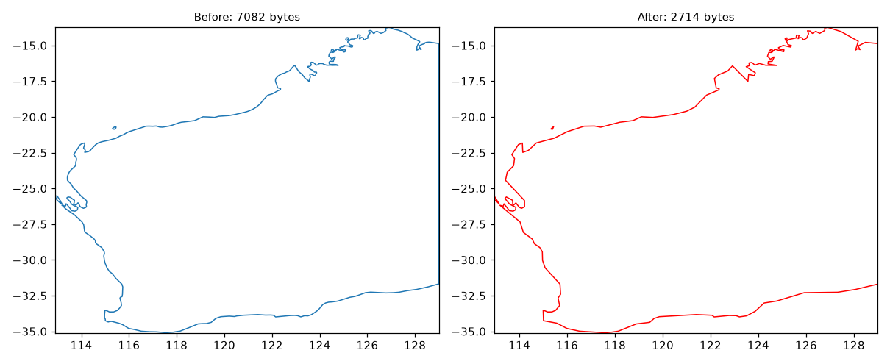
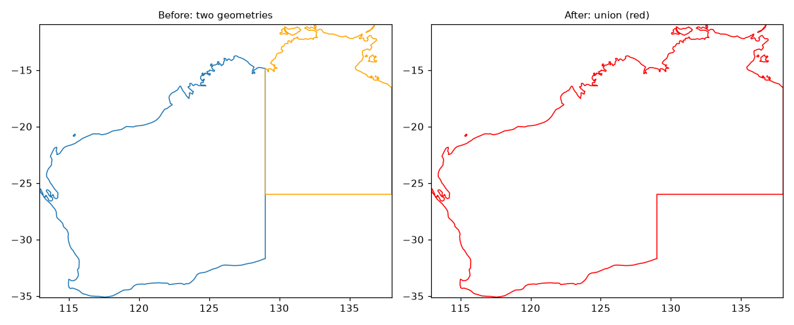

<p style="font-size: 120%;font-weight: bold;">gma.gio.Geometry</p><span style="background-color:#EFF0FC;display: block;line-height:1.6;border-radius: 0.3rem;"><span style="color: gray;font-size:90%;">[class] </span><span style="color: #616AE5; font-weight: bold;font-size: 150%;">Geometry</span><span style="font-style: italic; color: black;font-size: 130%;">(data = <span style="color:#48566B">None</span>, gtype = <span style="color:#48566B">None</span>, crs = <span style="color:#48566B">None</span>):</span></span>

<p>Create a Geometry object.</p>
<p style="font-size: 120%;color:#9298ED; font-weight: bold;">Optional:</p>
<p style="margin-left: 2em;"><b>data </b> = <code style="text-indent: 0em;">str||list||None</code>. <span style="color:#48566B;"> Default None</span>. </p>
<p style="margin-left: 4em;">The data to create the geometry from. It can be:</p>
<p style="margin-left: 4em;">- None: create an empty geometry of type gtype.</p>
<p style="margin-left: 4em;">- str: a string representation of the geometry in WKT, GeoJSON, GML, etc.</p>
<p style="margin-left: 4em;">- list, tuple or np.ndarray: a collection of points to create the geometry from.</p>
<p style="margin-left: 2em;"><b>gtype </b> = <code style="text-indent: 0em;">str</code>. <span style="color:#48566B;"> Default None</span>. </p>
<p style="margin-left: 4em;">The geometry type to create. It can be 'Point', 'LineString', 'Polygon', etc.</p>
<p style="margin-left: 4em;">This parameter is required if data is a list, tuple or np.ndarray.</p>
<p style="margin-left: 2em;"><b>crs </b> = <code style="text-indent: 0em;">str||int||None</code>. <span style="color:#48566B;"> Default None</span>. </p>
<p style="margin-left: 4em;">The projection of the geometry. If None, no projection is set.</p>

## Example

```python
from gma import gio

g = gio.open_vector('Australia.shp').get_feature(0).geom   # Western Australia
print(g.gtype, len(g))
print(tuple(round(v, 2) for v in g.bounds))
```

```text
MultiPolygon 5
(112.91, -35.1, 129.0, -13.74)
```

## Method

### add_geometry<span style="font-weight: normal;font-style: italic;color:#8a90a8;font-size: 88%;">(other)</span>

<p>Add a geometry to this geometry.</p>
<p style="font-size: 120%;color:#9298ED; font-weight: bold;">Parameters:</p>
<p style="margin-left: 2em;"><b>other</b>: <code style="text-indent: 0em;">Geometry</code>. </p>
<p style="margin-left: 4em;">The other geometry to add.</p>

<p style="font-size: 120%;color:#9298ED; font-weight: bold;">Returns:</p>
<p style="margin-left: 2em;"><b>Type</b>: <code style="text-indent: 0em;">None</code>. </p>
<p style="margin-left: 4em;">Modify the geometry in place.</p>

<p style="font-size: 120%;color:#9298ED; font-weight: bold;">Example:</p>

```python
from gma import gio

g = gio.open_vector('Australia.shp').get_feature(0).geom   # Western Australia
other = gio.open_vector('Australia.shp').get_feature(9).geom
print('Before:', len(g))
g.add_geometry(other)
print('After :', len(g))
```

```text
Before: 5
After : 5
```


### add_point<span style="font-weight: normal;font-style: italic;color:#8a90a8;font-size: 88%;">(point)</span>

<p>Add a point to this geometry.</p>
<p style="font-size: 120%;color:#9298ED; font-weight: bold;">Parameters:</p>
<p style="margin-left: 2em;"><b>point</b>: <code style="text-indent: 0em;">list||tuple</code>. </p>
<p style="margin-left: 4em;">The point coordinates to add. Should be a list or tuple of length 2, 3 or 4 depending on the geometry dimension.</p>

<p style="font-size: 120%;color:#9298ED; font-weight: bold;">Returns:</p>
<p style="margin-left: 2em;"><b>Type</b>: <code style="text-indent: 0em;">None</code>. </p>
<p style="margin-left: 4em;">Modify the geometry in place.</p>

<p style="font-size: 120%;color:#9298ED; font-weight: bold;">Example:</p>

```python
from gma import gio

p = gio.Geometry(gtype='Point')       # an empty Point geometry
print('Before:', p.to_str())

p.add_point((115.0, -25.0))
print('After :', p.to_str())
```

```text
Before: POINT EMPTY
After : POINT (115 -25)
```


### buffer<span style="font-weight: normal;font-style: italic;color:#8a90a8;font-size: 88%;">(distance, quadsecs = 30)</span>

<p>Compute buffer of geometry.</p>
<p style="font-size: 120%;color:#9298ED; font-weight: bold;">Parameters:</p>
<p style="margin-left: 2em;"><b>distance</b>: <code style="text-indent: 0em;">float</code>. </p>
<p style="margin-left: 4em;">The buffer distance to be applied. Should be expressed into the same unit as the coordinates of the geometry.</p>
<p style="font-size: 120%;color:#9298ED; font-weight: bold;">Optional:</p>
<p style="margin-left: 2em;"><b>quadsecs </b> = <code style="text-indent: 0em;">int</code>. <span style="color:#48566B;"> Default 30</span>. </p>
<p style="margin-left: 4em;">The number of segments used to approximate a 90 degree (quadrant) of curvature.</p>

<p style="font-size: 120%;color:#9298ED; font-weight: bold;">Returns:</p>
<p style="margin-left: 2em;"><b>Type</b>: <code style="text-indent: 0em;">Geometry</code>. </p>
<p style="margin-left: 4em;">A new geometry with the operation applied.</p>

<p style="font-size: 120%;color:#9298ED; font-weight: bold;">Example:</p>

```python
from gma import gio

g = gio.open_vector('Australia.shp').get_feature(0).geom   # Western Australia
print('Before:', tuple(round(v, 2) for v in g.bounds))
r = g.buffer(1)
print('After :', tuple(round(v, 2) for v in r.bounds), r.gtype)
```

```text
Before: (112.91, -35.1, 129.0, -13.74)
After : (111.91, -36.1, 130.0, -12.74) Polygon
```




### centroid<span style="font-weight: normal;font-style: italic;color:#8a90a8;font-size: 88%;">()</span>

<p>Compute the geometry centroid.</p>

<p style="font-size: 120%;color:#9298ED; font-weight: bold;">Returns:</p>
<p style="margin-left: 2em;"><b>Type</b>: <code style="text-indent: 0em;">Geometry</code>. </p>
<p style="margin-left: 4em;">A new geometry with the operation applied.</p>

<p style="font-size: 120%;color:#9298ED; font-weight: bold;">Example:</p>

```python
from gma import gio

g = gio.open_vector('Australia.shp').get_feature(0).geom   # Western Australia
r = g.centroid()
print(r.gtype, r.to_str())
```

```text
Point POINT (122.17823301045 -25.4653344819968)
```


### close_rings<span style="font-weight: normal;font-style: italic;color:#8a90a8;font-size: 88%;">()</span>

<p>Force rings to be closed.</p>

<p style="font-size: 120%;color:#9298ED; font-weight: bold;">Returns:</p>
<p style="margin-left: 2em;"><b>Type</b>: <code style="text-indent: 0em;">None</code>. </p>
<p style="margin-left: 4em;">Modify the geometry in place.</p>

<p style="font-size: 120%;color:#9298ED; font-weight: bold;">Example:</p>

```python
from gma import gio

g = gio.open_vector('Australia.shp').get_feature(0).geom   # Western Australia
print('Before:', g.gtype, len(g))
g.close_rings()
print('After :', g.gtype, len(g))
```

```text
Before: MultiPolygon 5
After : MultiPolygon 5
```


### concave_hull<span style="font-weight: normal;font-style: italic;color:#8a90a8;font-size: 88%;">(ratio = 0.0, allow_holes = True)</span>

<p style="margin-left: 2em;">concave_hull(double ratio, bool allowHoles) --> <code style="text-indent: 0em;">Geometry</code></p>

<p style="font-size: 120%;color:#9298ED; font-weight: bold;">Returns:</p>
<p style="margin-left: 2em;"><b>Type</b>: <code style="text-indent: 0em;">Geometry</code>. </p>
<p style="margin-left: 4em;">A new geometry with the operation applied.</p>

<p style="font-size: 120%;color:#9298ED; font-weight: bold;">Example:</p>

```python
from gma import gio

g = gio.open_vector('Australia.shp').get_feature(0).geom   # Western Australia
r = g.concave_hull(ratio=0.2)
print(r.gtype, len(r), tuple(round(v, 2) for v in r.bounds))
```

```text
Polygon 1 (112.91, -35.1, 129.0, -13.74)
```


### contains<span style="font-weight: normal;font-style: italic;color:#8a90a8;font-size: 88%;">(other)</span>

<p>Test for containment.</p>
<p style="font-size: 120%;color:#9298ED; font-weight: bold;">Parameters:</p>
<p style="margin-left: 2em;"><b>other</b>: <code style="text-indent: 0em;">Geometry</code>. </p>
<p style="margin-left: 4em;">the other geometry to compare.</p>

<p style="font-size: 120%;color:#9298ED; font-weight: bold;">Returns:</p>
<p style="margin-left: 2em;"><b>Type</b>: <code style="text-indent: 0em;">bool</code>. </p>
<p style="margin-left: 4em;">Whether the spatial relation / predicate holds.</p>

<p style="font-size: 120%;color:#9298ED; font-weight: bold;">Example:</p>

```python
from gma import gio

ly = gio.open_vector('Australia.shp')
g = ly.get_feature(0).geom       # Western Australia
other = ly.get_feature(1).geom   # Northern Territory
print('WA contains NT :', g.contains(other))
print('WA contains its copy:', g.contains(g.copy()))
```

```text
WA contains NT : False
WA contains its copy: True
```


### convex_hull<span style="font-weight: normal;font-style: italic;color:#8a90a8;font-size: 88%;">()</span>

<p>Compute convex hull.</p>

<p style="font-size: 120%;color:#9298ED; font-weight: bold;">Returns:</p>
<p style="margin-left: 2em;"><b>Type</b>: <code style="text-indent: 0em;">Geometry</code>. </p>
<p style="margin-left: 4em;">A new geometry with the operation applied.</p>

<p style="font-size: 120%;color:#9298ED; font-weight: bold;">Example:</p>

```python
from gma import gio

g = gio.open_vector('Australia.shp').get_feature(0).geom   # Western Australia
r = g.convex_hull()
print(r.gtype, len(r), tuple(round(v, 2) for v in r.bounds))
```

```text
Polygon 1 (112.91, -35.1, 129.0, -13.74)
```




### copy<span style="font-weight: normal;font-style: italic;color:#8a90a8;font-size: 88%;">()</span>

<p>Make a copy of this object.</p>

<p style="font-size: 120%;color:#9298ED; font-weight: bold;">Returns:</p>
<p style="margin-left: 2em;"><b>Type</b>: <code style="text-indent: 0em;">Geometry</code>. </p>
<p style="margin-left: 4em;">A new geometry with the operation applied.</p>

<p style="font-size: 120%;color:#9298ED; font-weight: bold;">Example:</p>

```python
from gma import gio

g = gio.open_vector('Australia.shp').get_feature(0).geom   # Western Australia
cp = g.copy()
cp.empty()
print('original:', g.gtype, len(g), g.is_empty())
print('copy    :', cp.gtype, len(cp), cp.is_empty())
print('same object:', cp is g)
```

```text
original: MultiPolygon 5 False
copy    : MultiPolygon 0 True
same object: False
```


### crosses<span style="font-weight: normal;font-style: italic;color:#8a90a8;font-size: 88%;">(other)</span>

<p>Test for crossing.</p>
<p style="font-size: 120%;color:#9298ED; font-weight: bold;">Parameters:</p>
<p style="margin-left: 2em;"><b>other</b>: <code style="text-indent: 0em;">Geometry</code>. </p>
<p style="margin-left: 4em;">the other geometry to compare.</p>

<p style="font-size: 120%;color:#9298ED; font-weight: bold;">Returns:</p>
<p style="margin-left: 2em;"><b>Type</b>: <code style="text-indent: 0em;">bool</code>. </p>
<p style="margin-left: 4em;">Whether the spatial relation / predicate holds.</p>

<p style="font-size: 120%;color:#9298ED; font-weight: bold;">Example:</p>

```python
from gma import gio

ly = gio.open_vector('Australia.shp')
g = ly.get_feature(0).geom       # Western Australia
other = ly.get_feature(1).geom   # Northern Territory
print(g.crosses(other))
```

```text
False
```


### delaunay_triangulation<span style="font-weight: normal;font-style: italic;color:#8a90a8;font-size: 88%;">(tolerance = 0.0, only_edges = True)</span>

<p>Return a Delaunay triangulation of the vertices of the geometry.</p>
<p style="font-size: 120%;color:#9298ED; font-weight: bold;">Optional:</p>
<p style="margin-left: 2em;"><b>dfTolerance </b> = <code style="text-indent: 0em;">float||default 0</code>. </p>
<p style="margin-left: 4em;">optional snapping tolerance to use for improved robustness</p>
<p style="margin-left: 2em;"><b>bOnlyEdges </b> = <code style="text-indent: 0em;">bool||default True</code>. </p>
<p style="margin-left: 4em;">If True, will return a MULTILINESTRING, otherwise it will return a GEOMETRYCOLLECTION containing triangular POLYGONs.</p>

<p style="font-size: 120%;color:#9298ED; font-weight: bold;">Returns:</p>
<p style="margin-left: 2em;"><b>Type</b>: <code style="text-indent: 0em;">Geometry</code>. </p>
<p style="margin-left: 4em;">A new geometry with the operation applied.</p>

<p style="font-size: 120%;color:#9298ED; font-weight: bold;">Example:</p>

```python
from gma import gio

g = gio.open_vector('Australia.shp').get_feature(0).geom   # Western Australia
r = g.delaunay_triangulation(tolerance=0.01)
print(r.gtype, len(r))
```

```text
MultiLineString 1272
```


### difference<span style="font-weight: normal;font-style: italic;color:#8a90a8;font-size: 88%;">(other)</span>

<p>Perform spatial difference between two Geometries.</p>
<p style="font-size: 120%;color:#9298ED; font-weight: bold;">Parameters:</p>
<p style="margin-left: 2em;"><b>other</b>: <code style="text-indent: 0em;">Geometry</code>. </p>
<p style="margin-left: 4em;">The other geometry to overlay.</p>

<p style="font-size: 120%;color:#9298ED; font-weight: bold;">Returns:</p>
<p style="margin-left: 2em;"><b>Type</b>: <code style="text-indent: 0em;">Geometry</code>. </p>
<p style="margin-left: 4em;">A new geometry with the operation applied.</p>

<p style="font-size: 120%;color:#9298ED; font-weight: bold;">Example:</p>

```python
from gma import gio

ly = gio.open_vector('Australia.shp')
g = ly.get_feature(0).geom       # Western Australia
other = ly.get_feature(1).geom   # Northern Territory
r = g.difference(other)
print(r.gtype, len(r), tuple(round(v, 2) for v in r.bounds))
```

```text
MultiPolygon 5 (112.91, -35.1, 129.0, -13.74)
```


### disjoint<span style="font-weight: normal;font-style: italic;color:#8a90a8;font-size: 88%;">(other)</span>

<p>Test for disjointness.</p>
<p style="font-size: 120%;color:#9298ED; font-weight: bold;">Parameters:</p>
<p style="margin-left: 2em;"><b>other</b>: <code style="text-indent: 0em;">Geometry</code>. </p>
<p style="margin-left: 4em;">The other geometry to compare.</p>

<p style="font-size: 120%;color:#9298ED; font-weight: bold;">Returns:</p>
<p style="margin-left: 2em;"><b>Type</b>: <code style="text-indent: 0em;">bool</code>. </p>
<p style="margin-left: 4em;">Whether the spatial relation / predicate holds.</p>

<p style="font-size: 120%;color:#9298ED; font-weight: bold;">Example:</p>

```python
from gma import gio

ly = gio.open_vector('Australia.shp')
g = ly.get_feature(0).geom       # Western Australia
other = ly.get_feature(1).geom   # Northern Territory
print(g.disjoint(other))
```

```text
False
```


### distance<span style="font-weight: normal;font-style: italic;color:#8a90a8;font-size: 88%;">(other)</span>

<p>Compute distance between two geometries.</p>
<p style="font-size: 120%;color:#9298ED; font-weight: bold;">Parameters:</p>
<p style="margin-left: 2em;"><b>other</b>: <code style="text-indent: 0em;">Geometry</code>. </p>
<p style="margin-left: 4em;">The other geometry to compare against.</p>

<p style="font-size: 120%;color:#9298ED; font-weight: bold;">Returns:</p>
<p style="margin-left: 2em;"><b>Type</b>: <code style="text-indent: 0em;">Geometry</code>. </p>
<p style="margin-left: 4em;">NOTE: 3.0.4.1 returns an empty Geometry instead of a float.</p>

<p style="font-size: 120%;color:#9298ED; font-weight: bold;">Example:</p>

```python
from gma import gio

ly = gio.open_vector('Australia.shp')
g = ly.get_feature(0).geom       # Western Australia
other = ly.get_feature(1).geom   # Northern Territory
d = g.distance(other)
print('type :', type(d).__name__)   # 3.0.4.1 returns an empty Geometry, not a float
```

```text
type : Geometry
```


### empty<span style="font-weight: normal;font-style: italic;color:#8a90a8;font-size: 88%;">()</span>

<p>Clear geometry information.</p>

<p style="font-size: 120%;color:#9298ED; font-weight: bold;">Returns:</p>
<p style="margin-left: 2em;"><b>Type</b>: <code style="text-indent: 0em;">None</code>. </p>
<p style="margin-left: 4em;">Modify the geometry in place.</p>

<p style="font-size: 120%;color:#9298ED; font-weight: bold;">Example:</p>

```python
from gma import gio

g = gio.open_vector('Australia.shp').get_feature(0).geom   # Western Australia
print('Before:', g.gtype, len(g), g.is_empty())
g.empty()
print('After :', g.gtype, len(g), g.is_empty())
```

```text
Before: MultiPolygon 5 False
After : MultiPolygon 0 True
```


### equals<span style="font-weight: normal;font-style: italic;color:#8a90a8;font-size: 88%;">(other)</span>

<p>Returns True if two geometries are equivalent.</p>
<p style="font-size: 120%;color:#9298ED; font-weight: bold;">Parameters:</p>
<p style="margin-left: 2em;"><b>other</b>: <code style="text-indent: 0em;">Geometry</code>. </p>
<p style="margin-left: 4em;">The other geometry to test against.</p>

<p style="font-size: 120%;color:#9298ED; font-weight: bold;">Returns:</p>
<p style="margin-left: 2em;"><b>Type</b>: <code style="text-indent: 0em;">bool</code>. </p>
<p style="margin-left: 4em;">Whether the spatial relation / predicate holds.</p>

<p style="font-size: 120%;color:#9298ED; font-weight: bold;">Example:</p>

```python
from gma import gio

g = gio.open_vector('Australia.shp').get_feature(0).geom   # Western Australia
print('g equals its copy:', g.equals(g.copy()))
```

```text
g equals its copy: True
```


### extent<span style="font-weight: normal;font-style: italic;color:#8a90a8;font-size: 88%;">()</span>

<p>The extent of a geometry is the bounding rectangle.</p>

<p style="font-size: 120%;color:#9298ED; font-weight: bold;">Returns:</p>
<p style="margin-left: 2em;"><b>Type</b>: <code style="text-indent: 0em;">Geometry</code>. </p>
<p style="margin-left: 4em;">A new geometry with the operation applied.</p>

<p style="font-size: 120%;color:#9298ED; font-weight: bold;">Example:</p>

```python
from gma import gio

g = gio.open_vector('Australia.shp').get_feature(0).geom   # Western Australia
r = g.extent()
print(r.gtype, tuple(round(v, 2) for v in r.bounds))
```

```text
Polygon (112.91, -35.1, 129.0, -13.74)
```


### flatten<span style="font-weight: normal;font-style: italic;color:#8a90a8;font-size: 88%;">()</span>

<p>Convert geometry to strictly 2D.</p>

<p style="font-size: 120%;color:#9298ED; font-weight: bold;">Returns:</p>
<p style="margin-left: 2em;"><b>Type</b>: <code style="text-indent: 0em;">None</code>. </p>
<p style="margin-left: 4em;">Modify the geometry in place.</p>

<p style="font-size: 120%;color:#9298ED; font-weight: bold;">Example:</p>

```python
from gma import gio

g = gio.open_vector('Australia.shp').get_feature(0).geom   # Western Australia
print('Before:', g.gtype, len(g))
g.flatten()
print('After :', g.gtype, len(g))
```

```text
Before: MultiPolygon 5
After : MultiPolygon 5
```


### get_area<span style="font-weight: normal;font-style: italic;color:#8a90a8;font-size: 88%;">(geodesic = False)</span>

<p>Compute geometry area.</p>
<p style="font-size: 120%;color:#9298ED; font-weight: bold;">Optional:</p>
<p style="margin-left: 2em;"><b>geodesic </b> = <code style="text-indent: 0em;">bool</code>. <span style="color:#48566B;"> Default False</span>. </p>
<p style="margin-left: 4em;">whether considered as a surface on the underlying ellipsoid of the SRS attached to the geometry.</p>

<p style="font-size: 120%;color:#9298ED; font-weight: bold;">Returns:</p>
<p style="margin-left: 2em;"><b>Type</b>: <code style="text-indent: 0em;">float</code>. </p>
<p style="margin-left: 4em;">The area of the geometry (planar or geodesic).</p>

<p style="font-size: 120%;color:#9298ED; font-weight: bold;">Example:</p>

```python
from gma import gio

g = gio.open_vector('Australia.shp').get_feature(0).geom   # Western Australia
print('planar  :', round(g.get_area(), 2))
print('geodesic:', round(g.get_area(geodesic=True), 2))
```

```text
planar  : 227.81
geodesic: 2528691844636.59
```


### get_length<span style="font-weight: normal;font-style: italic;color:#8a90a8;font-size: 88%;">(geodesic = False)</span>

<p>Compute geometry length.</p>
<p style="font-size: 120%;color:#9298ED; font-weight: bold;">Optional:</p>
<p style="margin-left: 2em;"><b>geodesic </b> = <code style="text-indent: 0em;">bool</code>. <span style="color:#48566B;"> Default False</span>. </p>
<p style="margin-left: 4em;">whether considered as a surface on the underlying ellipsoid of the SRS attached to the geometry.</p>

<p style="font-size: 120%;color:#9298ED; font-weight: bold;">Returns:</p>
<p style="margin-left: 2em;"><b>Type</b>: <code style="text-indent: 0em;">float</code>. </p>
<p style="margin-left: 4em;">The perimeter or length of the geometry.</p>

<p style="font-size: 120%;color:#9298ED; font-weight: bold;">Example:</p>

```python
from gma import gio

g = gio.open_vector('Australia.shp').get_feature(0).geom   # Western Australia
print('planar  :', round(g.get_length(), 2))
print('geodesic:', round(g.get_length(geodesic=True), 2))
```

```text
planar  : 82.19
geodesic: 8745433.58
```


### intersection<span style="font-weight: normal;font-style: italic;color:#8a90a8;font-size: 88%;">(other)</span>

<p>Perform spatial intersection between two Geometries.</p>
<p style="font-size: 120%;color:#9298ED; font-weight: bold;">Parameters:</p>
<p style="margin-left: 2em;"><b>other</b>: <code style="text-indent: 0em;">Geometry</code>. </p>
<p style="margin-left: 4em;">The other geometry to overlay.</p>

<p style="font-size: 120%;color:#9298ED; font-weight: bold;">Returns:</p>
<p style="margin-left: 2em;"><b>Type</b>: <code style="text-indent: 0em;">Geometry</code>. </p>
<p style="margin-left: 4em;">A new geometry with the operation applied.</p>

<p style="font-size: 120%;color:#9298ED; font-weight: bold;">Example:</p>

```python
from gma import gio

ly = gio.open_vector('Australia.shp')
g = ly.get_feature(0).geom       # Western Australia
other = ly.get_feature(1).geom   # Northern Territory
r = g.intersection(other)
print(r.gtype, r.is_empty(), 'bytes:', r.wkb_size())
```

```text
LineString False bytes: 41
```


### intersects<span style="font-weight: normal;font-style: italic;color:#8a90a8;font-size: 88%;">(other)</span>

<p>Determines whether two geometries intersect.</p>
<p style="font-size: 120%;color:#9298ED; font-weight: bold;">Parameters:</p>
<p style="margin-left: 2em;"><b>other</b>: <code style="text-indent: 0em;">Geometry</code>. </p>
<p style="margin-left: 4em;">The other geometry to test against.</p>

<p style="font-size: 120%;color:#9298ED; font-weight: bold;">Returns:</p>
<p style="margin-left: 2em;"><b>Type</b>: <code style="text-indent: 0em;">bool</code>. </p>
<p style="margin-left: 4em;">Whether the spatial relation / predicate holds.</p>

<p style="font-size: 120%;color:#9298ED; font-weight: bold;">Example:</p>

```python
from gma import gio

ly = gio.open_vector('Australia.shp')
g = ly.get_feature(0).geom       # Western Australia
other = ly.get_feature(1).geom   # Northern Territory
print(g.intersects(other))
```

```text
True
```


### is_empty<span style="font-weight: normal;font-style: italic;color:#8a90a8;font-size: 88%;">()</span>

<p>Test if the geometry is empty.</p>

<p style="font-size: 120%;color:#9298ED; font-weight: bold;">Returns:</p>
<p style="margin-left: 2em;"><b>Type</b>: <code style="text-indent: 0em;">bool</code>. </p>
<p style="margin-left: 4em;">Whether the spatial relation / predicate holds.</p>

<p style="font-size: 120%;color:#9298ED; font-weight: bold;">Example:</p>

```python
from gma import gio

g = gio.open_vector('Australia.shp').get_feature(0).geom   # Western Australia
print(g.is_empty())
```

```text
False
```


### is_measured<span style="font-weight: normal;font-style: italic;color:#8a90a8;font-size: 88%;">()</span>

<p>See whether this geometry is measured.</p>

<p style="font-size: 120%;color:#9298ED; font-weight: bold;">Returns:</p>
<p style="margin-left: 2em;"><b>Type</b>: <code style="text-indent: 0em;">bool</code>. </p>
<p style="margin-left: 4em;">Whether the spatial relation / predicate holds.</p>

<p style="font-size: 120%;color:#9298ED; font-weight: bold;">Example:</p>

```python
from gma import gio

g = gio.open_vector('Australia.shp').get_feature(0).geom   # Western Australia
print(g.is_measured())
```

```text
False
```


### is_ring<span style="font-weight: normal;font-style: italic;color:#8a90a8;font-size: 88%;">()</span>

<p>Test if the geometry is a ring.</p>

<p style="font-size: 120%;color:#9298ED; font-weight: bold;">Returns:</p>
<p style="margin-left: 2em;"><b>Type</b>: <code style="text-indent: 0em;">bool</code>. </p>
<p style="margin-left: 4em;">Whether the spatial relation / predicate holds.</p>

<p style="font-size: 120%;color:#9298ED; font-weight: bold;">Example:</p>

```python
from gma import gio

g = gio.open_vector('Australia.shp').get_feature(0).geom   # Western Australia
print(g.is_ring())
```

```text
False
```


### is_simple<span style="font-weight: normal;font-style: italic;color:#8a90a8;font-size: 88%;">()</span>

<p>Returns True if the geometry is simple.</p>

<p style="font-size: 120%;color:#9298ED; font-weight: bold;">Returns:</p>
<p style="margin-left: 2em;"><b>Type</b>: <code style="text-indent: 0em;">bool</code>. </p>
<p style="margin-left: 4em;">Whether the spatial relation / predicate holds.</p>

<p style="font-size: 120%;color:#9298ED; font-weight: bold;">Example:</p>

```python
from gma import gio

g = gio.open_vector('Australia.shp').get_feature(0).geom   # Western Australia
print(g.is_simple())
```

```text
True
```


### is_valid<span style="font-weight: normal;font-style: italic;color:#8a90a8;font-size: 88%;">()</span>

<p>Test if the geometry is valid.</p>

<p style="font-size: 120%;color:#9298ED; font-weight: bold;">Returns:</p>
<p style="margin-left: 2em;"><b>Type</b>: <code style="text-indent: 0em;">bool</code>. </p>
<p style="margin-left: 4em;">Whether the spatial relation / predicate holds.</p>

<p style="font-size: 120%;color:#9298ED; font-weight: bold;">Example:</p>

```python
from gma import gio

g = gio.open_vector('Australia.shp').get_feature(0).geom   # Western Australia
print(g.is_valid())
```

```text
True
```


### make_valid<span style="font-weight: normal;font-style: italic;color:#8a90a8;font-size: 88%;">(options = [])</span>

<p>Attempts to make an invalid geometry valid without losing vertices.</p>
<p style="font-size: 120%;color:#9298ED; font-weight: bold;">Optional:</p>
<p style="margin-left: 2em;"><b>options </b> = <code style="text-indent: 0em;">list[str]</code>. <span style="color:#48566B;"> Default []</span>. </p>
<p style="margin-left: 4em;">papszOptions to be passed in. For example: ["METHOD=STRUCTURE"].</p>

<p style="font-size: 120%;color:#9298ED; font-weight: bold;">Returns:</p>
<p style="margin-left: 2em;"><b>Type</b>: <code style="text-indent: 0em;">Geometry</code>. </p>
<p style="margin-left: 4em;">A new geometry with the operation applied.</p>

<p style="font-size: 120%;color:#9298ED; font-weight: bold;">Example:</p>

```python
from gma import gio

g = gio.open_vector('Australia.shp').get_feature(0).geom   # Western Australia
r = g.make_valid()
print(type(r).__name__, r.gtype, r.is_valid())
```

```text
Geometry MultiPolygon True
```


### normalize<span style="font-weight: normal;font-style: italic;color:#8a90a8;font-size: 88%;">()</span>

<p>Attempts to bring geometry into normalized/canonical form.</p>

<p style="font-size: 120%;color:#9298ED; font-weight: bold;">Returns:</p>
<p style="margin-left: 2em;"><b>Type</b>: <code style="text-indent: 0em;">None</code>. </p>
<p style="margin-left: 4em;">Modify the geometry in place.</p>

<p style="font-size: 120%;color:#9298ED; font-weight: bold;">Example:</p>

```python
from gma import gio

g = gio.open_vector('Australia.shp').get_feature(0).geom   # Western Australia
print('Before bytes:', g.wkb_size())
g.normalize()
print('After bytes :', g.wkb_size())
```

```text
Before bytes: 7082
After bytes : 7082
```


### overlaps<span style="font-weight: normal;font-style: italic;color:#8a90a8;font-size: 88%;">(other)</span>

<p>Test for overlap.</p>
<p style="font-size: 120%;color:#9298ED; font-weight: bold;">Parameters:</p>
<p style="margin-left: 2em;"><b>other</b>: <code style="text-indent: 0em;">Geometry</code>. </p>
<p style="margin-left: 4em;">the other geometry to compare.</p>

<p style="font-size: 120%;color:#9298ED; font-weight: bold;">Returns:</p>
<p style="margin-left: 2em;"><b>Type</b>: <code style="text-indent: 0em;">bool</code>. </p>
<p style="margin-left: 4em;">Whether the spatial relation / predicate holds.</p>

<p style="font-size: 120%;color:#9298ED; font-weight: bold;">Example:</p>

```python
from gma import gio

ly = gio.open_vector('Australia.shp')
g = ly.get_feature(0).geom       # Western Australia
other = ly.get_feature(1).geom   # Northern Territory
print(g.overlaps(other))
```

```text
False
```


### plot<span style="font-weight: normal;font-style: italic;color:#8a90a8;font-size: 88%;">(ax = None, **kwargs)</span>

<p>Make plots of Geometry.</p>
<p style="font-size: 120%;color:#9298ED; font-weight: bold;">Optional:</p>
<p style="margin-left: 2em;"><b>ax </b> = <code style="text-indent: 0em;">None||matplotlib</code>. <span style="color:#48566B;">~.AxesSubplot. Default None</span>. </p>
<p style="margin-left: 4em;">A matplotlib subplot. If None, a default axes will be created.</p>
<p style="margin-left: 2em;"><b>**kwargs</b></p>
<p style="margin-left: 4em;">Other plotting parameters. For more, see:</p>
<p style="margin-left: 6em;">~.carto.utils.PolyCollection/LineCollection/PointCollection.</p>

<p style="font-size: 120%;color:#9298ED; font-weight: bold;">Returns:</p>
<p style="margin-left: 2em;"><b>Type</b>: <code style="text-indent: 0em;">Axes</code>. </p>
<p style="margin-left: 4em;">The matplotlib axes with the geometry plotted on it.</p>

<p style="font-size: 120%;color:#9298ED; font-weight: bold;">Example:</p>

```python
from gma import gio

g = gio.open_vector('Australia.shp').get_feature(0).geom   # Western Australia
import matplotlib.pyplot as plt

fig, ax = plt.subplots(figsize=(6, 4.5))
ax = g.plot(ax=ax, facecolor='cornflowerblue', edgecolor='navy')
print(type(ax).__name__)
```

```text
Axes
```




### point_on_surface<span style="font-weight: normal;font-style: italic;color:#8a90a8;font-size: 88%;">()</span>

<p>Returns a point guaranteed to lie on the surface.</p>

<p style="font-size: 120%;color:#9298ED; font-weight: bold;">Returns:</p>
<p style="margin-left: 2em;"><b>Type</b>: <code style="text-indent: 0em;">Geometry</code>. </p>
<p style="margin-left: 4em;">A new geometry with the operation applied.</p>

<p style="font-size: 120%;color:#9298ED; font-weight: bold;">Example:</p>

```python
from gma import gio

g = gio.open_vector('Australia.shp').get_feature(0).geom   # Western Australia
r = g.point_on_surface()
print(r.gtype, r.to_str())
```

```text
Point POINT (121.208692520469 -24.3448241559099)
```


### remove_geometry<span style="font-weight: normal;font-style: italic;color:#8a90a8;font-size: 88%;">(i)</span>

<p>remove_geometry(int iSubGeom)</p>
<p style="font-size: 120%;color:#9298ED; font-weight: bold;">Parameters:</p>
<p style="margin-left: 2em;"><b>i</b>: <code style="text-indent: 0em;">int</code>. </p>
<p style="margin-left: 4em;">Sub geom's id.</p>

<p style="font-size: 120%;color:#9298ED; font-weight: bold;">Returns:</p>
<p style="margin-left: 2em;"><b>Type</b>: <code style="text-indent: 0em;">None</code>. </p>
<p style="margin-left: 4em;">Modify the geometry in place.</p>

<p style="font-size: 120%;color:#9298ED; font-weight: bold;">Example:</p>

```python
from gma import gio

g = gio.open_vector('Australia.shp').get_feature(0).geom   # Western Australia
print('Before:', g.gtype, len(g))
g.remove_geometry(0)
print('After :', g.gtype, len(g))
```

```text
Before: MultiPolygon 5
After : MultiPolygon 4
```


### remove_lower_dimension_sub_geoms<span style="font-weight: normal;font-style: italic;color:#8a90a8;font-size: 88%;">()</span>

<p>remove lower dimension sub geoms.</p>

<p style="font-size: 120%;color:#9298ED; font-weight: bold;">Returns:</p>
<p style="margin-left: 2em;"><b>Type</b>: <code style="text-indent: 0em;">None</code>. </p>
<p style="margin-left: 4em;">Modify the geometry in place.</p>

<p style="font-size: 120%;color:#9298ED; font-weight: bold;">Example:</p>

```python
from gma import gio

g = gio.open_vector('Australia.shp').get_feature(0).geom   # Western Australia
print('Before:', g.gtype, len(g))
g.remove_lower_dimension_sub_geoms()
print('After :', g.gtype, len(g))
```

```text
Before: MultiPolygon 5
After : MultiPolygon 5
```


### segmentize<span style="font-weight: normal;font-style: italic;color:#8a90a8;font-size: 88%;">(max_length)</span>

<p>Modify the geometry such it has no segment longer then the given distance.</p>
<p style="font-size: 120%;color:#9298ED; font-weight: bold;">Parameters:</p>
<p style="margin-left: 2em;"><b>max_length</b>: <code style="text-indent: 0em;">float</code>. </p>
<p style="margin-left: 4em;">the maximum distance between 2 points after segmentization</p>

<p style="font-size: 120%;color:#9298ED; font-weight: bold;">Returns:</p>
<p style="margin-left: 2em;"><b>Type</b>: <code style="text-indent: 0em;">None</code>. </p>
<p style="margin-left: 4em;">Modify the geometry in place.</p>

<p style="font-size: 120%;color:#9298ED; font-weight: bold;">Example:</p>

```python
from gma import gio

g = gio.open_vector('Australia.shp').get_feature(0).geom   # Western Australia
print('Before bytes:', g.wkb_size())
g.segmentize(0.5)
print('After bytes :', g.wkb_size())
```

```text
Before bytes: 7082
After bytes : 7754
```


### set_crs<span style="font-weight: normal;font-style: italic;color:#8a90a8;font-size: 88%;">(crs)</span>

<p>Set the geometry's crs.</p>
<p style="font-size: 120%;color:#9298ED; font-weight: bold;">Parameters:</p>
<p style="margin-left: 2em;"><b>crs</b>: <code style="text-indent: 0em;">str||int</code>. </p>
<p style="margin-left: 4em;">The output coordinate system. Can be EPSG, WKT, Proj4, and other types of coordinate characters. The default is no coordinate system!</p>

<p style="font-size: 120%;color:#9298ED; font-weight: bold;">Returns:</p>
<p style="margin-left: 2em;"><b>Type</b>: <code style="text-indent: 0em;">None</code>. </p>
<p style="margin-left: 4em;">Modify the geometry in place.</p>

<p style="font-size: 120%;color:#9298ED; font-weight: bold;">Example:</p>

```python
from gma import gio

g = gio.open_vector('Australia.shp').get_feature(0).geom   # Western Australia
print('Before:', g.crs)
g.set_crs('EPSG:3857')
print('After :', g.crs)
```

```text
Before: <CoordinateReferenceSystem:WGS 84>
After : <CoordinateReferenceSystem:WGS 84 / Pseudo-Mercator>
```


### set_dim<span style="font-weight: normal;font-style: italic;color:#8a90a8;font-size: 88%;">(dim = "XY")</span>

<p>Set space dimension of geometry.</p>
<p style="font-size: 120%;color:#9298ED; font-weight: bold;">Optional:</p>
<p style="margin-left: 2em;"><b>dim </b> = <code style="text-indent: 0em;">str</code>. <span style="color:#48566B;"> Default 'XY'</span>. </p>
<p style="margin-left: 4em;">Space dimensions. Can be 'XY', 'XYZ', 'XYM' or 'XYZM'.</p>

<p style="font-size: 120%;color:#9298ED; font-weight: bold;">Returns:</p>
<p style="margin-left: 2em;"><b>Type</b>: <code style="text-indent: 0em;">None</code>. </p>
<p style="margin-left: 4em;">Modify the geometry in place.</p>

<p style="font-size: 120%;color:#9298ED; font-weight: bold;">Example:</p>

```python
from gma import gio

g = gio.open_vector('Australia.shp').get_feature(0).geom   # Western Australia
print('Before:', g.dim)
g.set_dim('XYZ')
print('After :', g.dim)
```

```text
Before: XY
After : XYZ
```


### simplify<span style="font-weight: normal;font-style: italic;color:#8a90a8;font-size: 88%;">(tolerance, preserve_topology = False)</span>

<p>Compute a simplified geometry.</p>
<p style="font-size: 120%;color:#9298ED; font-weight: bold;">Parameters:</p>
<p style="margin-left: 2em;"><b>tolerance</b>: <code style="text-indent: 0em;">float</code>. </p>
<p style="margin-left: 4em;">The distance tolerance for the simplification.</p>
<p style="font-size: 120%;color:#9298ED; font-weight: bold;">Optional:</p>
<p style="margin-left: 2em;"><b>preserve_topology </b> = <code style="text-indent: 0em;">bool</code>. <span style="color:#48566B;"> Default False</span>. </p>
<p style="margin-left: 4em;">Simplify the geometry while preserving topology.</p>

<p style="font-size: 120%;color:#9298ED; font-weight: bold;">Returns:</p>
<p style="margin-left: 2em;"><b>Type</b>: <code style="text-indent: 0em;">Geometry</code>. </p>
<p style="margin-left: 4em;">A simplified copy of the geometry.</p>

<p style="font-size: 120%;color:#9298ED; font-weight: bold;">Example:</p>

```python
from gma import gio

g = gio.open_vector('Australia.shp').get_feature(0).geom   # Western Australia
print('Before bytes:', g.wkb_size())
r = g.simplify(0.05, preserve_topology=True)
print('After bytes :', r.wkb_size(), r.gtype)
```

```text
Before bytes: 7082
After bytes : 2714 MultiPolygon
```




### swap<span style="font-weight: normal;font-style: italic;color:#8a90a8;font-size: 88%;">()</span>

<p>Swap x and y coordinates.</p>

<p style="font-size: 120%;color:#9298ED; font-weight: bold;">Returns:</p>
<p style="margin-left: 2em;"><b>Type</b>: <code style="text-indent: 0em;">None</code>. </p>
<p style="margin-left: 4em;">Modify the geometry in place.</p>

<p style="font-size: 120%;color:#9298ED; font-weight: bold;">Example:</p>

```python
from gma import gio

g = gio.open_vector('Australia.shp').get_feature(0).geom   # Western Australia
print('Before:', g.to_str()[:70])
g.swap()
print('After :', g.to_str()[:70])
```

```text
Before: MULTIPOLYGON (((113.131812939816 -25.9519921855907,113.148226515042 -2
After : MULTIPOLYGON (((-25.9519921855907 113.131812939816,-25.9738330065878 1
```


### sym_difference<span style="font-weight: normal;font-style: italic;color:#8a90a8;font-size: 88%;">(other)</span>

<p>Perform spatial symmetric difference between two Geometries.</p>
<p style="font-size: 120%;color:#9298ED; font-weight: bold;">Parameters:</p>
<p style="margin-left: 2em;"><b>other</b>: <code style="text-indent: 0em;">Geometry</code>. </p>
<p style="margin-left: 4em;">The other geometry to overlay.</p>

<p style="font-size: 120%;color:#9298ED; font-weight: bold;">Returns:</p>
<p style="margin-left: 2em;"><b>Type</b>: <code style="text-indent: 0em;">Geometry</code>. </p>
<p style="margin-left: 4em;">A new geometry with the operation applied.</p>

<p style="font-size: 120%;color:#9298ED; font-weight: bold;">Example:</p>

```python
from gma import gio

ly = gio.open_vector('Australia.shp')
g = ly.get_feature(0).geom       # Western Australia
other = ly.get_feature(1).geom   # Northern Territory
r = g.sym_difference(other)
print(r.gtype, len(r), tuple(round(v, 2) for v in r.bounds))
```

```text
MultiPolygon 15 (112.91, -35.1, 138.0, -10.97)
```


### to_bytearray<span style="font-weight: normal;font-style: italic;color:#8a90a8;font-size: 88%;">(stype = "wkb")</span>

<p>Convert a geometry into bytearray.</p>
<p style="font-size: 120%;color:#9298ED; font-weight: bold;">Optional:</p>
<p style="margin-left: 2em;"><b>stype </b> = <code style="text-indent: 0em;">str</code>. <span style="color:#48566B;"> Default 'wkb'</span>. </p>
<p style="margin-left: 4em;">Export string type: 'iso_wkb' or 'wkb'.</p>

<p style="font-size: 120%;color:#9298ED; font-weight: bold;">Returns:</p>
<p style="margin-left: 2em;"><b>Type</b>: <code style="text-indent: 0em;">bytearray</code>. </p>
<p style="margin-left: 4em;">The WKB or WKT representation as bytes.</p>

<p style="font-size: 120%;color:#9298ED; font-weight: bold;">Example:</p>

```python
from gma import gio

g = gio.open_vector('Australia.shp').get_feature(0).geom   # Western Australia
b = g.to_bytearray()
print(type(b).__name__, len(b))
```

```text
bytearray 7082
```


### to_crs<span style="font-weight: normal;font-style: italic;color:#8a90a8;font-size: 88%;">(crs, copy = True)</span>

<p>Reproject geometry to new spatial reference system.</p>
<p style="font-size: 120%;color:#9298ED; font-weight: bold;">Parameters:</p>
<p style="margin-left: 2em;"><b>crs</b>: <code style="text-indent: 0em;">CoordinateReferenceSystem</code>. </p>
<p style="margin-left: 4em;">The spatial reference system to apply.</p>
<p style="font-size: 120%;color:#9298ED; font-weight: bold;">Optional:</p>
<p style="margin-left: 2em;"><b>copy </b> = <code style="text-indent: 0em;">bool</code>. <span style="color:#48566B;"> Default True</span>. </p>
<p style="margin-left: 4em;">Whether to return a copy of the reprojected geometry.</p>

<p style="font-size: 120%;color:#9298ED; font-weight: bold;">Returns:</p>
<p style="margin-left: 2em;"><b>Type</b>: <code style="text-indent: 0em;">Geometry</code>. </p>
<p style="margin-left: 4em;">A new geometry reprojected to the given CRS.</p>

<p style="font-size: 120%;color:#9298ED; font-weight: bold;">Example:</p>

```python
from gma import gio

g = gio.open_vector('Australia.shp').get_feature(0).geom   # Western Australia
print('Before:', g.crs, tuple(round(v, 2) for v in g.bounds))
r = g.to_crs('EPSG:3857')
print('After :', r.crs, tuple(round(v, 2) for v in r.bounds))
```

```text
Before: <CoordinateReferenceSystem:WGS 84> (112.91, -35.1, 129.0, -13.74)
After : <CoordinateReferenceSystem:WGS 84 / Pseudo-Mercator> (12568878.13, -4177180.15, 14360432.5, -1544883.41)
```


### to_geom_base<span style="font-weight: normal;font-style: italic;color:#8a90a8;font-size: 88%;">()</span>

<p>Split complex geometry into basic geometries.</p>

<p style="font-size: 120%;color:#9298ED; font-weight: bold;">Returns:</p>
<p style="margin-left: 2em;"><b>Type</b>: <code style="text-indent: 0em;">dict</code>. </p>
<p style="margin-left: 4em;">Basic geometries grouped by geometry type.</p>

<p style="font-size: 120%;color:#9298ED; font-weight: bold;">Example:</p>

```python
from gma import gio

g = gio.open_vector('Australia.shp').get_feature(0).geom   # Western Australia
d = g.to_geom_base()
print(type(d).__name__, list(d.keys()))
for k, v in d.items():
    print(k, len(v))
```

```text
dict ['Polygon']
Polygon 5
```


### to_points<span style="font-weight: normal;font-style: italic;color:#8a90a8;font-size: 88%;">(ndim = 2, node = False)</span>

<p>Get all points from the geometry.</p>
<p style="font-size: 120%;color:#9298ED; font-weight: bold;">Parameters:</p>
<p style="margin-left: 2em;"><b>ndim</b>: <code style="text-indent: 0em;">int</code>. <span style="color:#48566B;"> Default 0</span>. </p>
<p style="margin-left: 4em;">The number of dimensions for each point: 2, 3 or 4. If 0, it will use the geometry's own dimension.</p>
<p style="font-size: 120%;color:#9298ED; font-weight: bold;">Optional:</p>
<p style="margin-left: 2em;"><b>node </b> = <code style="text-indent: 0em;">bool||default False</code>. </p>
<p style="margin-left: 4em;">Whether to add node markers for points.</p>

<p style="font-size: 120%;color:#9298ED; font-weight: bold;">Returns:</p>
<p style="margin-left: 2em;"><b>Type</b>: <code style="text-indent: 0em;">list</code>. </p>
<p style="margin-left: 4em;">Point coordinates grouped by component geometry.</p>

<p style="font-size: 120%;color:#9298ED; font-weight: bold;">Example:</p>

```python
from gma import gio

g = gio.open_vector('Australia.shp').get_feature(0).geom   # Western Australia
pts = g.to_points()
print(type(pts).__name__, len(pts))
print('points in first part:', len(pts[0]))
print('first two points   :', pts[0][:2])
```

```text
list 5
points in first part: 11
first two points   : [(113.13181293981552, -25.95199218559071), (113.14822651504176, -25.973833006587824)]
```


### to_precision<span style="font-weight: normal;font-style: italic;color:#8a90a8;font-size: 88%;">(precision)</span>

<p>Set the geometry's precision.</p>
<p style="font-size: 120%;color:#9298ED; font-weight: bold;">Parameters:</p>
<p style="margin-left: 2em;"><b>precision</b>: <code style="text-indent: 0em;">float</code>. </p>
<p style="margin-left: 4em;">Geometric coordinate precision. e.g: 0.001.</p>

<p style="font-size: 120%;color:#9298ED; font-weight: bold;">Returns:</p>
<p style="margin-left: 2em;"><b>Type</b>: <code style="text-indent: 0em;">None</code>. </p>
<p style="margin-left: 4em;">Modify the geometry in place.</p>

<p style="font-size: 120%;color:#9298ED; font-weight: bold;">Example:</p>

```python
from gma import gio

g = gio.open_vector('Australia.shp').get_feature(0).geom   # Western Australia
print('Before bytes:', g.wkb_size())
g.to_precision(2)
print('After bytes :', g.wkb_size())
```

```text
Before bytes: 7082
After bytes : 7082
```


### to_str<span style="font-weight: normal;font-style: italic;color:#8a90a8;font-size: 88%;">(stype = "wkt")</span>

<p>Convert a geometry into str / bytes.</p>
<p style="font-size: 120%;color:#9298ED; font-weight: bold;">Optional:</p>
<p style="margin-left: 2em;"><b>stype </b> = <code style="text-indent: 0em;">str</code>. <span style="color:#48566B;"> Default 'wkt'</span>. </p>
<p style="margin-left: 4em;">Export string type: 'iso_wkt', 'json', 'kml' or 'wkt'.</p>

<p style="font-size: 120%;color:#9298ED; font-weight: bold;">Returns:</p>
<p style="margin-left: 2em;"><b>Type</b>: <code style="text-indent: 0em;">str</code>. </p>
<p style="margin-left: 4em;">The WKT or WKB string of the geometry.</p>

<p style="font-size: 120%;color:#9298ED; font-weight: bold;">Example:</p>

```python
from gma import gio

g = gio.open_vector('Australia.shp').get_feature(0).geom   # Western Australia
s = g.to_str()
print('format : WKT (length %d)' % len(s))
print('starts :', s[:70])
```

```text
format : WKT (length 15268)
starts : MULTIPOLYGON (((113.131812939816 -25.9519921855907,113.148226515042 -2
```


### touches<span style="font-weight: normal;font-style: italic;color:#8a90a8;font-size: 88%;">(other)</span>

<p>Test for touching.</p>
<p style="font-size: 120%;color:#9298ED; font-weight: bold;">Parameters:</p>
<p style="margin-left: 2em;"><b>other</b>: <code style="text-indent: 0em;">Geometry</code>. </p>
<p style="margin-left: 4em;">the other geometry to compare.</p>

<p style="font-size: 120%;color:#9298ED; font-weight: bold;">Returns:</p>
<p style="margin-left: 2em;"><b>Type</b>: <code style="text-indent: 0em;">bool</code>. </p>
<p style="margin-left: 4em;">Whether the spatial relation / predicate holds.</p>

<p style="font-size: 120%;color:#9298ED; font-weight: bold;">Example:</p>

```python
from gma import gio

ly = gio.open_vector('Australia.shp')
g = ly.get_feature(0).geom       # Western Australia
other = ly.get_feature(1).geom   # Northern Territory
print(g.touches(other))
```

```text
True
```


### unary_union<span style="font-weight: normal;font-style: italic;color:#8a90a8;font-size: 88%;">()</span>

<p>Union all sum Geometries.</p>

<p style="font-size: 120%;color:#9298ED; font-weight: bold;">Returns:</p>
<p style="margin-left: 2em;"><b>Type</b>: <code style="text-indent: 0em;">Geometry</code>. </p>
<p style="margin-left: 4em;">A new geometry with the operation applied.</p>

<p style="font-size: 120%;color:#9298ED; font-weight: bold;">Example:</p>

```python
from gma import gio

g = gio.open_vector('Australia.shp').get_feature(0).geom   # Western Australia
r = g.unary_union()
print(r.gtype, len(r), tuple(round(v, 2) for v in r.bounds))
```

```text
MultiPolygon 5 (112.91, -35.1, 129.0, -13.74)
```


### union<span style="font-weight: normal;font-style: italic;color:#8a90a8;font-size: 88%;">(other)</span>

<p>Perform spatial union between two Geometries.</p>
<p style="font-size: 120%;color:#9298ED; font-weight: bold;">Parameters:</p>
<p style="margin-left: 2em;"><b>other</b>: <code style="text-indent: 0em;">Geometry</code>. </p>
<p style="margin-left: 4em;">The other geometry to overlay.</p>

<p style="font-size: 120%;color:#9298ED; font-weight: bold;">Returns:</p>
<p style="margin-left: 2em;"><b>Type</b>: <code style="text-indent: 0em;">Geometry</code>. </p>
<p style="margin-left: 4em;">A new geometry with the operation applied.</p>

<p style="font-size: 120%;color:#9298ED; font-weight: bold;">Example:</p>

```python
from gma import gio

ly = gio.open_vector('Australia.shp')
g = ly.get_feature(0).geom       # Western Australia
other = ly.get_feature(1).geom   # Northern Territory
r = g.union(other)
print(r.gtype, len(r), tuple(round(v, 2) for v in r.bounds))
```

```text
MultiPolygon 15 (112.91, -35.1, 138.0, -10.97)
```




### within<span style="font-weight: normal;font-style: italic;color:#8a90a8;font-size: 88%;">(other)</span>

<p>Test for containment.</p>
<p style="font-size: 120%;color:#9298ED; font-weight: bold;">Parameters:</p>
<p style="margin-left: 2em;"><b>other</b>: <code style="text-indent: 0em;">Geometry</code>. </p>
<p style="margin-left: 4em;">the other geometry to compare.</p>

<p style="font-size: 120%;color:#9298ED; font-weight: bold;">Returns:</p>
<p style="margin-left: 2em;"><b>Type</b>: <code style="text-indent: 0em;">bool</code>. </p>
<p style="margin-left: 4em;">Whether the spatial relation / predicate holds.</p>

<p style="font-size: 120%;color:#9298ED; font-weight: bold;">Example:</p>

```python
from gma import gio

g = gio.open_vector('Australia.shp').get_feature(0).geom   # Western Australia
print(g.within(g.convex_hull()))
```

```text
True
```


### wkb_size<span style="font-weight: normal;font-style: italic;color:#8a90a8;font-size: 88%;">()</span>

<p>Returns size of related binary representation.</p>

<p style="font-size: 120%;color:#9298ED; font-weight: bold;">Returns:</p>
<p style="margin-left: 2em;"><b>Type</b>: <code style="text-indent: 0em;">int</code>. </p>
<p style="margin-left: 4em;">Size of the WKB representation in bytes.</p>

<p style="font-size: 120%;color:#9298ED; font-weight: bold;">Example:</p>

```python
from gma import gio

g = gio.open_vector('Australia.shp').get_feature(0).geom   # Western Australia
print(g.wkb_size())
```

```text
7082
```


## Property

### boundary

<p>Compute boundary.</p>
<p style="font-size: 120%;color:#9298ED; font-weight: bold;">Returns:</p>
<p style="margin-left: 2em;"><b>Geometry</b>: </p>
<p style="margin-left: 4em;">A new geometry.</p>

<p style="font-size: 120%;color:#9298ED; font-weight: bold;">Example:</p>

```python
from gma import gio

g = gio.open_vector('Australia.shp').get_feature(0).geom   # Western Australia
b = g.boundary
print(b.gtype, len(b))
```

```text
MultiLineString 5
```


### bounds

<p>Computes and returns the bounds for this geometry in the passed psEnvelope structure.</p>
<p style="font-size: 120%;color:#9298ED; font-weight: bold;">Returns:</p>
<p style="margin-left: 2em;"><b>list of float</b>: </p>
<p style="margin-left: 4em;">minx, maxx, miny, maxy</p>

<p style="font-size: 120%;color:#9298ED; font-weight: bold;">Example:</p>

```python
from gma import gio

g = gio.open_vector('Australia.shp').get_feature(0).geom   # Western Australia
print(g.bounds)
```

```text
(112.9081532637623, -35.097803081147106, 129.00196002963185, -13.744181661854043)
```


### crs

<p style="margin-left: 2em;">Geometry coordinate reference system. --> <code style="text-indent: 0em;">CoordinateReferenceSystem</code></p>

<p style="font-size: 120%;color:#9298ED; font-weight: bold;">Example:</p>

```python
from gma import gio

g = gio.open_vector('Australia.shp').get_feature(0).geom   # Western Australia
print(g.crs)
```

```text
<CoordinateReferenceSystem:WGS 84>
```


### dim

<p style="margin-left: 2em;">The dimension of the geometry. --> <code style="text-indent: 0em;">str(XY(2), XYZ(3) and XYM(3), XYZM(4)).</code></p>

<p style="font-size: 120%;color:#9298ED; font-weight: bold;">Example:</p>

```python
from gma import gio

g = gio.open_vector('Australia.shp').get_feature(0).geom   # Western Australia
print(g.dim)
```

```text
XY
```


### gtype

<p style="margin-left: 2em;">Fetch WKT name for geometry type. --> <code style="text-indent: 0em;">str</code></p>

<p style="font-size: 120%;color:#9298ED; font-weight: bold;">Example:</p>

```python
from gma import gio

g = gio.open_vector('Australia.shp').get_feature(0).geom   # Western Australia
print(g.gtype)
```

```text
MultiPolygon
```
