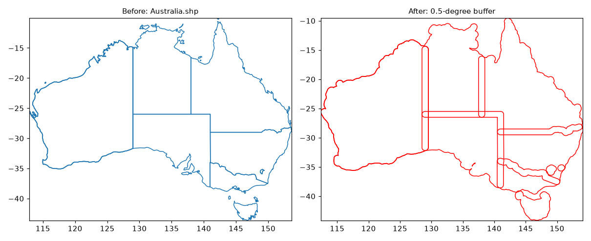
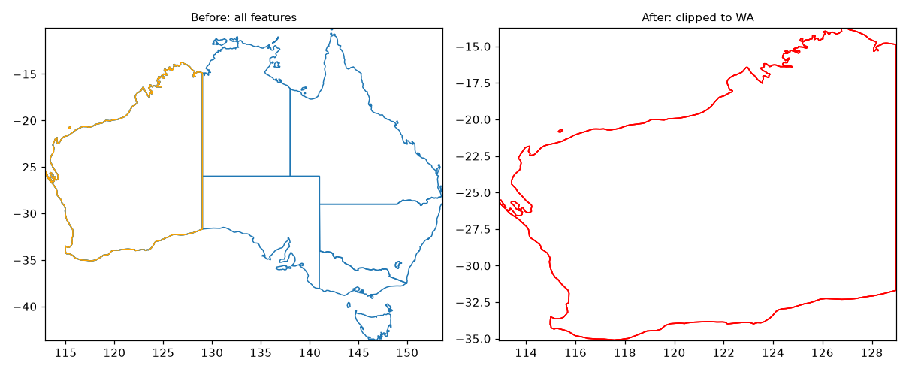
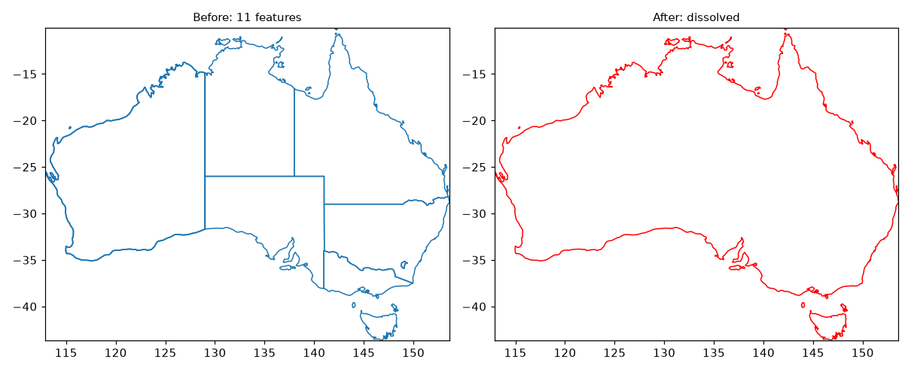
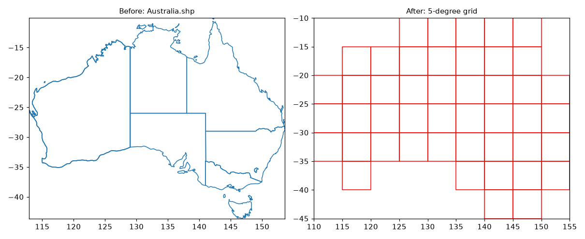
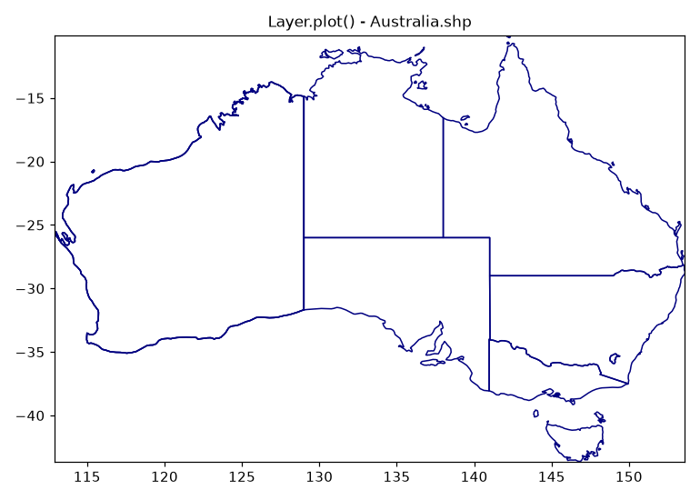
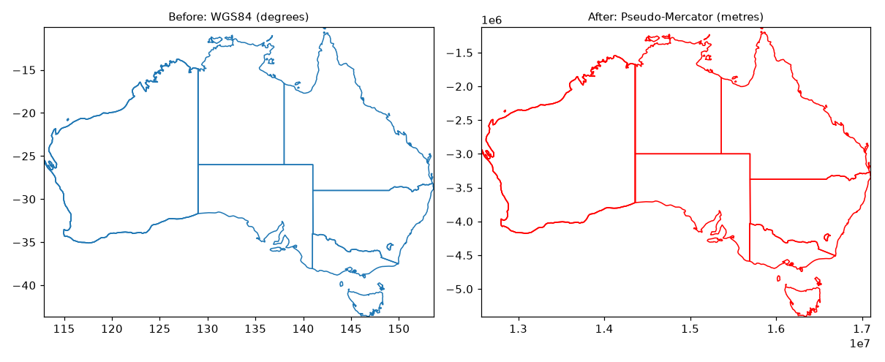

<p style="font-size: 120%;font-weight: bold;">gma.gio.Layer</p><span style="background-color:#EFF0FC;display: block;line-height:1.6;border-radius: 0.3rem;"><span style="color: gray;font-size:90%;">[class] </span><span style="color: #616AE5; font-weight: bold;font-size: 150%;">Layer</span><span style="font-style: italic; color: black;font-size: 130%;">(data = <span style="color:#48566B">None</span>, name = <span style="color:#48566B">None</span>, gtype = <span style="color:#48566B">None</span>, ftypes = <span style="color:#48566B">None</span>, crs = <span style="color:#48566B">None</span>, **kwargs):</span></span>

<p>Initialize a Layer object.</p>
<p style="font-size: 120%;color:#9298ED; font-weight: bold;">Optional:</p>
<p style="margin-left: 2em;"><b>data </b> = <code style="text-indent: 0em;">Layer||Geometry||Feature||list||None</code>. <span style="color:#48566B;"> Default None</span>. </p>
<p style="margin-left: 4em;">The data source to create the Layer. It can be:</p>
<p style="margin-left: 6em;">1) Another GMA Layer object.</p>
<p style="margin-left: 6em;">2) A Geometry object or a Feature object, or a list of Geometry/Features.</p>
<p style="margin-left: 6em;">3) None, create an empty Layer.</p>
<p style="margin-left: 2em;"><b>name </b> = <code style="text-indent: 0em;">str||None</code>. <span style="color:#48566B;"> Default None</span>. </p>
<p style="margin-left: 4em;">The name of the Layer. If data is a Layer, name can not be set.</p>
<p style="margin-left: 2em;"><b>gtype </b> = <code style="text-indent: 0em;">str||None</code>. <span style="color:#48566B;"> Default None</span>. </p>
<p style="margin-left: 4em;">The geometry type of the Layer. Supported geometry type include:</p>
<p style="margin-left: 6em;">'Point', 'MultiPoint', 'Line', 'MultiLine', 'Polygon', 'MultiPolygon'.</p>
<p style="margin-left: 4em;">If data is a Layer, gtype can not be set.</p>
<p style="margin-left: 2em;"><b>ftypes </b> = <code style="text-indent: 0em;">FieldType||list||dict||None</code>. <span style="color:#48566B;"> Default None</span>. </p>
<p style="margin-left: 4em;">The field types of the Layer. It can be:</p>
<p style="margin-left: 6em;">1) A FieldType object.</p>
<p style="margin-left: 6em;">2) A list of FieldType objects.</p>
<p style="margin-left: 6em;">3) A dict of field name and field type.</p>
<p style="margin-left: 4em;">If data is a Layer, ftypes can not be set.</p>
<p style="margin-left: 2em;"><b>crs </b> = <code style="text-indent: 0em;">str||int||class||None</code>. <span style="color:#48566B;"> Default None</span>. </p>
<p style="margin-left: 4em;">The coordinate system of the Layer. Can be EPSG, WKT, Proj4, and other types of coordinate characters. If data is a Layer, crs can not be set.</p>
<p style="margin-left: 2em;"><b>**kwargs</b>: </p>
<p style="margin-left: 4em;">Other parameters passed to _algos.geodatabase.GeoDatabase.</p>

## Example

```python
from gma import gio

ly = gio.open_vector('Australia.shp')
print('features:', len(ly))
print('geometry:', ly.gtype)
print('fields  :', len(ly.ftypes.names))
print('bounds  :', tuple(round(v, 2) for v in ly.bounds))
```

```text
features: 11
geometry: Polygon
fields  : 123
bounds  : (112.91, -43.62, 153.62, -10.05)
```

## Method

### add_feature<span style="font-weight: normal;font-style: italic;color:#8a90a8;font-size: 88%;">(*features)</span>

<p>Add features to Layer.</p>
<p style="font-size: 120%;color:#9298ED; font-weight: bold;">Parameters:</p>
<p style="margin-left: 2em;"><b>*feature</b>: <code style="text-indent: 0em;">Feature</code>. </p>
<p style="margin-left: 4em;">One or more vector features.</p>

<p style="font-size: 120%;color:#9298ED; font-weight: bold;">Returns:</p>
<p style="margin-left: 2em;"><b>Type</b>: <code style="text-indent: 0em;">None</code>. </p>
<p style="margin-left: 4em;">Modify the layer in place.</p>

<p style="font-size: 120%;color:#9298ED; font-weight: bold;">Example:</p>

```python
from gma import gio

ly = gio.open_vector('Australia.shp')
ft = gio.open_vector('Australia.shp').get_feature(0)
print('Before:', len(ly))
ly.add_feature(ft)
print('After :', len(ly))
print('last feature:', ly.get_feature(len(ly) - 1).fields.get('name'))
```

```text
Before: 11
After : 12
last feature: Western Australia
```


### add_field<span style="font-weight: normal;font-style: italic;color:#8a90a8;font-size: 88%;">(name = None, dtype = "UNKNOWN")</span>

<p>Add a field to Layer.</p>
<p style="font-size: 120%;color:#9298ED; font-weight: bold;">Optional:</p>
<p style="margin-left: 2em;"><b>name</b>: <code style="text-indent: 0em;">str</code>. <span style="color:#48566B;"> Default None</span>. </p>
<p style="margin-left: 4em;">The name of the field. None for dtype name.</p>
<p style="margin-left: 2em;"><b>dtype</b>: <code style="text-indent: 0em;">str</code>. <span style="color:#48566B;"> Default 'UNKNOWN'</span>. </p>
<p style="margin-left: 4em;">The data type of the field. See `dtypes.DefinedFieldDataTypes` for valid types.</p>

<p style="font-size: 120%;color:#9298ED; font-weight: bold;">Returns:</p>
<p style="margin-left: 2em;"><b>Type</b>: <code style="text-indent: 0em;">None</code>. </p>
<p style="margin-left: 4em;">Modify the layer in place.</p>

<p style="font-size: 120%;color:#9298ED; font-weight: bold;">Example:</p>

```python
from gma import gio

ly = gio.open_vector('Australia.shp')
print('Before:', ly.ftypes.names[-3:])
ly.add_field('new_field', 'String')
print('After :', ly.ftypes.names[-3:])
print('first value:', ly.get_feature(0).fields.get('new_field'))
```

```text
Before: ['FCLASS_TLC', 'Shape_Leng', 'Shape_Area']
After : ['Shape_Leng', 'Shape_Area', 'new_field']
first value: 
```


### boundary<span style="font-weight: normal;font-style: italic;color:#8a90a8;font-size: 88%;">(**kwargs)</span>

<p>Creates buffer polygons around input features to a specified distance. **kwargs:</p>
<p style="margin-left: 2em;"><b>Other parameters passed to _algos.geo.layer.vector_translate.</b></p>

<p style="font-size: 120%;color:#9298ED; font-weight: bold;">Returns:</p>
<p style="margin-left: 2em;"><b>Type</b>: <code style="text-indent: 0em;">Layer</code>. </p>
<p style="margin-left: 4em;">A new layer with the operation applied.</p>

<p style="font-size: 120%;color:#9298ED; font-weight: bold;">Example:</p>

```python
from gma import gio

ly = gio.open_vector('Australia.shp')
print('Before:', len(ly), ly.gtype)
r = ly.boundary()
print('After :', len(r), r.gtype)
if len(r): print('first feature:', r.get_feature(0).fields.get('name'))
```

```text
Before: 11 Polygon
After : 11 LineString
first feature: Western Australia
```


### buffer<span style="font-weight: normal;font-style: italic;color:#8a90a8;font-size: 88%;">(distance = 10, side = "Both", dissolve = False, **kwargs)</span>

<p>Creates buffer polygons around input features to a specified distance.</p>
<p style="font-size: 120%;color:#9298ED; font-weight: bold;">Optional:</p>
<p style="margin-left: 2em;"><b>distance </b> = <code style="text-indent: 0em;">float</code>. <span style="color:#48566B;"> Default 10</span>. </p>
<p style="margin-left: 4em;">The distance around the input features that will be buffered.</p>
<p style="margin-left: 2em;"><b>side </b> = <code style="text-indent: 0em;">str</code>. <span style="color:#48566B;"> Default 'Both'</span>. </p>
<p style="margin-left: 4em;">Specifies the sides of the input features that will be buffered. May be 'Both', 'Left' or 'Right'. 'Both' is only supported for Polygon.</p>
<p style="margin-left: 2em;"><b>dissolve </b> = <code style="text-indent: 0em;">bool</code>. <span style="color:#48566B;"> Default False</span>. </p>
<p style="margin-left: 4em;">Whether to dissolve the buffers into one feature.</p>
<p style="margin-left: 2em;"><b>**kwargs</b>: </p>
<p style="margin-left: 4em;">Other parameters passed to _algos.geo.layer.vector_translate.</p>

<p style="font-size: 120%;color:#9298ED; font-weight: bold;">Returns:</p>
<p style="margin-left: 2em;"><b>Type</b>: <code style="text-indent: 0em;">Layer</code>. </p>
<p style="margin-left: 4em;">A new layer with the operation applied.</p>

<p style="font-size: 120%;color:#9298ED; font-weight: bold;">Example:</p>

```python
from gma import gio

ly = gio.open_vector('Australia.shp')
other = gio.Layer(data=[ly.get_feature(0)], name='WA', gtype='Polygon')
print('Before:', len(ly), ly.gtype)
r = ly.buffer(0.5)
print('After :', len(r), r.gtype)
if len(r): print('first feature:', r.get_feature(0).fields.get('name'))
```

```text
Before: 11 Polygon
After : 11 MultiPolygon
first feature: Western Australia
```




### calculate_geometry<span style="font-weight: normal;font-style: italic;color:#8a90a8;font-size: 88%;">(area = False, length = False, gtype = False, circularity = False, num_points = False, num_geometries = False, ellipsoid_area = False, ellipsoid_length = False, keep_fields = False, keep_geom = True, **kwargs)</span>

<p>Calculate geometry attribute.</p>
<p style="font-size: 120%;color:#9298ED; font-weight: bold;">Optional:</p>
<p style="margin-left: 2em;"><b>area </b> = <code style="text-indent: 0em;">bool||str</code>. <span style="color:#48566B;"> Default False</span>. </p>
<p style="margin-left: 4em;">Whether to calculate the area of the polygon. GeoGCS: deg2; ProjCS:m2.</p>
<p style="margin-left: 4em;">If str, it will be the new name of the output result.</p>
<p style="margin-left: 2em;"><b>length </b> = <code style="text-indent: 0em;">bool||str</code>. <span style="color:#48566B;"> Default False</span>. </p>
<p style="margin-left: 4em;">Whether to calculate the length of a line. GeoGCS: deg; ProjCS:m.</p>
<p style="margin-left: 4em;">If str, it will be the new name of the output result.</p>
<p style="margin-left: 2em;"><b>gtype </b> = <code style="text-indent: 0em;">bool||str</code>. <span style="color:#48566B;"> Default False</span>. </p>
<p style="margin-left: 4em;">Whether to get the type of the geometry. If str, it will be the new name of the output result.</p>
<p style="margin-left: 2em;"><b>circularity </b> = <code style="text-indent: 0em;">bool||str</code>. <span style="color:#48566B;"> Default False</span>. </p>
<p style="margin-left: 4em;">Whether to computes the Circularity Index from the given Geometry.</p>
<p style="margin-left: 4em;">If str, it will be the new name of the output result.</p>
<p style="margin-left: 2em;"><b>num_points </b> = <code style="text-indent: 0em;">bool||str</code>. <span style="color:#48566B;"> Default False</span>. </p>
<p style="margin-left: 4em;">Whether to count the number of inflection points. If str, it will be the new name of the output result.</p>
<p style="margin-left: 2em;"><b>NumGeometries </b> = <code style="text-indent: 0em;">bool||str</code>. <span style="color:#48566B;"> Default False</span>. </p>
<p style="margin-left: 4em;">Whether to count the number of geometries. If str, it will be the new name of the output result.</p>
<p style="margin-left: 2em;"><b>ellipsoid_area </b> = <code style="text-indent: 0em;">bool||str</code>. <span style="color:#48566B;"> Default False</span>. </p>
<p style="margin-left: 4em;">Whether to calculate the area of the polygon using crs's ellipsoid. Unit: m2.</p>
<p style="margin-left: 4em;">If str, it will be the new name of the output result.</p>
<p style="margin-left: 2em;"><b>ellipsoid_length </b> = <code style="text-indent: 0em;">bool||str</code>. <span style="color:#48566B;"> Default False</span>. </p>
<p style="margin-left: 4em;">Whether to calculate the length of a line using crs's ellipsoid. Unit: m.</p>
<p style="margin-left: 4em;">If str, it will be the new name of the output result.</p>
<p style="margin-left: 2em;"><b>keep_fields </b> = <code style="text-indent: 0em;">bool||list</code>. <span style="color:#48566B;"> Default False</span>. </p>
<p style="margin-left: 4em;">Whether to retain attribute table fields. If list, it specifies the field names to be retained.</p>
<p style="margin-left: 2em;"><b>keep_geom </b> = <code style="text-indent: 0em;">bool</code>. <span style="color:#48566B;"> Default True</span>. </p>
<p style="margin-left: 4em;">Whether to retain geometry field.</p>
<p style="margin-left: 2em;"><b>**kwargs</b>: </p>
<p style="margin-left: 4em;">Other parameters passed to _algos.geo.layer.vector_translate.</p>

<p style="font-size: 120%;color:#9298ED; font-weight: bold;">Returns:</p>
<p style="margin-left: 2em;"><b>Type</b>: <code style="text-indent: 0em;">Layer</code>. </p>
<p style="margin-left: 4em;">A new layer with the operation applied.</p>

<p style="font-size: 120%;color:#9298ED; font-weight: bold;">Example:</p>

```python
from gma import gio

ly = gio.open_vector('Australia.shp')
r = ly.calculate_geometry(area=True, length=True, gtype=True)
print(type(r).__name__, len(r))
print('new fields:', r.ftypes.names[-3:])
print('areas:', [round(r.get_feature(i).fields['Area'], 2) for i in range(3)])
```

```text
Layer 11
new fields: ['Area', 'Length', 'GeomType']
areas: [227.81, 116.2, 92.32]
```


### calculate_statistics<span style="font-weight: normal;font-style: italic;color:#8a90a8;font-size: 88%;">(statistics, case = None, where = None, **kwargs)</span>

<p>Calculates summary statistics for fields in a table.</p>
<p style="font-size: 120%;color:#9298ED; font-weight: bold;">Parameters:</p>
<p style="margin-left: 2em;"><b>statistics</b>: <code style="text-indent: 0em;">dict||list||str</code>. </p>
<p style="margin-left: 4em;">Conduct statistical analysis on selected fields according to the predefined statistical methods.</p>
<p style="margin-left: 4em;">Format 1: Statistics = {Method: [Field0, Field1, ...]}</p>
<p style="margin-left: 6em;">All fields will undergo Method(Field) and will be stored in Field_Method field.</p>
<p style="margin-left: 6em;">Example: Statistics = {'sum': ['field0', 'field1']}</p>
<p style="margin-left: 4em;">Format 2: Statistics = {Method: {Field0: NewName0, Field1: NewName1, ...}}</p>
<p style="margin-left: 6em;">All fields will undergo Method(Field) and will be stored in NewName field.</p>
<p style="margin-left: 6em;">Example: Statistics = {'sum': {'field0': 'NewName0sum', 'field1': 'NewName1sum'}}</p>
<p style="margin-left: 4em;">Format 3: Statistics = 'Field0 + Field1 AS sum_result'</p>
<p style="margin-left: 6em;">Calculate the sum of Field0 and Field1 as "sum_result".</p>
<p style="margin-left: 4em;">If it is a list, it must be a list of str in the format 3.</p>
<p style="margin-left: 4em;">Including statistics types: 'min', 'max', 'sum', 'avg', 'count', 'total', ...</p>
<p style="margin-left: 4em;">For more, see SQLite grammar.</p>
<p style="font-size: 120%;color:#9298ED; font-weight: bold;">Optional:</p>
<p style="margin-left: 2em;"><b>case </b> = <code style="text-indent: 0em;">str||list||None</code>. <span style="color:#48566B;"> Default None</span>. </p>
<p style="margin-left: 4em;">The field or fields in the input that will be used to calculate statistics separately for each unique attribute value (or combination of attribute values when multiple fields are specified).</p>
<p style="margin-left: 2em;"><b>where </b> = <code style="text-indent: 0em;">str||None</code>. <span style="color:#48566B;"> Default None</span>. </p>
<p style="margin-left: 4em;">The SQL query string expressions to evaluate. For example:</p>
<p style="margin-left: 6em;">Where = 'ROWID = 1 OR Name IN ("GMA", "Layer")' 'ROWID' and 'Name' are the Layer field names.</p>
<p style="margin-left: 4em;">Supported Rules:</p>
<p style="margin-left: 4em;">Comparison Operators: =, !=, <>, <, >, <=, >= Logical Operators: AND, OR, NOT Wildcard Search Symbols: LIKE Range Condition: BETWEEN, IN, NOT IN Null-Value Check Operators: IS NULL, IS NOT NULL Regular expression matching: REGEXP</p>
<p style="margin-left: 2em;"><b>**kwargs</b>: </p>
<p style="margin-left: 4em;">Other parameters passed to _algos.geo.layer.vector_translate.</p>

<p style="font-size: 120%;color:#9298ED; font-weight: bold;">Returns:</p>
<p style="margin-left: 2em;"><b>Type</b>: <code style="text-indent: 0em;">Layer</code>. </p>
<p style="margin-left: 4em;">A new layer with the operation applied.</p>

<p style="font-size: 120%;color:#9298ED; font-weight: bold;">Example:</p>

```python
from gma import gio

ly = gio.open_vector('Australia.shp')
r = ly.calculate_statistics({'AVG': ['scalerank'], 'COUNT': ['scalerank']})
print(type(r).__name__, len(r))
print('fields:', r.ftypes.names)
print('result:', r.get_feature(0).fields)
```

```text
Layer 1
fields: ['scalerank_AVG', 'scalerank_COUNT']
result: {'scalerank_AVG': 2.0, 'scalerank_COUNT': 11}
```


### centroid<span style="font-weight: normal;font-style: italic;color:#8a90a8;font-size: 88%;">(**kwargs)</span>

<p>The points representing the centroid of each geometry.</p>
<p style="font-size: 120%;color:#9298ED; font-weight: bold;">Optional:</p>
<p style="margin-left: 2em;"><b>**kwargs</b>: </p>
<p style="margin-left: 4em;">Other parameters passed to _algos.geo.layer.vector_translate.</p>

<p style="font-size: 120%;color:#9298ED; font-weight: bold;">Returns:</p>
<p style="margin-left: 2em;"><b>Type</b>: <code style="text-indent: 0em;">Layer</code>. </p>
<p style="margin-left: 4em;">A new layer with the operation applied.</p>

<p style="font-size: 120%;color:#9298ED; font-weight: bold;">Example:</p>

```python
from gma import gio

ly = gio.open_vector('Australia.shp')
print('Before:', len(ly), ly.gtype)
r = ly.centroid()
print('After :', len(r), r.gtype)
if len(r): print('first feature:', r.get_feature(0).fields.get('name'))
```

```text
Before: 11 Polygon
After : 11 Point
first feature: Western Australia
```


### clip<span style="font-weight: normal;font-style: italic;color:#8a90a8;font-size: 88%;">(other, **kwargs)</span>

<p>Clip off areas that are not covered by the method layer.</p>
<p style="font-size: 120%;color:#9298ED; font-weight: bold;">Parameters:</p>
<p style="margin-left: 4em;">other: Layer.</p>
<p style="margin-left: 4em;">Another GMA Layer!</p>
<p style="font-size: 120%;color:#9298ED; font-weight: bold;">Optional:</p>
<p style="margin-left: 2em;"><b>**kwargs</b>: </p>
<p style="margin-left: 4em;">Other parameters passed to io.CreateLayer.</p>

<p style="font-size: 120%;color:#9298ED; font-weight: bold;">Returns:</p>
<p style="margin-left: 2em;"><b>Type</b>: <code style="text-indent: 0em;">Layer</code>. </p>
<p style="margin-left: 4em;">A new layer with the operation applied.</p>

<p style="font-size: 120%;color:#9298ED; font-weight: bold;">Example:</p>

```python
from gma import gio

ly = gio.open_vector('Australia.shp')
other = gio.Layer(data=[ly.get_feature(0)], name='WA', gtype='Polygon')
print('Before:', len(ly), ly.gtype)
r = ly.clip(other)
print('After :', len(r), r.gtype)
if len(r): print('first feature:', r.get_feature(0).fields.get('name'))
```

```text
Before: 11 Polygon
After : 5 Polygon
first feature: Western Australia
```




### closest_point<span style="font-weight: normal;font-style: italic;color:#8a90a8;font-size: 88%;">(other, **kwargs)</span>

<p>Calculate the closest point on the tow layer.</p>
<p style="font-size: 120%;color:#9298ED; font-weight: bold;">Parameters:</p>
<p style="margin-left: 2em;"><b>other</b>: <code style="text-indent: 0em;">Layer</code>. </p>
<p style="margin-left: 4em;">Another GMA Layer!</p>
<p style="font-size: 120%;color:#9298ED; font-weight: bold;">Optional:</p>
<p style="margin-left: 2em;"><b>**kwargs</b>: </p>
<p style="margin-left: 4em;">Other parameters passed to _algos.geo.layer.vector_translate.</p>

<p style="font-size: 120%;color:#9298ED; font-weight: bold;">Returns:</p>
<p style="margin-left: 2em;"><b>Type</b>: <code style="text-indent: 0em;">Layer</code>. </p>
<p style="margin-left: 4em;">A new layer with the operation applied.</p>

<p style="font-size: 120%;color:#9298ED; font-weight: bold;">Example:</p>

```python
from gma import gio

ly = gio.open_vector('Australia.shp')
other = gio.Layer(data=[ly.get_feature(0)], name='WA', gtype='Polygon')
print('Before:', len(ly), ly.gtype)
r = ly.closest_point(other)
print('After :', len(r), r.gtype)
if len(r): print('first feature:', r.get_feature(0).fields.get('name'))
```

```text
Before: 11 Polygon
After : 8 Point
first feature: None
```


### collect<span style="font-weight: normal;font-style: italic;color:#8a90a8;font-size: 88%;">(use_field = None, keep_fields = True, **kwargs)</span>

<p>Collect features based on field values.</p>
<p style="font-size: 120%;color:#9298ED; font-weight: bold;">Optional:</p>
<p style="margin-left: 2em;"><b>use_field </b> = <code style="text-indent: 0em;">str||list||None</code>. <span style="color:#48566B;"> Default None</span>. </p>
<p style="margin-left: 4em;">The field name(s) used to merge Features! If it's None, then dissolve all features.</p>
<p style="margin-left: 2em;"><b>keep_fields </b> = <code style="text-indent: 0em;">bool||list</code>. <span style="color:#48566B;"> Default False</span>. </p>
<p style="margin-left: 4em;">Whether to retain attribute table fields. If list, it specifies the field names to be retained.</p>
<p style="margin-left: 2em;"><b>**kwargs</b>: </p>
<p style="margin-left: 4em;">Other parameters passed to _algos.geo.layer.vector_translate.</p>

<p style="font-size: 120%;color:#9298ED; font-weight: bold;">Returns:</p>
<p style="margin-left: 2em;"><b>Type</b>: <code style="text-indent: 0em;">Layer</code>. </p>
<p style="margin-left: 4em;">A new layer with the operation applied.</p>

<p style="font-size: 120%;color:#9298ED; font-weight: bold;">Example:</p>

```python
from gma import gio

ly = gio.open_vector('Australia.shp')
print('Before:', len(ly), ly.gtype)
r = ly.collect()
print('After :', len(r), r.gtype)
if len(r): print('first feature:', r.get_feature(0).fields.get('name'))
```

```text
Before: 11 Polygon
After : 1 MultiPolygon
first feature: Western Australia
```


### concave_hull<span style="font-weight: normal;font-style: italic;color:#8a90a8;font-size: 88%;">(**kwargs)</span>

<p>The concave hull of a geometry is the smallest concave Polygon containing all the points in each geometry.</p>
<p style="font-size: 120%;color:#9298ED; font-weight: bold;">Optional:</p>
<p style="margin-left: 2em;"><b>**kwargs</b>: </p>
<p style="margin-left: 4em;">Other parameters passed to _algos.geo.layer.vector_translate.</p>

<p style="font-size: 120%;color:#9298ED; font-weight: bold;">Returns:</p>
<p style="margin-left: 2em;"><b>Type</b>: <code style="text-indent: 0em;">Layer</code>. </p>
<p style="margin-left: 4em;">A new layer with the operation applied.</p>

<p style="font-size: 120%;color:#9298ED; font-weight: bold;">Example:</p>

```python
from gma import gio

ly = gio.open_vector('Australia.shp')
print('Before:', len(ly), ly.gtype)
r = ly.concave_hull()
print('After :', len(r), r.gtype)
if len(r): print('first feature:', r.get_feature(0).fields.get('name'))
```

```text
Before: 11 Polygon
After : 11 MultiPolygon
first feature: None
```


### convex_hull<span style="font-weight: normal;font-style: italic;color:#8a90a8;font-size: 88%;">(**kwargs)</span>

<p>The convex hull of a geometry is the smallest convex Polygon containing all the points in each geometry.</p>
<p style="font-size: 120%;color:#9298ED; font-weight: bold;">Optional:</p>
<p style="margin-left: 2em;"><b>**kwargs</b>: </p>
<p style="margin-left: 4em;">Other parameters passed to _algos.geo.layer.vector_translate.</p>

<p style="font-size: 120%;color:#9298ED; font-weight: bold;">Returns:</p>
<p style="margin-left: 2em;"><b>Type</b>: <code style="text-indent: 0em;">Layer</code>. </p>
<p style="margin-left: 4em;">A new layer with the operation applied.</p>

<p style="font-size: 120%;color:#9298ED; font-weight: bold;">Example:</p>

```python
from gma import gio

ly = gio.open_vector('Australia.shp')
print('Before:', len(ly), ly.gtype)
r = ly.convex_hull()
print('After :', len(r), r.gtype)
if len(r): print('first feature:', r.get_feature(0).fields.get('name'))
```

```text
Before: 11 Polygon
After : 11 MultiPolygon
first feature: None
```


### copy<span style="font-weight: normal;font-style: italic;color:#8a90a8;font-size: 88%;">(**kwargs)</span>

<p>Copy replica to default driver.</p>
<p style="font-size: 120%;color:#9298ED; font-weight: bold;">Optional:</p>
<p style="margin-left: 2em;"><b>**kwargs</b>: </p>
<p style="margin-left: 4em;">Other parameters passed to _algos.geo.layer.vector_translate.</p>

<p style="font-size: 120%;color:#9298ED; font-weight: bold;">Returns:</p>
<p style="margin-left: 2em;"><b>Type</b>: <code style="text-indent: 0em;">Layer</code>. </p>
<p style="margin-left: 4em;">A new layer with the operation applied.</p>

<p style="font-size: 120%;color:#9298ED; font-weight: bold;">Example:</p>

```python
from gma import gio

ly = gio.open_vector('Australia.shp')
print('Before:', len(ly), ly.gtype)
r = ly.copy()
print('After :', len(r), r.gtype)
if len(r): print('first feature:', r.get_feature(0).fields.get('name'))
```

```text
Before: 11 Polygon
After : 11 Polygon
first feature: Western Australia
```


### delaunay_triangulation<span style="font-weight: normal;font-style: italic;color:#8a90a8;font-size: 88%;">(edges_only = False, tolerance = 0, **kwargs)</span>

<p>Return a Delaunay triangulation of the vertices of the geometry.</p>
<p style="font-size: 120%;color:#9298ED; font-weight: bold;">Optional:</p>
<p style="margin-left: 2em;"><b>tolerance </b> = <code style="text-indent: 0em;">float</code>. <span style="color:#48566B;"> Default 0.0</span>. </p>
<p style="margin-left: 4em;">Snapping tolerance to use for improved robustness.</p>
<p style="margin-left: 2em;"><b>edges_only </b> = <code style="text-indent: 0em;">bool</code>. <span style="color:#48566B;"> Default False</span>. </p>
<p style="margin-left: 4em;">Whether the output geometry should be filled polygons(False) or just boundary lines(True).</p>
<p style="margin-left: 2em;"><b>**kwargs</b>: </p>
<p style="margin-left: 4em;">Other parameters passed to _algos.geo.layer.vector_translate.</p>

<p style="font-size: 120%;color:#9298ED; font-weight: bold;">Returns:</p>
<p style="margin-left: 2em;"><b>Type</b>: <code style="text-indent: 0em;">Layer</code>. </p>
<p style="margin-left: 4em;">A new layer with the operation applied.</p>

<p style="font-size: 120%;color:#9298ED; font-weight: bold;">Example:</p>

```python
from gma import gio

ly = gio.open_vector('Australia.shp')
other = gio.Layer(data=[ly.get_feature(0)], name='WA', gtype='Polygon')
print('Before:', len(ly), ly.gtype)
r = ly.delaunay_triangulation()
print('After :', len(r), r.gtype)
if len(r): print('first feature:', r.get_feature(0).fields.get('name'))
```

```text
Before: 11 Polygon
After : 3822 Polygon
first feature: None
```


### dissolve<span style="font-weight: normal;font-style: italic;color:#8a90a8;font-size: 88%;">(use_field = None, keep_fields = True, **kwargs)</span>

<p>Dissolve features based on field values.</p>
<p style="font-size: 120%;color:#9298ED; font-weight: bold;">Optional:</p>
<p style="margin-left: 2em;"><b>use_field </b> = <code style="text-indent: 0em;">str||list||None</code>. <span style="color:#48566B;"> Default None</span>. </p>
<p style="margin-left: 4em;">The field name(s) used to dissolve Features! If it's None, then dissolve all features.</p>
<p style="margin-left: 2em;"><b>keep_fields </b> = <code style="text-indent: 0em;">bool||list</code>. <span style="color:#48566B;"> Default False</span>. </p>
<p style="margin-left: 4em;">Whether to retain attribute table fields. If list, it specifies the field names to be retained.</p>
<p style="margin-left: 2em;"><b>**kwargs</b>: </p>
<p style="margin-left: 4em;">Other parameters passed to _algos.geo.layer.vector_translate.</p>

<p style="font-size: 120%;color:#9298ED; font-weight: bold;">Returns:</p>
<p style="margin-left: 2em;"><b>Type</b>: <code style="text-indent: 0em;">Layer</code>. </p>
<p style="margin-left: 4em;">A new layer with the operation applied.</p>

<p style="font-size: 120%;color:#9298ED; font-weight: bold;">Example:</p>

```python
from gma import gio

ly = gio.open_vector('Australia.shp')
print('Before:', len(ly), ly.gtype)
r = ly.dissolve()
print('After :', len(r), r.gtype)
if len(r): print('first feature:', r.get_feature(0).fields.get('name'))
```

```text
Before: 11 Polygon
After : 1 MultiPolygon
first feature: Western Australia
```




### distance<span style="font-weight: normal;font-style: italic;color:#8a90a8;font-size: 88%;">(other, method = None, densify_fract = 0.1, **kwargs)</span>

<p>Calculates the distance between all geometric shapes within two Layers.</p>
<p style="font-size: 120%;color:#9298ED; font-weight: bold;">Parameters:</p>
<p style="margin-left: 2em;"><b>other</b>: <code style="text-indent: 0em;">Layer</code>. </p>
<p style="margin-left: 4em;">Another GMA Layer!</p>
<p style="font-size: 120%;color:#9298ED; font-weight: bold;">Optional:</p>
<p style="margin-left: 2em;"><b>method </b> = <code style="text-indent: 0em;">str||None</code>. <span style="color:#48566B;"> Default None</span>. </p>
<p style="margin-left: 4em;">Calculate method. May be None(normal distance), 'Hausdorff' or 'Frechet'.</p>
<p style="margin-left: 2em;"><b>densify_fract </b> = <code style="text-indent: 0em;">float</code>. <span style="color:#48566B;"> Default 0.1</span>. </p>
<p style="margin-left: 4em;">A value between 0 and 1, that splits each subsegment of a line string into equal length segments, making the approximation less coarse.</p>
<p style="margin-left: 4em;">A densify value of 0.5 will add a point halfway between each pair of points. A densify value of 0.25 will add a point every quarter of the way between each pair of points.</p>
<p style="margin-left: 2em;"><b>**kwargs</b>: </p>
<p style="margin-left: 4em;">Other parameters passed to _algos.geo.layer.vector_translate.</p>

<p style="font-size: 120%;color:#9298ED; font-weight: bold;">Returns:</p>
<p style="margin-left: 2em;"><b>Type</b>: <code style="text-indent: 0em;">Layer</code>. </p>
<p style="margin-left: 4em;">A new layer with the operation applied.</p>

<p style="font-size: 120%;color:#9298ED; font-weight: bold;">Example:</p>

```python
from gma import gio

ly = gio.open_vector('Australia.shp')
other = gio.Layer(data=[ly.get_feature(0)], name='WA', gtype='Polygon')
print('Before:', len(ly), ly.gtype)
r = ly.distance(other)
print('After :', len(r), r.gtype)
if len(r): print('first feature:', r.get_feature(0).fields.get('name'))
```

```text
Before: 11 Polygon
After : 11 None
first feature: None
```


### drop<span style="font-weight: normal;font-style: italic;color:#8a90a8;font-size: 88%;">(rows = None, fields = None)</span>

<p>Drop specified features or fields.</p>
<p style="font-size: 120%;color:#9298ED; font-weight: bold;">Optional:</p>
<p style="margin-left: 2em;"><b>rows </b> = <code style="text-indent: 0em;">int||list||None</code>. <span style="color:#48566B;"> Default None</span>. </p>
<p style="margin-left: 4em;">List of FIDs to be deleted.</p>
<p style="margin-left: 2em;"><b>fields </b> = <code style="text-indent: 0em;">str||list||None</code>. <span style="color:#48566B;"> Default None</span>. </p>
<p style="margin-left: 4em;">List of field names to be deleted.</p>

<p style="font-size: 120%;color:#9298ED; font-weight: bold;">Returns:</p>
<p style="margin-left: 2em;"><b>Type</b>: <code style="text-indent: 0em;">None</code>. </p>
<p style="margin-left: 4em;">Modify the layer in place.</p>

<p style="font-size: 120%;color:#9298ED; font-weight: bold;">Example:</p>

```python
from gma import gio

ly = gio.open_vector('Australia.shp')
print('Before:', len(ly), len(ly.ftypes.names))
ly.drop(rows=[0, 1], fields=['note'])
print('After :', len(ly), len(ly.ftypes.names))
print('has note:', 'note' in ly.ftypes.names)
```

```text
Before: 11 123
After : 9 122
has note: False
```


### envelope<span style="font-weight: normal;font-style: italic;color:#8a90a8;font-size: 88%;">(union = False, **kwargs)</span>

<p>The envelope of a geometry is the bounding rectangle.</p>
<p style="font-size: 120%;color:#9298ED; font-weight: bold;">Optional:</p>
<p style="margin-left: 2em;"><b>union </b> = <code style="text-indent: 0em;">bool</code>. <span style="color:#48566B;"> Default True</span>. </p>
<p style="margin-left: 4em;">Whether to first integrate all elements before calculating.</p>
<p style="margin-left: 2em;"><b>**kwargs</b>: </p>
<p style="margin-left: 4em;">Other parameters passed to _algos.geo.layer.vector_translate.</p>

<p style="font-size: 120%;color:#9298ED; font-weight: bold;">Returns:</p>
<p style="margin-left: 2em;"><b>Type</b>: <code style="text-indent: 0em;">Layer</code>. </p>
<p style="margin-left: 4em;">A new layer with the operation applied.</p>

<p style="font-size: 120%;color:#9298ED; font-weight: bold;">Example:</p>

```python
from gma import gio

ly = gio.open_vector('Australia.shp')
print('Before:', len(ly), ly.gtype)
r = ly.envelope()
print('After :', len(r), r.gtype)
if len(r): print('first feature:', r.get_feature(0).fields.get('name'))
```

```text
Before: 11 Polygon
After : 11 MultiPolygon
first feature: Western Australia
```


### erase<span style="font-weight: normal;font-style: italic;color:#8a90a8;font-size: 88%;">(other, **kwargs)</span>

<p>Remove areas that are covered by the method layer.</p>
<p style="font-size: 120%;color:#9298ED; font-weight: bold;">Parameters:</p>
<p style="margin-left: 2em;"><b>other</b>: <code style="text-indent: 0em;">Layer</code>. </p>
<p style="margin-left: 4em;">Another GMA Layer!</p>
<p style="margin-left: 2em;"><b>**kwargs</b>: </p>
<p style="margin-left: 4em;">Other parameters passed to io.CreateLayer.</p>

<p style="font-size: 120%;color:#9298ED; font-weight: bold;">Returns:</p>
<p style="margin-left: 2em;"><b>Type</b>: <code style="text-indent: 0em;">Layer</code>. </p>
<p style="margin-left: 4em;">A new layer with the operation applied.</p>

<p style="font-size: 120%;color:#9298ED; font-weight: bold;">Example:</p>

```python
from gma import gio

ly = gio.open_vector('Australia.shp')
other = gio.Layer(data=[ly.get_feature(0)], name='WA', gtype='Polygon')
print('Before:', len(ly), ly.gtype)
r = ly.erase(other)
print('After :', len(r), r.gtype)
if len(r): print('first feature:', r.get_feature(0).fields.get('name'))
```

```text
Before: 11 Polygon
After : 8 Polygon
first feature: Northern Territory
```


### explode<span style="font-weight: normal;font-style: italic;color:#8a90a8;font-size: 88%;">(**kwargs)</span>

<p>Separate a selected multipart feature into its individual.</p>
<p style="font-size: 120%;color:#9298ED; font-weight: bold;">Optional:</p>
<p style="margin-left: 2em;"><b>**kwargs</b>: </p>
<p style="margin-left: 4em;">Other parameters passed to _algos.geo.layer.vector_translate.</p>

<p style="font-size: 120%;color:#9298ED; font-weight: bold;">Returns:</p>
<p style="margin-left: 2em;"><b>Type</b>: <code style="text-indent: 0em;">Layer</code>. </p>
<p style="margin-left: 4em;">A new layer with the operation applied.</p>

<p style="font-size: 120%;color:#9298ED; font-weight: bold;">Example:</p>

```python
from gma import gio

ly = gio.open_vector('Australia.shp')
print('Before:', len(ly), ly.gtype)
r = ly.explode()
print('After :', len(r), r.gtype)
if len(r): print('first feature:', r.get_feature(0).fields.get('name'))
```

```text
Before: 11 Polygon
After : 59 Polygon
first feature: Western Australia
```


### extent<span style="font-weight: normal;font-style: italic;color:#8a90a8;font-size: 88%;">(**kwargs)</span>

<p>The extent of a geometry is the bounding rectangle.</p>
<p style="font-size: 120%;color:#9298ED; font-weight: bold;">Optional:</p>
<p style="margin-left: 2em;"><b>**kwargs</b>: </p>
<p style="margin-left: 4em;">Other parameters passed to _algos.geo.layer.vector_translate.</p>

<p style="font-size: 120%;color:#9298ED; font-weight: bold;">Returns:</p>
<p style="margin-left: 2em;"><b>Type</b>: <code style="text-indent: 0em;">Layer</code>. </p>
<p style="margin-left: 4em;">A new layer with the operation applied.</p>

<p style="font-size: 120%;color:#9298ED; font-weight: bold;">Example:</p>

```python
from gma import gio

ly = gio.open_vector('Australia.shp')
print('Before:', len(ly), ly.gtype)
r = ly.extent()
print('After :', len(r), r.gtype)
if len(r): print('first feature:', r.get_feature(0).fields.get('name'))
```

```text
Before: 11 Polygon
After : 1 Polygon
first feature: None
```


### exterior_ring<span style="font-weight: normal;font-style: italic;color:#8a90a8;font-size: 88%;">(**kwargs)</span>

<p>Returns a of LinearRings representing the outer bounds of each polygon.</p>
<p style="font-size: 120%;color:#9298ED; font-weight: bold;">Optional:</p>
<p style="margin-left: 2em;"><b>**kwargs</b>: </p>
<p style="margin-left: 4em;">Other parameters passed to _algos.geo.layer.vector_translate.</p>

<p style="font-size: 120%;color:#9298ED; font-weight: bold;">Returns:</p>
<p style="margin-left: 2em;"><b>Type</b>: <code style="text-indent: 0em;">Layer</code>. </p>
<p style="margin-left: 4em;">A new layer with the operation applied.</p>

<p style="font-size: 120%;color:#9298ED; font-weight: bold;">Example:</p>

```python
from gma import gio

ly = gio.open_vector('Australia.shp')
print('Before:', len(ly), ly.gtype)
r = ly.exterior_ring()
print('After :', len(r), r.gtype)
if len(r): print('first feature:', r.get_feature(0).fields.get('name'))
```

```text
Before: 11 Polygon
After : 11 MultiLineString
first feature: None
```


### find_overlaps<span style="font-weight: normal;font-style: italic;color:#8a90a8;font-size: 88%;">(**kwargs)</span>

<p>Find overlapping features in Layer.</p>
<p style="font-size: 120%;color:#9298ED; font-weight: bold;">Optional:</p>
<p style="margin-left: 2em;"><b>**kwargs</b>: </p>
<p style="margin-left: 4em;">Other parameters passed to _algos.geo.layer.vector_translate.</p>

<p style="font-size: 120%;color:#9298ED; font-weight: bold;">Returns:</p>
<p style="margin-left: 2em;"><b>Type</b>: <code style="text-indent: 0em;">Layer</code>. </p>
<p style="margin-left: 4em;">A new layer with the operation applied.</p>

<p style="font-size: 120%;color:#9298ED; font-weight: bold;">Example:</p>

```python
from gma import gio

ly = gio.open_vector('Australia.shp')
print('Before:', len(ly), ly.gtype)
r = ly.find_overlaps()
print('After :', len(r), r.gtype)
if len(r): print('first feature:', r.get_feature(0).fields.get('name'))
```

```text
Before: 11 Polygon
After : 4 Polygon
first feature: None
```


### fix_geometry<span style="font-weight: normal;font-style: italic;color:#8a90a8;font-size: 88%;">(**kwargs)</span>

<p>Fix invalid geometric features in Layer.</p>

<p style="font-size: 120%;color:#9298ED; font-weight: bold;">Returns:</p>
<p style="margin-left: 2em;"><b>Type</b>: <code style="text-indent: 0em;">Layer</code>. </p>
<p style="margin-left: 4em;">A new layer with the operation applied.</p>

<p style="font-size: 120%;color:#9298ED; font-weight: bold;">Example:</p>

```python
from gma import gio

ly = gio.open_vector('Australia.shp')
print('Before:', len(ly), ly.gtype)
r = ly.fix_geometry()
print('After :', len(r), r.gtype)
if len(r): print('first feature:', r.get_feature(0).fields.get('name'))
```

```text
Before: 11 Polygon
After : 11 Polygon
first feature: Western Australia
```


### gen_grid<span style="font-weight: normal;font-style: italic;color:#8a90a8;font-size: 88%;">(grid_type = "Square", size = 1, **kwargs)</span>

<p>Gen a grid of cells (having the edge length of size) precisely covering the input Layer.</p>
<p style="font-size: 120%;color:#9298ED; font-weight: bold;">Optional:</p>
<p style="margin-left: 2em;"><b>grid_type </b> = <code style="text-indent: 0em;">str</code>. <span style="color:#48566B;"> Default 'Square'</span>. </p>
<p style="margin-left: 4em;">Grid type.Can be 'Square', 'Triangular', 'Hexagonal'.</p>
<p style="margin-left: 2em;"><b>**kwargs</b>: </p>
<p style="margin-left: 4em;">Other parameters passed to _algos.geo.layer.vector_translate.</p>

<p style="font-size: 120%;color:#9298ED; font-weight: bold;">Returns:</p>
<p style="margin-left: 2em;"><b>Type</b>: <code style="text-indent: 0em;">Layer</code>. </p>
<p style="margin-left: 4em;">A new layer with the operation applied.</p>

<p style="font-size: 120%;color:#9298ED; font-weight: bold;">Example:</p>

```python
from gma import gio

ly = gio.open_vector('Australia.shp')
other = gio.Layer(data=[ly.get_feature(0)], name='WA', gtype='Polygon')
print('Before:', len(ly), ly.gtype)
r = ly.gen_grid(size=5)
print('After :', len(r), r.gtype)
if len(r): print('first feature:', r.get_feature(0).fields.get('name'))
```

```text
Before: 11 Polygon
After : 46 Polygon
first feature: None
```




### geom_self_test<span style="font-weight: normal;font-style: italic;color:#8a90a8;font-size: 88%;">()</span>

<p>Geometry self-test. Include: Empty, Simple, Valid, 3D, Measured, Valid Reason, Polygon Clockwise Rule(Counter-Clockwise Rule).</p>

<p style="font-size: 120%;color:#9298ED; font-weight: bold;">Returns:</p>
<p style="margin-left: 2em;"><b>Type</b>: <code style="text-indent: 0em;">Layer</code>. </p>
<p style="margin-left: 4em;">A layer with geometry validity results for each feature.</p>

<p style="font-size: 120%;color:#9298ED; font-weight: bold;">Example:</p>

```python
from gma import gio

ly = gio.open_vector('Australia.shp')
r = ly.geom_self_test()
print(type(r).__name__, len(r))
print('first result:', r.get_feature(0).fields)
```

```text
Layer 11
first result: {'IsEmpty': 0, 'IsSimple': 1, 'IsValid': 1, 'IsValidReason': 'Valid Geometry', 'IsRing': -1, 'Is3D': 0, 'IsMeasured': 0, 'IsPolygonCW': 0, 'IsPolygonCCW': 0}
```


### geom_to_str<span style="font-weight: normal;font-style: italic;color:#8a90a8;font-size: 88%;">(wkt = True, gml = False, kml = False, json = False, ewkb = False, ewkt = False, svg = False, **kwargs)</span>

<p>Converts geometry to string.</p>
<p style="font-size: 120%;color:#9298ED; font-weight: bold;">Optional:</p>
<p style="margin-left: 2em;"><b>wkt </b> = <code style="text-indent: 0em;">bool</code>. <span style="color:#48566B;"> Default True</span>. </p>
<p style="margin-left: 4em;">Whether to convert to WTK string.</p>
<p style="margin-left: 2em;"><b>gml </b> = <code style="text-indent: 0em;">bool</code>. <span style="color:#48566B;"> Default False</span>. </p>
<p style="margin-left: 4em;">Whether to convert to Gml string.</p>
<p style="margin-left: 2em;"><b>kml </b> = <code style="text-indent: 0em;">bool</code>. <span style="color:#48566B;"> Default False</span>. </p>
<p style="margin-left: 4em;">Whether to convert to Kml string.</p>
<p style="margin-left: 2em;"><b>json </b> = <code style="text-indent: 0em;">bool</code>. <span style="color:#48566B;"> Default False</span>. </p>
<p style="margin-left: 4em;">Whether to convert to GeoJSON string.</p>
<p style="margin-left: 2em;"><b>ewkb </b> = <code style="text-indent: 0em;">bool</code>. <span style="color:#48566B;"> Default False</span>. </p>
<p style="margin-left: 4em;">Whether to convert to EWKB string.</p>
<p style="margin-left: 2em;"><b>ewkt </b> = <code style="text-indent: 0em;">bool</code>. <span style="color:#48566B;"> Default False</span>. </p>
<p style="margin-left: 4em;">Whether to convert to EWKT string.</p>
<p style="margin-left: 2em;"><b>svg </b> = <code style="text-indent: 0em;">bool</code>. <span style="color:#48566B;"> Default False</span>. </p>
<p style="margin-left: 4em;">Whether to convert to SVG string.</p>
<p style="margin-left: 2em;"><b>**kwargs</b>: </p>
<p style="margin-left: 4em;">Other parameters passed to _algos.geo.layer.vector_translate.</p>

<p style="font-size: 120%;color:#9298ED; font-weight: bold;">Returns:</p>
<p style="margin-left: 2em;"><b>Type</b>: <code style="text-indent: 0em;">Layer</code>. </p>
<p style="margin-left: 4em;">A new layer with the operation applied.</p>

<p style="font-size: 120%;color:#9298ED; font-weight: bold;">Example:</p>

```python
from gma import gio

ly = gio.open_vector('Australia.shp')
r = ly.geom_to_str(wkt=True)
print(type(r).__name__, len(r))
print('fields:', r.ftypes.names)
print('first WKT:', str(r.get_feature(0).fields.get('WKT', ''))[:80])
```

```text
Layer 11
fields: ['WKT']
first WKT: MULTIPOLYGON(((113.131813 -25.951992, 113.148227 -25.973833, 113.183119 -26.0530
```


### get_feature<span style="font-weight: normal;font-style: italic;color:#8a90a8;font-size: 88%;">(row_num = 0)</span>

<p>Fetch a feature by its identifier.</p>
<p style="font-size: 120%;color:#9298ED; font-weight: bold;">Optional:</p>
<p style="margin-left: 2em;"><b>row_num </b> = <code style="text-indent: 0em;">int</code>. <span style="color:#48566B;"> Default 0</span>. </p>
<p style="margin-left: 4em;">The feature number of the feature to read.</p>

<p style="font-size: 120%;color:#9298ED; font-weight: bold;">Returns:</p>
<p style="margin-left: 2em;"><b>Type</b>: <code style="text-indent: 0em;">Feature</code>. </p>
<p style="margin-left: 4em;">The feature at the given row number.</p>

<p style="font-size: 120%;color:#9298ED; font-weight: bold;">Example:</p>

```python
from gma import gio

ly = gio.open_vector('Australia.shp')
ft = ly.get_feature(0)
print(type(ft).__name__, ft.fid, ft.fields['name'], ft.geom.gtype)
```

```text
Feature 0 Western Australia MultiPolygon
```


### identity<span style="font-weight: normal;font-style: italic;color:#8a90a8;font-size: 88%;">(other, o_prefix = "L1_", **kwargs)</span>

<p>Identify the features of this layer with the ones from the identity layer.</p>
<p style="font-size: 120%;color:#9298ED; font-weight: bold;">Parameters:</p>
<p style="margin-left: 2em;"><b>other</b>: <code style="text-indent: 0em;">Layer</code>. </p>
<p style="margin-left: 4em;">Another GMA Layer!</p>
<p style="font-size: 120%;color:#9298ED; font-weight: bold;">Optional:</p>
<p style="margin-left: 2em;"><b>o_prefix </b> = <code style="text-indent: 0em;">str</code>. <span style="color:#48566B;"> Default 'L1_'</span>. </p>
<p style="margin-left: 4em;">Set a prefix for the field names that will be created from the fields of the method layer.</p>
<p style="margin-left: 2em;"><b>**kwargs</b>: </p>
<p style="margin-left: 4em;">Other parameters passed to io.CreateLayer.</p>

<p style="font-size: 120%;color:#9298ED; font-weight: bold;">Returns:</p>
<p style="margin-left: 2em;"><b>Type</b>: <code style="text-indent: 0em;">Layer</code>. </p>
<p style="margin-left: 4em;">A new layer with the operation applied.</p>

<p style="font-size: 120%;color:#9298ED; font-weight: bold;">Example:</p>

```python
from gma import gio

ly = gio.open_vector('Australia.shp')
other = gio.Layer(data=[ly.get_feature(0)], name='WA', gtype='Polygon')
print('Before:', len(ly), ly.gtype)
r = ly.identity(other)
print('After :', len(r), r.gtype)
if len(r): print('first feature:', r.get_feature(0).fields.get('name'))
```

```text
Before: 11 Polygon
After : 11 Polygon
first feature: Western Australia
```


### interior_ring<span style="font-weight: normal;font-style: italic;color:#8a90a8;font-size: 88%;">(n = 1, **kwargs)</span>

<p>Returns a of LinearRings representing the inner bounds of each polygon.</p>
<p style="font-size: 120%;color:#9298ED; font-weight: bold;">Optional:</p>
<p style="margin-left: 2em;"><b>n </b> = <code style="text-indent: 0em;">int</code>. <span style="color:#48566B;"> Default 1</span>. </p>
<p style="margin-left: 4em;">Extracted inner ring index (starting from 1).</p>
<p style="margin-left: 2em;"><b>**kwargs</b>: </p>
<p style="margin-left: 4em;">Other parameters passed to _algos.geo.layer.vector_translate.</p>

<p style="font-size: 120%;color:#9298ED; font-weight: bold;">Returns:</p>
<p style="margin-left: 2em;"><b>Type</b>: <code style="text-indent: 0em;">Layer</code>. </p>
<p style="margin-left: 4em;">A new layer with the operation applied.</p>

<p style="font-size: 120%;color:#9298ED; font-weight: bold;">Example:</p>

```python
from gma import gio

# Build a polygon with a hole from a real WKT definition
g = gio.Geometry(data='POLYGON ((0 0,40 0,40 40,0 40,0 0),(10 10,10 30,30 30,30 10,10 10))')
ly = gio.Layer(data=[gio.Feature(geom=g)], name='holes', gtype='Polygon')

r = ly.interior_ring(1)
print(type(r).__name__, len(r), r.gtype)
print('bounds:', r.get_feature(0).geom.bounds)
```

```text
Layer 1 MultiLineString
bounds: (10.0, 10.0, 30.0, 30.0)
```


### interpolation<span style="font-weight: normal;font-style: italic;color:#8a90a8;font-size: 88%;">(v_field, bounds = None, resolution = None, method = "idw", ipt_opts = {}, **kwargs)</span>

<p>Interpolate points into raster dataset.</p>
<p style="font-size: 120%;color:#9298ED; font-weight: bold;">Parameters:</p>
<p style="margin-left: 2em;"><b>v_field</b>: <code style="text-indent: 0em;">str</code>. </p>
<p style="margin-left: 4em;">The field to be interpolated.</p>
<p style="font-size: 120%;color:#9298ED; font-weight: bold;">Optional:</p>
<p style="margin-left: 2em;"><b>bounds </b> = <code style="text-indent: 0em;">tuple</code>. <span style="color:#48566B;"> Default None</span>. </p>
<p style="margin-left: 4em;">The four boundaries of the interpolation result are the minimum longitude (left), the minimum latitude (bottom), the maximum longitude (right), and the maximum latitude (top). The default (None) is to extract the range from the input coordinate points.</p>
<p style="margin-left: 2em;"><b>resolution </b> = <code style="text-indent: 0em;">float</code>. <span style="color:#48566B;"> Default None</span>. </p>
<p style="margin-left: 4em;">The resolution of the interpolation result. The default (None) is 1/10 of the minimum bounds X and Y difference.</p>
<p style="margin-left: 2em;"><b>method </b> = <code style="text-indent: 0em;">str</code>. <span style="color:#48566B;"> Default 'idw'</span>. </p>
<p style="margin-left: 4em;">Interpolation method. Can be 'b_spline', 'idw', 'kriging', 'natural_neighbor', 'nearest', 'rbf' and 'trend'. For more, see smc.interp.</p>
<p style="margin-left: 2em;"><b>ipt_opts </b> = <code style="text-indent: 0em;">dict</code>. <span style="color:#48566B;"> Default {}</span>. </p>
<p style="margin-left: 4em;">Interpolation parameters. Corresponding to the interpolation method.</p>
<p style="margin-left: 2em;"><b>**kwargs</b>: </p>
<p style="margin-left: 4em;">Other parameters passed to _algos.geo.dataset.raster_translate.</p>

<p style="font-size: 120%;color:#9298ED; font-weight: bold;">Returns:</p>
<p style="margin-left: 2em;"><b>Type</b>: <code style="text-indent: 0em;">Dataset</code>. </p>
<p style="margin-left: 4em;">NOTE: 3.0.4.1 crashes on this call (see the result block).</p>

<p style="font-size: 120%;color:#9298ED; font-weight: bold;">Example:</p>

```python
from gma import gio

ly = gio.open_vector('Australia.shp')
pts = ly.centroid()                 # interpolation needs point features
print('points:', len(pts))
r = pts.interpolation('scalerank', resolution=0.5, method='idw')  # 3.0.4.1 bug
print(type(r).__name__, r.shape)
```

```text
IndexError: index 11 is out of bounds for axis 0 with size 11 (gma 3.0.4.1)
```


### intersection<span style="font-weight: normal;font-style: italic;color:#8a90a8;font-size: 88%;">(other, o_prefix = "L1_", **kwargs)</span>

<p>Intersection of two layers.</p>
<p style="font-size: 120%;color:#9298ED; font-weight: bold;">Parameters:</p>
<p style="margin-left: 2em;"><b>other</b>: <code style="text-indent: 0em;">Layer</code>. </p>
<p style="margin-left: 4em;">Another GMA Layer!</p>
<p style="font-size: 120%;color:#9298ED; font-weight: bold;">Optional:</p>
<p style="margin-left: 2em;"><b>o_prefix </b> = <code style="text-indent: 0em;">str</code>. <span style="color:#48566B;"> Default 'L1_'</span>. </p>
<p style="margin-left: 4em;">Set a prefix for the field names that will be created from the fields of the method layer.</p>
<p style="margin-left: 2em;"><b>**kwargs</b>: </p>
<p style="margin-left: 4em;">Other parameters passed to io.CreateLayer.</p>

<p style="font-size: 120%;color:#9298ED; font-weight: bold;">Returns:</p>
<p style="margin-left: 2em;"><b>Type</b>: <code style="text-indent: 0em;">Layer</code>. </p>
<p style="margin-left: 4em;">A new layer with the operation applied.</p>

<p style="font-size: 120%;color:#9298ED; font-weight: bold;">Example:</p>

```python
from gma import gio

ly = gio.open_vector('Australia.shp')
other = gio.Layer(data=[ly.get_feature(0)], name='WA', gtype='Polygon')
print('Before:', len(ly), ly.gtype)
r = ly.intersection(other)
print('After :', len(r), r.gtype)
if len(r): print('first feature:', r.get_feature(0).fields.get('name'))
```

```text
Before: 11 Polygon
After : 3 Polygon
first feature: Western Australia
```


### join<span style="font-weight: normal;font-style: italic;color:#8a90a8;font-size: 88%;">(other, spatial_join = None, left_on = None, right_on = None, one_to_one = True, suffixes = "", ext_cond = None, **kwargs)</span>

<p>Join the attribute table of RLayer into the first Layer.</p>
<p style="font-size: 120%;color:#9298ED; font-weight: bold;">Parameters:</p>
<p style="margin-left: 2em;"><b>other</b>: <code style="text-indent: 0em;">Layer</code>. </p>
<p style="margin-left: 4em;">Another GMA Layer!</p>
<p style="font-size: 120%;color:#9298ED; font-weight: bold;">Optional:</p>
<p style="margin-left: 2em;"><b>spatial_join </b> = <code style="text-indent: 0em;">str</code>. <span style="color:#48566B;"> Default None</span>. </p>
<p style="margin-left: 4em;">Spatial join method. Supported 'Intersects', 'Disjoint', 'Within', 'Equals', 'Touches'.</p>
<p style="margin-left: 4em;">Default(None) no spatial join.</p>
<p style="margin-left: 2em;"><b>left_on </b> = <code style="text-indent: 0em;">str||list||None</code>. <span style="color:#48566B;"> Default None</span>. </p>
<p style="margin-left: 4em;">Feild names to join on in the self Layer. Can also be a list of the length of the self Layer. Default(None) using self FID column if spatial_join is None.</p>
<p style="margin-left: 2em;"><b>right_on </b> = <code style="text-indent: 0em;">str||list||None</code>. <span style="color:#48566B;"> Default None</span>. </p>
<p style="margin-left: 4em;">Feild names to join on in the other Layer. Can also be a list of the length of the other Layer. Default(None) using other FID column if spatial_join is None.</p>
<p style="margin-left: 2em;"><b>one_to_one </b> = <code style="text-indent: 0em;">bool</code>. <span style="color:#48566B;"> Default False</span>. </p>
<p style="margin-left: 4em;">Whether to keep only one feature in the second layer for each feature in the first layer.</p>
<p style="margin-left: 2em;"><b>suffixes </b> = <code style="text-indent: 0em;">str</code>. <span style="color:#48566B;"> Default ''</span>. </p>
<p style="margin-left: 4em;">Extended character used to mark the second layer column.</p>
<p style="margin-left: 2em;"><b>ext_cond </b> = <code style="text-indent: 0em;">str||None</code>. <span style="color:#48566B;"> Default None</span>. </p>
<p style="margin-left: 4em;">Additional SQL conditions for joining the two layers. For example:</p>
<p style="margin-left: 6em;">ext_cond = 'a0.field0 > 10 AND a1.field1 < 20'.</p>
<p style="margin-left: 6em;">a0 and a1 are the aliases of the self and other layers, respectively.</p>
<p style="margin-left: 2em;"><b>**kwargs</b>: </p>
<p style="margin-left: 4em;">Other parameters passed to _algos.geo.layer.vector_translate.</p>

<p style="font-size: 120%;color:#9298ED; font-weight: bold;">Returns:</p>
<p style="margin-left: 2em;"><b>Type</b>: <code style="text-indent: 0em;">Layer</code>. </p>
<p style="margin-left: 4em;">A new layer with the operation applied.</p>

<p style="font-size: 120%;color:#9298ED; font-weight: bold;">Example:</p>

```python
from gma import gio

ly = gio.open_vector('Australia.shp')
other = gio.Layer(data=[ly.get_feature(0)], name='WA', gtype='Polygon')
print('Before:', len(ly), ly.gtype)
r = ly.join(other)
print('After :', len(r), r.gtype)
if len(r): print('first feature:', r.get_feature(0).fields.get('name'))
```

```text
Before: 11 Polygon
After : 11 Polygon
first feature: Western Australia
```


### line_equidistant_points<span style="font-weight: normal;font-style: italic;color:#8a90a8;font-size: 88%;">(length, keep_fields = True, **kwargs)</span>

<p>Generate equidistant points along the line geometry.</p>
<p style="font-size: 120%;color:#9298ED; font-weight: bold;">Parameters:</p>
<p style="margin-left: 2em;"><b>length</b>: <code style="text-indent: 0em;">float</code>. </p>
<p style="margin-left: 4em;">Distance between points.</p>
<p style="font-size: 120%;color:#9298ED; font-weight: bold;">Optional:</p>
<p style="margin-left: 2em;"><b>keep_fields </b> = <code style="text-indent: 0em;">bool</code>. <span style="color:#48566B;"> Default True</span>. </p>
<p style="margin-left: 4em;">Whether to retain attribute table fields.</p>
<p style="margin-left: 2em;"><b>**kwargs</b>: </p>
<p style="margin-left: 4em;">Other parameters passed to _algos.geo.layer.vector_translate.</p>

<p style="font-size: 120%;color:#9298ED; font-weight: bold;">Returns:</p>
<p style="margin-left: 2em;"><b>Type</b>: <code style="text-indent: 0em;">Layer</code>. </p>
<p style="margin-left: 4em;">A new layer with the operation applied.</p>

<p style="font-size: 120%;color:#9298ED; font-weight: bold;">Example:</p>

```python
from gma import gio

ly = gio.open_vector('Australia.shp')
other = gio.Layer(data=[ly.get_feature(0)], name='WA', gtype='Polygon')
print('Before:', len(ly), ly.gtype)
r = ly.line_equidistant_points(5)
print('After :', len(r), r.gtype)
if len(r): print('first feature:', r.get_feature(0).fields.get('name'))
```

```text
Before: 11 Polygon
After : 11 MultiPoint
first feature: Western Australia
```


### merge<span style="font-weight: normal;font-style: italic;color:#8a90a8;font-size: 88%;">(*others, **kwargs)</span>

<p>Merge all layers.</p>
<p style="font-size: 120%;color:#9298ED; font-weight: bold;">Parameters:</p>
<p style="margin-left: 2em;"><b>*others</b>: <code style="text-indent: 0em;">Layer||list of Layer</code>. </p>
<p style="margin-left: 4em;">Other GMA Layers!</p>
<p style="font-size: 120%;color:#9298ED; font-weight: bold;">Optional:</p>
<p style="margin-left: 2em;"><b>**kwargs</b>: </p>
<p style="margin-left: 4em;">Other parameters passed to _algos.geo.layer.vector_translate.</p>

<p style="font-size: 120%;color:#9298ED; font-weight: bold;">Returns:</p>
<p style="margin-left: 2em;"><b>Type</b>: <code style="text-indent: 0em;">Layer</code>. </p>
<p style="margin-left: 4em;">A new layer with the operation applied.</p>

<p style="font-size: 120%;color:#9298ED; font-weight: bold;">Example:</p>

```python
from gma import gio

ly = gio.open_vector('Australia.shp')
other = gio.Layer(data=[ly.get_feature(0)], name='WA', gtype='Polygon')
print('Before:', len(ly), ly.gtype)
r = ly.merge(other)
print('After :', len(r), r.gtype)
if len(r): print('first feature:', r.get_feature(0).fields.get('name'))
```

```text
Before: 11 Polygon
After : 12 Polygon
first feature: Western Australia
```


### min_bounding_circle<span style="font-weight: normal;font-style: italic;color:#8a90a8;font-size: 88%;">(**kwargs)</span>

<p>Constructs the Minimum Bounding Circle for a generic geometry.</p>
<p style="font-size: 120%;color:#9298ED; font-weight: bold;">Optional:</p>
<p style="margin-left: 2em;"><b>**kwargs</b>: </p>
<p style="margin-left: 4em;">Other parameters passed to _algos.geo.layer.vector_translate.</p>

<p style="font-size: 120%;color:#9298ED; font-weight: bold;">Returns:</p>
<p style="margin-left: 2em;"><b>Type</b>: <code style="text-indent: 0em;">Layer</code>. </p>
<p style="margin-left: 4em;">A new layer with the operation applied.</p>

<p style="font-size: 120%;color:#9298ED; font-weight: bold;">Example:</p>

```python
from gma import gio

ly = gio.open_vector('Australia.shp')
print('Before:', len(ly), ly.gtype)
r = ly.min_bounding_circle()
print('After :', len(r), r.gtype)
if len(r): print('first feature:', r.get_feature(0).fields.get('name'))
```

```text
Before: 11 Polygon
After : 11 MultiPolygon
first feature: Western Australia
```


### min_rotated_rectangle<span style="font-weight: normal;font-style: italic;color:#8a90a8;font-size: 88%;">(**kwargs)</span>

<p>Calculate the minimum rotated rectangular polygon which encloses the input geometry.</p>
<p style="font-size: 120%;color:#9298ED; font-weight: bold;">Optional:</p>
<p style="margin-left: 2em;"><b>**kwargs</b>: </p>
<p style="margin-left: 4em;">Other parameters passed to _algos.geo.layer.vector_translate.</p>

<p style="font-size: 120%;color:#9298ED; font-weight: bold;">Returns:</p>
<p style="margin-left: 2em;"><b>Type</b>: <code style="text-indent: 0em;">Layer</code>. </p>
<p style="margin-left: 4em;">A new layer with the operation applied.</p>

<p style="font-size: 120%;color:#9298ED; font-weight: bold;">Example:</p>

```python
from gma import gio

ly = gio.open_vector('Australia.shp')
print('Before:', len(ly), ly.gtype)
r = ly.min_rotated_rectangle()
print('After :', len(r), r.gtype)
if len(r): print('first feature:', r.get_feature(0).fields.get('name'))
```

```text
Before: 11 Polygon
After : 11 MultiPolygon
first feature: Western Australia
```


### min_width<span style="font-weight: normal;font-style: italic;color:#8a90a8;font-size: 88%;">(**kwargs)</span>

<p>Calculate the LINESTRING geometry which represents the minimum diameter of the geometry.</p>
<p style="font-size: 120%;color:#9298ED; font-weight: bold;">Optional:</p>
<p style="margin-left: 2em;"><b>**kwargs</b>: </p>
<p style="margin-left: 4em;">Other parameters passed to _algos.geo.layer.vector_translate.</p>

<p style="font-size: 120%;color:#9298ED; font-weight: bold;">Returns:</p>
<p style="margin-left: 2em;"><b>Type</b>: <code style="text-indent: 0em;">Layer</code>. </p>
<p style="margin-left: 4em;">A new layer with the operation applied.</p>

<p style="font-size: 120%;color:#9298ED; font-weight: bold;">Example:</p>

```python
from gma import gio

ly = gio.open_vector('Australia.shp')
print('Before:', len(ly), ly.gtype)
r = ly.min_width()
print('After :', len(r), r.gtype)
if len(r): print('first feature:', r.get_feature(0).fields.get('name'))
```

```text
Before: 11 Polygon
After : 11 MultiLineString
first feature: Western Australia
```


### multi<span style="font-weight: normal;font-style: italic;color:#8a90a8;font-size: 88%;">(**kwargs)</span>

<p>Make single part geometry into their multi counterpart.</p>
<p style="font-size: 120%;color:#9298ED; font-weight: bold;">Optional:</p>
<p style="margin-left: 2em;"><b>**kwargs</b>: </p>
<p style="margin-left: 4em;">Other parameters passed to _algos.geo.layer.vector_translate.</p>

<p style="font-size: 120%;color:#9298ED; font-weight: bold;">Returns:</p>
<p style="margin-left: 2em;"><b>Type</b>: <code style="text-indent: 0em;">Layer</code>. </p>
<p style="margin-left: 4em;">A new layer with the operation applied.</p>

<p style="font-size: 120%;color:#9298ED; font-weight: bold;">Example:</p>

```python
from gma import gio

ly = gio.open_vector('Australia.shp')
print('Before:', len(ly), ly.gtype)
r = ly.multi()
print('After :', len(r), r.gtype)
if len(r): print('first feature:', r.get_feature(0).fields.get('name'))
```

```text
Before: 11 Polygon
After : 11 MultiPolygon
first feature: Western Australia
```


### order_by<span style="font-weight: normal;font-style: italic;color:#8a90a8;font-size: 88%;">(fields, ascending = True, **kwargs)</span>

<p>Sort by field.</p>
<p style="font-size: 120%;color:#9298ED; font-weight: bold;">Parameters:</p>
<p style="margin-left: 2em;"><b>fields</b>: <code style="text-indent: 0em;">str||list</code>. </p>
<p style="margin-left: 4em;">Fields or list of fields to be sorted.</p>
<p style="font-size: 120%;color:#9298ED; font-weight: bold;">Optional:</p>
<p style="margin-left: 2em;"><b>ascending </b> = <code style="text-indent: 0em;">bool||list</code>. <span style="color:#48566B;"> Default True</span>. </p>
<p style="margin-left: 4em;">Sort order, which can be True(ascending) or False(descending).</p>
<p style="margin-left: 2em;"><b>**kwargs</b>: </p>
<p style="margin-left: 4em;">Other parameters passed to _algos.geo.layer.vector_translate.</p>

<p style="font-size: 120%;color:#9298ED; font-weight: bold;">Returns:</p>
<p style="margin-left: 2em;"><b>Type</b>: <code style="text-indent: 0em;">Layer</code>. </p>
<p style="margin-left: 4em;">A new layer with the operation applied.</p>

<p style="font-size: 120%;color:#9298ED; font-weight: bold;">Example:</p>

```python
from gma import gio

ly = gio.open_vector('Australia.shp')
other = gio.Layer(data=[ly.get_feature(0)], name='WA', gtype='Polygon')
print('Before:', len(ly), ly.gtype)
r = ly.order_by('name')
print('After :', len(r), r.gtype)
if len(r): print('first feature:', r.get_feature(0).fields.get('name'))
```

```text
Before: 11 Polygon
After : 11 Polygon
first feature: Australian Capital Territory
```


### plot<span style="font-weight: normal;font-style: italic;color:#8a90a8;font-size: 88%;">(ax = None, **kwargs)</span>

<p>Make plots of Layer.</p>
<p style="font-size: 120%;color:#9298ED; font-weight: bold;">Optional:</p>
<p style="margin-left: 2em;"><b>ax </b> = <code style="text-indent: 0em;">None||matplotlib</code>. <span style="color:#48566B;">~.AxesSubplot. Default None</span>. </p>
<p style="margin-left: 4em;">A matplotlib subplot. If None, a default axes will be created.</p>
<p style="margin-left: 2em;"><b>**kwargs</b></p>
<p style="margin-left: 4em;">Other plotting parameters. For more, see:</p>
<p style="margin-left: 6em;">~.carto.utils.PolyCollection/LineCollection/PointCollection.</p>

<p style="font-size: 120%;color:#9298ED; font-weight: bold;">Returns:</p>
<p style="margin-left: 2em;"><b>Type</b>: <code style="text-indent: 0em;">Axes</code>. </p>
<p style="margin-left: 4em;">The matplotlib axes with the layer plotted on it.</p>

<p style="font-size: 120%;color:#9298ED; font-weight: bold;">Example:</p>

```python
from gma import gio

ly = gio.open_vector('Australia.shp')
fig, ax = plt.subplots(figsize=(7, 5))
ax = ly.plot(ax=ax, facecolor='none', edgecolor='navy')
print(type(ax).__name__)
```

```text
Axes
```




### point_on_surface<span style="font-weight: normal;font-style: italic;color:#8a90a8;font-size: 88%;">(**kwargs)</span>

<p>Computes a point guaranteed to lie in a polygon, or on a geometry.</p>
<p style="font-size: 120%;color:#9298ED; font-weight: bold;">Optional:</p>
<p style="margin-left: 2em;"><b>**kwargs</b>: </p>
<p style="margin-left: 4em;">Other parameters passed to _algos.geo.layer.vector_translate.</p>

<p style="font-size: 120%;color:#9298ED; font-weight: bold;">Returns:</p>
<p style="margin-left: 2em;"><b>Type</b>: <code style="text-indent: 0em;">Layer</code>. </p>
<p style="margin-left: 4em;">A new layer with the operation applied.</p>

<p style="font-size: 120%;color:#9298ED; font-weight: bold;">Example:</p>

```python
from gma import gio

ly = gio.open_vector('Australia.shp')
print('Before:', len(ly), ly.gtype)
r = ly.point_on_surface()
print('After :', len(r), r.gtype)
if len(r): print('first feature:', r.get_feature(0).fields.get('name'))
```

```text
Before: 11 Polygon
After : 11 MultiPoint
first feature: Western Australia
```


### query<span style="font-weight: normal;font-style: italic;color:#8a90a8;font-size: 88%;">(expr, tran_opts = {}, **kwargs)</span>

<p>Query the data with a full SpatiaLite SQL expression.</p>
<p style="font-size: 120%;color:#9298ED; font-weight: bold;">Parameters:</p>
<p style="margin-left: 2em;"><b>expr</b>: <code style="text-indent: 0em;">str</code>. </p>
<p style="margin-left: 4em;">The query string to evaluate.</p>
<p style="font-size: 120%;color:#9298ED; font-weight: bold;">Optional:</p>
<p style="margin-left: 2em;"><b>tran_opts </b> = <code style="text-indent: 0em;">dict</code>. <span style="color:#48566B;"> Default {}</span>. </p>
<p style="margin-left: 4em;">Vector translate options. For more, see _algos.geo.layer.vector_translate.</p>
<p style="margin-left: 2em;"><b>**kwargs</b>: </p>
<p style="margin-left: 4em;">Other parameters passed to ._algos.geo.vrt.VRTGeoDatabase.add_layer.</p>

<p style="font-size: 120%;color:#9298ED; font-weight: bold;">Returns:</p>
<p style="margin-left: 2em;"><b>Type</b>: <code style="text-indent: 0em;">Layer</code>. </p>
<p style="margin-left: 4em;">A new layer with the operation applied.</p>

<p style="font-size: 120%;color:#9298ED; font-weight: bold;">Example:</p>

```python
from gma import gio

ly = gio.open_vector('Australia.shp')
r = ly.query('SELECT * FROM Australia WHERE scalerank < 3 LIMIT 3')
print(type(r).__name__, len(r), r.gtype)
```

```text
Layer 3 Polygon
```


### rotate<span style="font-weight: normal;font-style: italic;color:#8a90a8;font-size: 88%;">(angle = 90, **kwargs)</span>

<p>Rotate an angle of the layer.</p>
<p style="font-size: 120%;color:#9298ED; font-weight: bold;">Parameters:</p>
<p style="margin-left: 2em;"><b>Angle </b> = <code style="text-indent: 0em;">float</code>. <span style="color:#48566B;"> Default 90</span>. </p>
<p style="margin-left: 4em;">Rotation angle (In Degrees) with the point [0, 0] as the origin.</p>
<p style="font-size: 120%;color:#9298ED; font-weight: bold;">Optional:</p>
<p style="margin-left: 2em;"><b>**kwargs</b>: </p>
<p style="margin-left: 4em;">Other parameters passed to _algos.geo.layer.vector_translate.</p>

<p style="font-size: 120%;color:#9298ED; font-weight: bold;">Returns:</p>
<p style="margin-left: 2em;"><b>Type</b>: <code style="text-indent: 0em;">Layer</code>. </p>
<p style="margin-left: 4em;">A new layer with the operation applied.</p>

<p style="font-size: 120%;color:#9298ED; font-weight: bold;">Example:</p>

```python
from gma import gio

ly = gio.open_vector('Australia.shp')
other = gio.Layer(data=[ly.get_feature(0)], name='WA', gtype='Polygon')
print('Before:', len(ly), ly.gtype)
r = ly.rotate(45)
print('After :', len(r), r.gtype)
if len(r): print('first feature:', r.get_feature(0).fields.get('name'))
```

```text
Before: 11 Polygon
After : 11 Polygon
first feature: Western Australia
```


### sanitize<span style="font-weight: normal;font-style: italic;color:#8a90a8;font-size: 88%;">(**kwargs)</span>

<p>Sanitize geometry. Including removing duplicate points and ensuring closed rings.</p>
<p style="font-size: 120%;color:#9298ED; font-weight: bold;">Optional:</p>
<p style="margin-left: 2em;"><b>**kwargs</b>: </p>
<p style="margin-left: 4em;">Other parameters passed to _algos.geo.layer.vector_translate.</p>

<p style="font-size: 120%;color:#9298ED; font-weight: bold;">Returns:</p>
<p style="margin-left: 2em;"><b>Type</b>: <code style="text-indent: 0em;">Layer</code>. </p>
<p style="margin-left: 4em;">A new layer with the operation applied.</p>

<p style="font-size: 120%;color:#9298ED; font-weight: bold;">Example:</p>

```python
from gma import gio

ly = gio.open_vector('Australia.shp')
print('Before:', len(ly), ly.gtype)
r = ly.sanitize()
print('After :', len(r), r.gtype)
if len(r): print('first feature:', r.get_feature(0).fields.get('name'))
```

```text
Before: 11 Polygon
After : 11 Polygon
first feature: Western Australia
```


### scale<span style="font-weight: normal;font-style: italic;color:#8a90a8;font-size: 88%;">(factor = 1, **kwargs)</span>

<p>Select the intersecting features.</p>
<p style="font-size: 120%;color:#9298ED; font-weight: bold;">Optional:</p>
<p style="margin-left: 2em;"><b>factor </b> = <code style="text-indent: 0em;">float||list</code>. <span style="color:#48566B;"> Default 1</span>. </p>
<p style="margin-left: 4em;">X, Y scale factors. If a single value is provided, it is assumed that X = Y.</p>
<p style="margin-left: 2em;"><b>**kwargs</b>: </p>
<p style="margin-left: 4em;">Other parameters passed to _algos.geo.layer.vector_translate.</p>

<p style="font-size: 120%;color:#9298ED; font-weight: bold;">Returns:</p>
<p style="margin-left: 2em;"><b>Type</b>: <code style="text-indent: 0em;">Layer</code>. </p>
<p style="margin-left: 4em;">A new layer with the operation applied.</p>

<p style="font-size: 120%;color:#9298ED; font-weight: bold;">Example:</p>

```python
from gma import gio

ly = gio.open_vector('Australia.shp')
other = gio.Layer(data=[ly.get_feature(0)], name='WA', gtype='Polygon')
print('Before:', len(ly), ly.gtype)
r = ly.scale(2)
print('After :', len(r), r.gtype)
if len(r): print('first feature:', r.get_feature(0).fields.get('name'))
```

```text
Before: 11 Polygon
After : 11 Polygon
first feature: Western Australia
```


### select<span style="font-weight: normal;font-style: italic;color:#8a90a8;font-size: 88%;">(where = "", keep_fields = True, keep_geom = True, **kwargs)</span>

<p>Using SQL WHERE expressions to filter features by attribute table fields.</p>
<p style="font-size: 120%;color:#9298ED; font-weight: bold;">Optional:</p>
<p style="margin-left: 2em;"><b>where </b> = <code style="text-indent: 0em;">str</code>. <span style="color:#48566B;"> Default ''</span>. </p>
<p style="margin-left: 4em;">The SQL query string expressions to evaluate. For example:</p>
<p style="margin-left: 6em;">Where = 'ROWID = 1 OR Name IN ("GMA", "Layer")' 'ROWID' and 'Name' are the Layer field names.</p>
<p style="margin-left: 4em;">Supported Rules:</p>
<p style="margin-left: 4em;">Comparison Operators: =, !=, <>, <, >, <=, >= Logical Operators: AND, OR, NOT Wildcard Search Symbols: LIKE Range Condition: BETWEEN, IN, NOT IN Null-Value Check Operators: IS NULL, IS NOT NULL Regular expression matching: REGEXP</p>
<p style="margin-left: 2em;"><b>keep_fields </b> = <code style="text-indent: 0em;">bool||list</code>. <span style="color:#48566B;"> Default False</span>. </p>
<p style="margin-left: 4em;">Whether to retain attribute table fields. If list, it specifies the field names to be retained.</p>
<p style="margin-left: 2em;"><b>keep_geom </b> = <code style="text-indent: 0em;">bool</code>. <span style="color:#48566B;"> Default True</span>. </p>
<p style="margin-left: 4em;">Whether to retain geometry field.</p>
<p style="margin-left: 2em;"><b>**kwargs</b>: </p>
<p style="margin-left: 4em;">Other parameters passed to _algos.geo.layer.vector_translate.</p>

<p style="font-size: 120%;color:#9298ED; font-weight: bold;">Returns:</p>
<p style="margin-left: 2em;"><b>Type</b>: <code style="text-indent: 0em;">Layer</code>. </p>
<p style="margin-left: 4em;">A new layer with the operation applied.</p>

<p style="font-size: 120%;color:#9298ED; font-weight: bold;">Example:</p>

```python
from gma import gio

ly = gio.open_vector('Australia.shp')
other = gio.Layer(data=[ly.get_feature(0)], name='WA', gtype='Polygon')
print('Before:', len(ly), ly.gtype)
r = ly.select("type='State'")
print('After :', len(r), r.gtype)
if len(r): print('first feature:', r.get_feature(0).fields.get('name'))
```

```text
Before: 11 Polygon
After : 8 Polygon
first feature: Western Australia
```


### select_overlay<span style="font-weight: normal;font-style: italic;color:#8a90a8;font-size: 88%;">(other, method = "Intersects", **kwargs)</span>

<p>Select features that conform to the overlay rule.</p>
<p style="font-size: 120%;color:#9298ED; font-weight: bold;">Parameters:</p>
<p style="margin-left: 2em;"><b>other</b>: <code style="text-indent: 0em;">Layer</code>. </p>
<p style="margin-left: 4em;">Another GMA Layer!</p>
<p style="font-size: 120%;color:#9298ED; font-weight: bold;">Optional:</p>
<p style="margin-left: 2em;"><b>method </b> = <code style="text-indent: 0em;">str</code>. <span style="color:#48566B;"> Default 'Intersects'</span>. </p>
<p style="margin-left: 4em;">Overlay method. Supported methods include: 'Intersects', 'Disjoint', 'Within', 'Equals', 'Touches'.</p>
<p style="margin-left: 2em;"><b>**kwargs</b>: </p>
<p style="margin-left: 4em;">Other parameters passed to _algos.geo.layer.vector_translate.</p>

<p style="font-size: 120%;color:#9298ED; font-weight: bold;">Returns:</p>
<p style="margin-left: 2em;"><b>Type</b>: <code style="text-indent: 0em;">Layer</code>. </p>
<p style="margin-left: 4em;">A new layer with the operation applied.</p>

<p style="font-size: 120%;color:#9298ED; font-weight: bold;">Example:</p>

```python
from gma import gio

ly = gio.open_vector('Australia.shp')
other = gio.Layer(data=[ly.get_feature(0)], name='WA', gtype='Polygon')
print('Before:', len(ly), ly.gtype)
r = ly.select_overlay(other, method='Intersects')
print('After :', len(r), r.gtype)
if len(r): print('first feature:', r.get_feature(0).fields.get('name'))
```

```text
Before: 11 Polygon
After : 5 Polygon
first feature: Western Australia
```


### set_feature<span style="font-weight: normal;font-style: italic;color:#8a90a8;font-size: 88%;">(feature, fid = None)</span>

<p>Rewrite an existing feature. To set a feature, but create it if it doesn't exist.</p>
<p style="font-size: 120%;color:#9298ED; font-weight: bold;">Parameters:</p>
<p style="margin-left: 2em;"><b>feature</b>: <code style="text-indent: 0em;">Feature</code>. </p>
<p style="margin-left: 4em;">A vector feature.</p>
<p style="font-size: 120%;color:#9298ED; font-weight: bold;">Optional:</p>
<p style="margin-left: 2em;"><b>fid </b> = <code style="text-indent: 0em;">int||None</code>. <span style="color:#48566B;"> Default None</span>. </p>
<p style="margin-left: 4em;">The FID added to the layer. Defaults to the feature's FID.</p>

<p style="font-size: 120%;color:#9298ED; font-weight: bold;">Returns:</p>
<p style="margin-left: 2em;"><b>Type</b>: <code style="text-indent: 0em;">None</code>. </p>
<p style="margin-left: 4em;">Modify the layer in place.</p>

<p style="font-size: 120%;color:#9298ED; font-weight: bold;">Example:</p>

```python
from gma import gio

ly = gio.open_vector('Australia.shp')
print('Before:', len(ly), ly.get_feature(0).fields['name'])
ft = ly.get_feature(0).copy()
ft.fields['name'] = 'Modified WA'
print('returns:', repr(ly.set_feature(ft, fid=0)))
print('After :', len(ly), ly.get_feature(0).fields['name'])
```

```text
Before: 11 Western Australia
returns: None
After : 11 Western Australia
```


### set_spatial_filter<span style="font-weight: normal;font-style: italic;color:#8a90a8;font-size: 88%;">(geom = None)</span>

<p style="font-size: 120%;color:#9298ED; font-weight: bold;">Returns:</p>
<p style="margin-left: 2em;"><b>Type</b>: <code style="text-indent: 0em;">None</code>. </p>
<p style="margin-left: 4em;">Modify the layer in place.</p>

<p style="font-size: 120%;color:#9298ED; font-weight: bold;">Example:</p>

```python
from gma import gio

ly = gio.open_vector('Australia.shp')
print('Before filter:', len(ly))
g = gio.open_vector('Australia.shp').get_feature(0).geom
ly.set_spatial_filter(g)
print('After filter :', len(ly))
print('filter:', type(ly.spatial_filter).__name__)
```

```text
Before filter: 11
After filter : 5
filter: Geometry
```


### shared_paths<span style="font-weight: normal;font-style: italic;color:#8a90a8;font-size: 88%;">(other, **kwargs)</span>

<p>Calculate the shared paths between two layers.</p>
<p style="font-size: 120%;color:#9298ED; font-weight: bold;">Parameters:</p>
<p style="margin-left: 2em;"><b>other</b>: <code style="text-indent: 0em;">Layer</code>. </p>
<p style="margin-left: 4em;">Another GMA Layer!</p>
<p style="font-size: 120%;color:#9298ED; font-weight: bold;">Optional:</p>
<p style="margin-left: 2em;"><b>**kwargs</b>: </p>
<p style="margin-left: 4em;">Other parameters passed to _algos.geo.layer.vector_translate.</p>

<p style="font-size: 120%;color:#9298ED; font-weight: bold;">Returns:</p>
<p style="margin-left: 2em;"><b>Type</b>: <code style="text-indent: 0em;">Layer</code>. </p>
<p style="margin-left: 4em;">A new layer with the operation applied.</p>

<p style="font-size: 120%;color:#9298ED; font-weight: bold;">Example:</p>

```python
from gma import gio

ly = gio.open_vector('Australia.shp')
other = gio.Layer(data=[ly.get_feature(0)], name='WA', gtype='Polygon')
print('Before:', len(ly), ly.gtype)
r = ly.shared_paths(other)
print('After :', len(r), r.gtype)
if len(r): print('first feature:', r.get_feature(0).fields.get('name'))
```

```text
Before: 11 Polygon
After : 11 MultiLineString
first feature: None
```


### shift<span style="font-weight: normal;font-style: italic;color:#8a90a8;font-size: 88%;">(distance = 1, **kwargs)</span>

<p>Shilf a distance of the layer.</p>
<p style="font-size: 120%;color:#9298ED; font-weight: bold;">Optional:</p>
<p style="margin-left: 2em;"><b>distance </b> = <code style="text-indent: 0em;">float||list</code>. <span style="color:#48566B;"> Default 1</span>. </p>
<p style="margin-left: 4em;">X, Y shift distance. If a single value is provided, it is assumed that X = Y.</p>
<p style="margin-left: 2em;"><b>**kwargs</b>: </p>
<p style="margin-left: 4em;">Other parameters passed to _algos.geo.layer.vector_translate.</p>

<p style="font-size: 120%;color:#9298ED; font-weight: bold;">Returns:</p>
<p style="margin-left: 2em;"><b>Type</b>: <code style="text-indent: 0em;">Layer</code>. </p>
<p style="margin-left: 4em;">A new layer with the operation applied.</p>

<p style="font-size: 120%;color:#9298ED; font-weight: bold;">Example:</p>

```python
from gma import gio

ly = gio.open_vector('Australia.shp')
other = gio.Layer(data=[ly.get_feature(0)], name='WA', gtype='Polygon')
print('Before:', len(ly), ly.gtype)
r = ly.shift(1)
print('After :', len(r), r.gtype)
if len(r): print('first feature:', r.get_feature(0).fields.get('name'))
```

```text
Before: 11 Polygon
After : 11 Polygon
first feature: Western Australia
```


### shortest_line<span style="font-weight: normal;font-style: italic;color:#8a90a8;font-size: 88%;">(other, **kwargs)</span>

<p>Calculate the shortest line between the geometries of tow layers.</p>
<p style="font-size: 120%;color:#9298ED; font-weight: bold;">Parameters:</p>
<p style="margin-left: 2em;"><b>other</b>: <code style="text-indent: 0em;">Layer</code>. </p>
<p style="margin-left: 4em;">Another GMA Layer!</p>
<p style="font-size: 120%;color:#9298ED; font-weight: bold;">Optional:</p>
<p style="margin-left: 2em;"><b>**kwargs</b>: </p>
<p style="margin-left: 4em;">Other parameters passed to _algos.geo.layer.vector_translate.</p>

<p style="font-size: 120%;color:#9298ED; font-weight: bold;">Returns:</p>
<p style="margin-left: 2em;"><b>Type</b>: <code style="text-indent: 0em;">Layer</code>. </p>
<p style="margin-left: 4em;">A new layer with the operation applied.</p>

<p style="font-size: 120%;color:#9298ED; font-weight: bold;">Example:</p>

```python
from gma import gio

ly = gio.open_vector('Australia.shp')
other = gio.Layer(data=[ly.get_feature(0)], name='WA', gtype='Polygon')
print('Before:', len(ly), ly.gtype)
r = ly.shortest_line(other)
print('After :', len(r), r.gtype)
if len(r): print('first feature:', r.get_feature(0).fields.get('name'))
```

```text
Before: 11 Polygon
After : 11 MultiLineString
first feature: None
```


### simplify<span style="font-weight: normal;font-style: italic;color:#8a90a8;font-size: 88%;">(tolerance = 0, preserve_topology = False, **kwargs)</span>

<p>Simplify geometries in the Layer.</p>
<p style="font-size: 120%;color:#9298ED; font-weight: bold;">Optional:</p>
<p style="margin-left: 2em;"><b>tolerance </b> = <code style="text-indent: 0em;">float</code>. <span style="color:#48566B;"> Default 0.0</span>. </p>
<p style="margin-left: 4em;">Tolerance allowed when simplifying geometric features.</p>
<p style="margin-left: 2em;"><b>preserve_topology </b> = <code style="text-indent: 0em;">bool</code>. <span style="color:#48566B;"> Default False</span>. </p>
<p style="margin-left: 4em;">Simplify the geometry while preserving topology.</p>
<p style="margin-left: 2em;"><b>**kwargs</b>: </p>
<p style="margin-left: 4em;">Other parameters passed to _algos.geo.layer.vector_translate.</p>

<p style="font-size: 120%;color:#9298ED; font-weight: bold;">Returns:</p>
<p style="margin-left: 2em;"><b>Type</b>: <code style="text-indent: 0em;">Layer</code>. </p>
<p style="margin-left: 4em;">A new layer with the operation applied.</p>

<p style="font-size: 120%;color:#9298ED; font-weight: bold;">Example:</p>

```python
from gma import gio

ly = gio.open_vector('Australia.shp')
print('Before:', len(ly), ly.gtype)
r = ly.simplify()
print('After :', len(r), r.gtype)
if len(r): print('first feature:', r.get_feature(0).fields.get('name'))
```

```text
Before: 11 Polygon
After : 11 Polygon
first feature: Western Australia
```


### snap<span style="font-weight: normal;font-style: italic;color:#8a90a8;font-size: 88%;">(other = None, tolerance = 0, **kwargs)</span>

<p>Snap vertices to the nearest vertices of another geometry.</p>
<p style="font-size: 120%;color:#9298ED; font-weight: bold;">Optional:</p>
<p style="margin-left: 2em;"><b>other </b> = <code style="text-indent: 0em;">None||Layer</code>. <span style="color:#48566B;"> Default None</span>. </p>
<p style="margin-left: 4em;">Another GMA Layer! If None, snap to the grid.</p>
<p style="margin-left: 2em;"><b>tolerance </b> = <code style="text-indent: 0em;">float</code>. <span style="color:#48566B;"> Default 0.0</span>. </p>
<p style="margin-left: 4em;">Tolerance allowed when processing features. If snapped to the grid, this parameter represents the size of the grid. All points and vertices will be aligned to a grid defined by its origin and size.</p>
<p style="margin-left: 2em;"><b>**kwargs</b>: </p>
<p style="margin-left: 4em;">Other parameters passed to _algos.geo.layer.vector_translate.</p>

<p style="font-size: 120%;color:#9298ED; font-weight: bold;">Returns:</p>
<p style="margin-left: 2em;"><b>Type</b>: <code style="text-indent: 0em;">Layer</code>. </p>
<p style="margin-left: 4em;">A new layer with the operation applied.</p>

<p style="font-size: 120%;color:#9298ED; font-weight: bold;">Example:</p>

```python
from gma import gio

ly = gio.open_vector('Australia.shp')
other = gio.Layer(data=[ly.get_feature(0)], name='WA', gtype='Polygon')
print('Before:', len(ly), ly.gtype)
r = ly.snap(tolerance=0.1)
print('After :', len(r), r.gtype)
if len(r): print('first feature:', r.get_feature(0).fields.get('name'))
```

```text
Before: 11 Polygon
After : 11 Polygon
first feature: Western Australia
```


### sym_difference<span style="font-weight: normal;font-style: italic;color:#8a90a8;font-size: 88%;">(other, o_prefix = "L1_", **kwargs)</span>

<p>Symmetrical difference of two layers.</p>
<p style="font-size: 120%;color:#9298ED; font-weight: bold;">Parameters:</p>
<p style="margin-left: 2em;"><b>other</b>: <code style="text-indent: 0em;">Layer</code>. </p>
<p style="margin-left: 4em;">Another GMA Layer!</p>
<p style="font-size: 120%;color:#9298ED; font-weight: bold;">Optional:</p>
<p style="margin-left: 2em;"><b>o_prefix </b> = <code style="text-indent: 0em;">str</code>. <span style="color:#48566B;"> Default 'L1_'</span>. </p>
<p style="margin-left: 4em;">Set a prefix for the field names that will be created from the fields of the method layer.</p>
<p style="margin-left: 2em;"><b>**kwargs</b>: </p>
<p style="margin-left: 4em;">Other parameters passed to io.CreateLayer.</p>

<p style="font-size: 120%;color:#9298ED; font-weight: bold;">Returns:</p>
<p style="margin-left: 2em;"><b>Type</b>: <code style="text-indent: 0em;">Layer</code>. </p>
<p style="margin-left: 4em;">A new layer with the operation applied.</p>

<p style="font-size: 120%;color:#9298ED; font-weight: bold;">Example:</p>

```python
from gma import gio

ly = gio.open_vector('Australia.shp')
other = gio.Layer(data=[ly.get_feature(0)], name='WA', gtype='Polygon')
print('Before:', len(ly), ly.gtype)
r = ly.sym_difference(other)
print('After :', len(r), r.gtype)
if len(r): print('first feature:', r.get_feature(0).fields.get('name'))
```

```text
Before: 11 Polygon
After : 8 Polygon
first feature: Northern Territory
```


### to_bytearray<span style="font-weight: normal;font-style: italic;color:#8a90a8;font-size: 88%;">(keep_geom = False, keep_fields = True)</span>

<p>Read vector attribute table to a bytearray.</p>
<p style="font-size: 120%;color:#9298ED; font-weight: bold;">Optional:</p>
<p style="margin-left: 2em;"><b>keep_geom </b> = <code style="text-indent: 0em;">bool</code>. <span style="color:#48566B;"> Default False</span>. </p>
<p style="margin-left: 4em;">Whether to export the geometry in WKT format!</p>
<p style="margin-left: 2em;"><b>keep_fields </b> = <code style="text-indent: 0em;">bool||list</code>. <span style="color:#48566B;"> Default False</span>. </p>
<p style="margin-left: 4em;">Whether to retain attribute table fields. If list, it specifies the field names to be retained.</p>

<p style="font-size: 120%;color:#9298ED; font-weight: bold;">Returns:</p>
<p style="margin-left: 2em;"><b>Type</b>: <code style="text-indent: 0em;">bytearray</code>. </p>
<p style="margin-left: 4em;">The serialized layer as bytes.</p>

<p style="font-size: 120%;color:#9298ED; font-weight: bold;">Example:</p>

```python
from gma import gio

ly = gio.open_vector('Australia.shp')
b = ly.to_bytearray()
print(type(b).__name__, len(b))
```

```text
bytearray 13146
```


### to_crs<span style="font-weight: normal;font-style: italic;color:#8a90a8;font-size: 88%;">(crs = "WGS84", **kwargs)</span>

<p>Reproject to another coordinate system.</p>
<p style="font-size: 120%;color:#9298ED; font-weight: bold;">Optional:</p>
<p style="margin-left: 2em;"><b>crs </b> = <code style="text-indent: 0em;">str||int||class</code>. <span style="color:#48566B;"> Default 'WGS84'</span>. </p>
<p style="margin-left: 4em;">The output coordinate system. Can be EPSG, WKT, Proj4, and other types of coordinate characters.</p>
<p style="font-size: 120%;color:#9298ED; font-weight: bold;">Optional:</p>
<p style="margin-left: 2em;"><b>**kwargs</b>: </p>
<p style="margin-left: 4em;">Other parameters passed to _algos.geo.layer.vector_translate.</p>

<p style="font-size: 120%;color:#9298ED; font-weight: bold;">Returns:</p>
<p style="margin-left: 2em;"><b>Type</b>: <code style="text-indent: 0em;">Layer</code>. </p>
<p style="margin-left: 4em;">A new layer with the operation applied.</p>

<p style="font-size: 120%;color:#9298ED; font-weight: bold;">Example:</p>

```python
from gma import gio

ly = gio.open_vector('Australia.shp')
other = gio.Layer(data=[ly.get_feature(0)], name='WA', gtype='Polygon')
print('Before:', len(ly), ly.gtype)
r = ly.to_crs('EPSG:3857')
print('After :', len(r), r.gtype)
if len(r): print('first feature:', r.get_feature(0).fields.get('name'))
```

```text
Before: 11 Polygon
After : 11 Polygon
first feature: Western Australia
```




### to_dataset<span style="font-weight: normal;font-style: italic;color:#8a90a8;font-size: 88%;">(resolution = 1, field = None, bounds = None, nodata = None, **kwargs)</span>

<p>Translate Layer to DataSet!</p>
<p style="font-size: 120%;color:#9298ED; font-weight: bold;">Optional:</p>
<p style="margin-left: 2em;"><b>resolution </b> = <code style="text-indent: 0em;">float</code>. <span style="color:#48566B;"> Default 1</span>. </p>
<p style="margin-left: 4em;">Resolution of the DataSet.</p>
<p style="margin-left: 2em;"><b>field </b> = <code style="text-indent: 0em;">str||None</code>. <span style="color:#48566B;"> Default None</span>. </p>
<p style="margin-left: 4em;">The field to be translated. By default (None), the DataSet will be generated with 0 and 1.</p>
<p style="margin-left: 2em;"><b>bounds </b> = <code style="text-indent: 0em;">tuple</code>. <span style="color:#48566B;"> Default None</span>. </p>
<p style="margin-left: 4em;">The four boundaries of the interpolation result are the minimum longitude (left), the minimum latitude (bottom), the maximum longitude (right), and the maximum latitude (top). The default (None) is the bounds of the input Layer.</p>
<p style="margin-left: 2em;"><b>nodata </b> = <code style="text-indent: 0em;">float||None</code>. <span style="color:#48566B;"> Default None</span>. </p>
<p style="margin-left: 4em;">The output DataSet nodata value. By default (None), the nodata value is automatically calculated.</p>
<p style="margin-left: 2em;"><b>**kwargs</b>: </p>
<p style="margin-left: 4em;">Other parameters passed to algos.dataio.utils.CreateRasterEx.</p>

<p style="font-size: 120%;color:#9298ED; font-weight: bold;">Returns:</p>
<p style="margin-left: 2em;"><b>Type</b>: <code style="text-indent: 0em;">Dataset</code>. </p>
<p style="margin-left: 4em;">A raster dataset generated from the layer features.</p>

<p style="font-size: 120%;color:#9298ED; font-weight: bold;">Example:</p>

```python
from gma import gio

ly = gio.open_vector('Australia.shp')
r = ly.to_dataset(1)
print(type(r).__name__, r.shape)
```

```text
Dataset (1, 34, 41)
```


### to_dim<span style="font-weight: normal;font-style: italic;color:#8a90a8;font-size: 88%;">(dim = "XY", z = None, m = None, **kwargs)</span>

<p>Casting space dimension of Layer.</p>
<p style="font-size: 120%;color:#9298ED; font-weight: bold;">Optional:</p>
<p style="margin-left: 2em;"><b>dim </b> = <code style="text-indent: 0em;">str</code>. <span style="color:#48566B;"> Default 'XY'</span>. </p>
<p style="margin-left: 4em;">Space dimensions. Can be 'XY', 'XYZ', 'XYM' or 'XYZM'.</p>
<p style="margin-left: 2em;"><b>z </b> = <code style="text-indent: 0em;">float||None</code>. <span style="color:#48566B;"> Default None</span>. </p>
<p style="margin-left: 4em;">Z value. Only valid when SDIM is in 'XYZ', 'ZYZM' and layer SDIM is 'XY'.</p>
<p style="margin-left: 2em;"><b>m </b> = <code style="text-indent: 0em;">float||None</code>. <span style="color:#48566B;"> Default None</span>. </p>
<p style="margin-left: 4em;">M value. Only valid when SDIM is in 'XYM', 'ZYZM' and layer SDIM is 'XY'.</p>
<p style="margin-left: 2em;"><b>**kwargs</b>: </p>
<p style="margin-left: 4em;">Other parameters passed to _algos.geo.layer.vector_translate.</p>

<p style="font-size: 120%;color:#9298ED; font-weight: bold;">Returns:</p>
<p style="margin-left: 2em;"><b>Type</b>: <code style="text-indent: 0em;">Layer</code>. </p>
<p style="margin-left: 4em;">A new layer with the operation applied.</p>

<p style="font-size: 120%;color:#9298ED; font-weight: bold;">Example:</p>

```python
from gma import gio

ly = gio.open_vector('Australia.shp')
other = gio.Layer(data=[ly.get_feature(0)], name='WA', gtype='Polygon')
print('Before:', len(ly), ly.gtype)
r = ly.to_dim('XYZ')
print('After :', len(r), r.gtype)
if len(r): print('first feature:', r.get_feature(0).fields.get('name'))
```

```text
Before: 11 Polygon
After : 11 3DPolygon
first feature: Western Australia
```


### to_file<span style="font-weight: normal;font-style: italic;color:#8a90a8;font-size: 88%;">(out_dst, driver = "ESRI Shapefile", layer_name = None, mode = None, **kwargs)</span>

<p>in_src, out_dst = None, driver = None, optional Save Layer as a vector file.</p>
<p style="font-size: 120%;color:#9298ED; font-weight: bold;">Parameters:</p>
<p style="margin-left: 2em;"><b>out_dst</b>: <code style="text-indent: 0em;">str</code>. </p>
<p style="margin-left: 4em;">The output vector file path.</p>
<p style="font-size: 120%;color:#9298ED; font-weight: bold;">Optional:</p>
<p style="margin-left: 2em;"><b>driver </b> = <code style="text-indent: 0em;">str</code>. <span style="color:#48566B;"> Default 'ESRI Shapefile'</span>. </p>
<p style="margin-left: 4em;">Output file driver. For other drivers, see ._algos.geo.driver.DriveStatistics().vectors.</p>
<p style="margin-left: 2em;"><b>layer_name </b> = <code style="text-indent: 0em;">str||None</code>. <span style="color:#48566B;"> Default None</span>. </p>
<p style="margin-left: 4em;">Output layer name. Default(None) is the self name.</p>
<p style="margin-left: 2em;"><b>mode </b> = <code style="text-indent: 0em;">str||None</code>. <span style="color:#48566B;"> Default None</span>. </p>
<p style="margin-left: 4em;">Access mode. Default(None) is 'creation'. Other supported mode include:</p>
<p style="margin-left: 4em;">'update', 'append', 'upsert' and 'overwrite'.</p>
<p style="margin-left: 2em;"><b>**kwargs</b>: </p>
<p style="margin-left: 4em;">Other parameters passed to _algos.geo.layer.vector_translate.</p>

<p style="font-size: 120%;color:#9298ED; font-weight: bold;">Returns:</p>
<p style="margin-left: 2em;"><b>Type</b>: <code style="text-indent: 0em;">None</code>. </p>
<p style="margin-left: 4em;">Modify the layer in place.</p>

<p style="font-size: 120%;color:#9298ED; font-weight: bold;">Example:</p>

```python
from gma import gio

ly = gio.open_vector('Australia.shp')
out = ly.to_file('australia_copy.shp')
print('return:', repr(out))
print('written:', os.path.isfile('australia_copy.shp'))
```

```text
return: None
written: True
```


### to_gtype<span style="font-weight: normal;font-style: italic;color:#8a90a8;font-size: 88%;">(gtype = "MultiPolygon", **kwargs)</span>

<p>Change the geometric type of Layer.</p>
<p style="font-size: 120%;color:#9298ED; font-weight: bold;">Optional:</p>
<p style="margin-left: 2em;"><b>gtype </b> = <code style="text-indent: 0em;">str</code>. <span style="color:#48566B;"> Default 'MultiPolygon'</span>. </p>
<p style="margin-left: 4em;">Output geometry type. Supported geometry type include:</p>
<p style="margin-left: 6em;">'Point', 'MultiPoint', 'Line', 'MultiLine', 'Polygon', 'MultiPolygon'.</p>
<p style="margin-left: 2em;"><b>**kwargs</b>: </p>
<p style="margin-left: 4em;">Other parameters passed to _algos.geo.layer.vector_translate.</p>

<p style="font-size: 120%;color:#9298ED; font-weight: bold;">Returns:</p>
<p style="margin-left: 2em;"><b>Type</b>: <code style="text-indent: 0em;">Layer</code>. </p>
<p style="margin-left: 4em;">A new layer with the operation applied.</p>

<p style="font-size: 120%;color:#9298ED; font-weight: bold;">Example:</p>

```python
from gma import gio

ly = gio.open_vector('Australia.shp')
other = gio.Layer(data=[ly.get_feature(0)], name='WA', gtype='Polygon')
print('Before:', len(ly), ly.gtype)
r = ly.to_gtype('MultiPolygon')
print('After :', len(r), r.gtype)
if len(r): print('first feature:', r.get_feature(0).fields.get('name'))
```

```text
Before: 11 Polygon
After : 11 MultiPolygon
first feature: Western Australia
```


### to_pandas<span style="font-weight: normal;font-style: italic;color:#8a90a8;font-size: 88%;">(keep_geom = False, keep_fields = True, **kwargs)</span>

<p>Read vector attribute table to a pandas DataFrame.</p>
<p style="font-size: 120%;color:#9298ED; font-weight: bold;">Optional:</p>
<p style="margin-left: 2em;"><b>keep_geom </b> = <code style="text-indent: 0em;">bool</code>. <span style="color:#48566B;"> Default False</span>. </p>
<p style="margin-left: 4em;">Whether to export the geometry in WKT format!</p>
<p style="margin-left: 2em;"><b>keep_fields </b> = <code style="text-indent: 0em;">bool||list</code>. <span style="color:#48566B;"> Default False</span>. </p>
<p style="margin-left: 4em;">Whether to retain attribute table fields. If list, it specifies the field names to be retained.</p>
<p style="margin-left: 2em;"><b>**kwargs</b>: </p>
<p style="margin-left: 4em;">Other parameters passed to pd.read_csv.</p>

<p style="font-size: 120%;color:#9298ED; font-weight: bold;">Returns:</p>
<p style="margin-left: 2em;"><b>Type</b>: <code style="text-indent: 0em;">DataFrame</code>. </p>
<p style="margin-left: 4em;">The attribute table as a pandas DataFrame.</p>

<p style="font-size: 120%;color:#9298ED; font-weight: bold;">Example:</p>

```python
from gma import gio

ly = gio.open_vector('Australia.shp')
df = ly.to_pandas()
print(type(df).__name__, df.shape)
print('columns[:5]:', list(df.columns[:5]))
```

```text
DataFrame (11, 123)
columns[:5]: ['featurecla', 'scalerank', 'adm1_code', 'diss_me', 'iso_3166_2']
```


### union<span style="font-weight: normal;font-style: italic;color:#8a90a8;font-size: 88%;">(other, o_prefix = "L1_", **kwargs)</span>

<p>Union of two layers.</p>
<p style="font-size: 120%;color:#9298ED; font-weight: bold;">Parameters:</p>
<p style="margin-left: 2em;"><b>other</b>: <code style="text-indent: 0em;">Layer</code>. </p>
<p style="margin-left: 4em;">Another GMA Layer!</p>
<p style="font-size: 120%;color:#9298ED; font-weight: bold;">Optional:</p>
<p style="margin-left: 2em;"><b>o_prefix </b> = <code style="text-indent: 0em;">str</code>. <span style="color:#48566B;"> Default 'L1_'</span>. </p>
<p style="margin-left: 4em;">Set a prefix for the field names that will be created from the fields of the method layer.</p>
<p style="margin-left: 2em;"><b>**kwargs</b>: </p>
<p style="margin-left: 4em;">Other parameters passed to io.CreateLayer.</p>

<p style="font-size: 120%;color:#9298ED; font-weight: bold;">Returns:</p>
<p style="margin-left: 2em;"><b>Type</b>: <code style="text-indent: 0em;">Layer</code>. </p>
<p style="margin-left: 4em;">A new layer with the operation applied.</p>

<p style="font-size: 120%;color:#9298ED; font-weight: bold;">Example:</p>

```python
from gma import gio

ly = gio.open_vector('Australia.shp')
other = gio.Layer(data=[ly.get_feature(0)], name='WA', gtype='Polygon')
print('Before:', len(ly), ly.gtype)
r = ly.union(other)
print('After :', len(r), r.gtype)
if len(r): print('first feature:', r.get_feature(0).fields.get('name'))
```

```text
Before: 11 Polygon
After : 11 Polygon
first feature: Western Australia
```


### update<span style="font-weight: normal;font-style: italic;color:#8a90a8;font-size: 88%;">(other, **kwargs)</span>

<p>Update this layer with features from the update layer.</p>
<p style="font-size: 120%;color:#9298ED; font-weight: bold;">Parameters:</p>
<p style="margin-left: 2em;"><b>other</b>: <code style="text-indent: 0em;">Layer</code>. </p>
<p style="margin-left: 4em;">Another GMA Layer!</p>
<p style="font-size: 120%;color:#9298ED; font-weight: bold;">Optional:</p>
<p style="margin-left: 2em;"><b>**kwargs</b>: </p>
<p style="margin-left: 4em;">Other parameters passed to io.CreateLayer.</p>

<p style="font-size: 120%;color:#9298ED; font-weight: bold;">Returns:</p>
<p style="margin-left: 2em;"><b>Type</b>: <code style="text-indent: 0em;">Layer</code>. </p>
<p style="margin-left: 4em;">A new layer with the operation applied.</p>

<p style="font-size: 120%;color:#9298ED; font-weight: bold;">Example:</p>

```python
from gma import gio

ly = gio.open_vector('Australia.shp')
other = gio.Layer(data=[ly.get_feature(0)], name='WA', gtype='Polygon')
print('Before:', len(ly), ly.gtype)
r = ly.update(other)
print('After :', len(r), r.gtype)
if len(r): print('first feature:', r.get_feature(0).fields.get('name'))
```

```text
Before: 11 Polygon
After : 9 Polygon
first feature: Northern Territory
```


### vertices_to_points<span style="font-weight: normal;font-style: italic;color:#8a90a8;font-size: 88%;">(**kwargs)</span>

<p>Creates points generated from specified vertices or locations.</p>
<p style="font-size: 120%;color:#9298ED; font-weight: bold;">Optional:</p>
<p style="margin-left: 2em;"><b>**kwargs</b>: </p>
<p style="margin-left: 4em;">Other parameters passed to _algos.geo.layer.vector_translate.</p>

<p style="font-size: 120%;color:#9298ED; font-weight: bold;">Returns:</p>
<p style="margin-left: 2em;"><b>Type</b>: <code style="text-indent: 0em;">Layer</code>. </p>
<p style="margin-left: 4em;">A new layer with the operation applied.</p>

<p style="font-size: 120%;color:#9298ED; font-weight: bold;">Example:</p>

```python
from gma import gio

ly = gio.open_vector('Australia.shp')
print('Before:', len(ly), ly.gtype)
r = ly.vertices_to_points()
print('After :', len(r), r.gtype)
if len(r): print('first feature:', r.get_feature(0).fields.get('name'))
```

```text
Before: 11 Polygon
After : 11 MultiPoint
first feature: Western Australia
```


### voronoj_diagram<span style="font-weight: normal;font-style: italic;color:#8a90a8;font-size: 88%;">(ext_frame_size = 5, edges_only = False, **kwargs)</span>

<p>Return a geometric object representing the Voronoj Diagram corresponding to the input Geometry.</p>
<p style="font-size: 120%;color:#9298ED; font-weight: bold;">Optional:</p>
<p style="margin-left: 2em;"><b>ext_frame_size </b> = <code style="text-indent: 0em;">float</code>. <span style="color:#48566B;"> Default 5(%)</span>. </p>
<p style="margin-left: 4em;">Allows to arbitrarily set the percent extension of the bounding frame.</p>
<p style="margin-left: 2em;"><b>edges_only </b> = <code style="text-indent: 0em;">bool</code>. <span style="color:#48566B;"> Default False</span>. </p>
<p style="margin-left: 4em;">Whether the output geometry should be filled polygons(False) or just boundary lines(True).</p>
<p style="margin-left: 2em;"><b>**kwargs</b>: </p>
<p style="margin-left: 4em;">Other parameters passed to _algos.geo.layer.vector_translate.</p>

<p style="font-size: 120%;color:#9298ED; font-weight: bold;">Returns:</p>
<p style="margin-left: 2em;"><b>Type</b>: <code style="text-indent: 0em;">Layer</code>. </p>
<p style="margin-left: 4em;">A new layer with the operation applied.</p>

<p style="font-size: 120%;color:#9298ED; font-weight: bold;">Example:</p>

```python
from gma import gio

ly = gio.open_vector('Australia.shp')
print('Before:', len(ly), ly.gtype)
r = ly.voronoj_diagram()
print('After :', len(r), r.gtype)
if len(r): print('first feature:', r.get_feature(0).fields.get('name'))
```

```text
Before: 11 Polygon
After : 1926 Polygon
first feature: Western Australia
```


### xy_table_to_point<span style="font-weight: normal;font-style: italic;color:#8a90a8;font-size: 88%;">(x_field, y_field, crs = "WGS84", **kwargs)</span>

<p>Creates a point Layer based on X, Y-coordinates from a table.</p>
<p style="font-size: 120%;color:#9298ED; font-weight: bold;">Parameters:</p>
<p style="margin-left: 2em;"><b>x_field</b>: <code style="text-indent: 0em;">str</code>. </p>
<p style="margin-left: 4em;">The field in the input table that contains the x-coordinates (or longitude).</p>
<p style="margin-left: 2em;"><b>y_field</b>: <code style="text-indent: 0em;">str</code>. </p>
<p style="margin-left: 4em;">The field in the input table that contains the y-coordinates (or latitude).</p>
<p style="font-size: 120%;color:#9298ED; font-weight: bold;">Optional:</p>
<p style="margin-left: 2em;"><b>crs </b> = <code style="text-indent: 0em;">str||int||class||None</code>. <span style="color:#48566B;"> Default 'WGS84'</span>. </p>
<p style="margin-left: 4em;">The output coordinate system. Can be EPSG, WKT, Proj4, and other types of coordinate characters.</p>
<p style="margin-left: 2em;"><b>**kwargs</b>: </p>
<p style="margin-left: 4em;">Other parameters passed to _algos.geo.layer.vector_translate.</p>

<p style="font-size: 120%;color:#9298ED; font-weight: bold;">Returns:</p>
<p style="margin-left: 2em;"><b>Type</b>: <code style="text-indent: 0em;">Layer</code>. </p>
<p style="margin-left: 4em;">A new layer with the operation applied.</p>

<p style="font-size: 120%;color:#9298ED; font-weight: bold;">Example:</p>

```python
from gma import gio

ly = gio.open_vector('Australia.shp')
r = ly.xy_table_to_point('scalerank', 'diss_me')
print(type(r).__name__, len(r), r.gtype)
```

```text
Layer 11 Point
```


## Property

### bounds

<p style="margin-left: 2em;">Layer bounds(left, bottom, right, top). --> <code style="text-indent: 0em;">tuple</code></p>

<p style="font-size: 120%;color:#9298ED; font-weight: bold;">Example:</p>

```python
from gma import gio

ly = gio.open_vector('Australia.shp')
print(ly.bounds)
```

```text
(112.9081532637623, -43.61945867967415, 153.61696096897367, -10.05169861030248)
```


### crs

<p style="margin-left: 2em;">Layer coordinate reference system. --> <code style="text-indent: 0em;">CoordinateReferenceSystem</code></p>

<p style="font-size: 120%;color:#9298ED; font-weight: bold;">Example:</p>

```python
from gma import gio

ly = gio.open_vector('Australia.shp')
print(ly.crs)
```

```text
<CoordinateReferenceSystem:WGS 84>
```


### driver

<p style="margin-left: 2em;">Layer driver. --> <code style="text-indent: 0em;">VectorDriver</code></p>

<p style="font-size: 120%;color:#9298ED; font-weight: bold;">Example:</p>

```python
from gma import gio

ly = gio.open_vector('Australia.shp')
print(ly.driver)
```

```text
ESRI Shapefile - Vector
```


### fid_col

<p style="margin-left: 2em;">FID field name. --> <code style="text-indent: 0em;">str</code></p>

<p style="font-size: 120%;color:#9298ED; font-weight: bold;">Example:</p>

```python
from gma import gio

ly = gio.open_vector('Australia.shp')
print(ly.fid_col)
```

```text
RowID
```


### ftypes

<p style="margin-left: 2em;">Field definitions. --> <code style="text-indent: 0em;">FieldTypes</code></p>

<p style="font-size: 120%;color:#9298ED; font-weight: bold;">Example:</p>

```python
from gma import gio

ly = gio.open_vector('Australia.shp')
print('count:', len(ly.ftypes.names))
print('first five:', ly.ftypes.names[:5])
```

```text
count: 123
first five: ['featurecla', 'scalerank', 'adm1_code', 'diss_me', 'iso_3166_2']
```


### geom_col

<p style="margin-left: 2em;">Geometry field name. --> <code style="text-indent: 0em;">str</code></p>

<p style="font-size: 120%;color:#9298ED; font-weight: bold;">Example:</p>

```python
from gma import gio

ly = gio.open_vector('Australia.shp')
print(ly.geom_col)
```

```text
geometry
```


### gtype

<p style="margin-left: 2em;">Layer geometry type. --> <code style="text-indent: 0em;">GMADataType</code></p>

<p style="font-size: 120%;color:#9298ED; font-weight: bold;">Example:</p>

```python
from gma import gio

ly = gio.open_vector('Australia.shp')
print(ly.gtype)
```

```text
Polygon
```


### link

<p style="margin-left: 2em;">Layer path link. --> <code style="text-indent: 0em;">str</code></p>

<p style="font-size: 120%;color:#9298ED; font-weight: bold;">Example:</p>

```python
from gma import gio

ly = gio.open_vector('Australia.shp')
print(ly.link)
```

```text
Australia.shp
```


### name

<p style="font-size: 120%;color:#9298ED; font-weight: bold;">Example:</p>

```python
from gma import gio

ly = gio.open_vector('Australia.shp')
print(ly.name)
```

```text
Australia
```


### spatial_filter

<p style="font-size: 120%;color:#9298ED; font-weight: bold;">Example:</p>

```python
from gma import gio

ly = gio.open_vector('Australia.shp')
print(ly.spatial_filter)
```

```text
<Geometry: Polygon>
```


### tb

<p style="font-size: 120%;color:#9298ED; font-weight: bold;">Example:</p>

```python
from gma import gio

ly = gio.open_vector('Australia.shp')
print(type(ly.tb).__name__)
print(ly.tb)
```

```text
TableStats
<Table:Australia>
```
